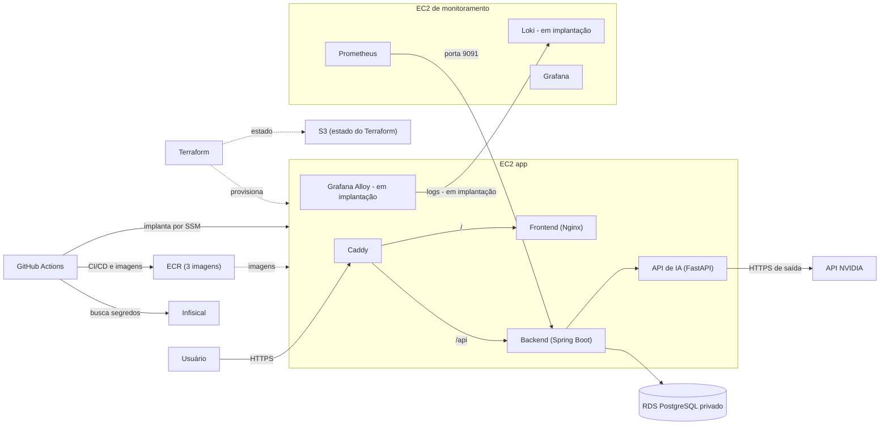

# IVIS — Intelligent Virtual Interview System

<p align="center">
  <strong>Intelligent Virtual Interview System</strong><br>
  Plataforma inteligente para treinamento de entrevistas técnicas com Inteligência Artificial.
</p>

---

## 📌 Sobre o Projeto

O **IVIS (Intelligent Virtual Interview System)** é uma aplicação web baseada em **Inteligência Artificial**, desenvolvida para auxiliar estudantes e profissionais em preparação para entrevistas de emprego na área de tecnologia.

A plataforma permite que o usuário realize **simulações de entrevistas técnicas**, personalizadas de acordo com suas habilidades ou com os requisitos de uma vaga de interesse. Durante o treinamento, a IA conduz a entrevista, processa as respostas e, ao final, fornece uma avaliação de desempenho com pontos de destaque e oportunidades de melhoria.

Além do módulo de treinamento, o IVIS contempla o **gerenciamento de contas, planos de acesso e contratação**, incluindo planos individuais para alunos e planos institucionais por meio de consórcios contratados por instituições de ensino.

O projeto está sendo desenvolvido e aprimorado no contexto da disciplina de **Engenharia de Software**, aplicando conceitos de levantamento e especificação de requisitos, casos de uso, histórias de usuário, arquitetura, desenvolvimento, testes, qualidade e evolução de software.

## ▶️ Executar localmente

Para preparar o ambiente, iniciar o sistema e rodar os testes, siga o guia [Como rodar o IVIS](etc/como%20rodar.md).

## 🌐 Acesso à produção

A versão de produção do IVIS roda na AWS (AWS Academy Learner Lab), em [https://ivis-ia.duckdns.org](https://ivis-ia.duckdns.org). Ela fica no ar durante as demonstrações, porque o laboratório é desligado entre os usos. A arquitetura, as decisões técnicas e o procedimento de implantação estão na seção [Implantação em nuvem (AWS)](#-implantação-em-nuvem-aws) e no [Guia de Implantação](etc/plano/Guia_Implantacao_AWS.md).

---

## 🎯 Objetivo

O principal objetivo do IVIS é oferecer um ambiente acessível e personalizado para que alunos e profissionais possam **praticar entrevistas técnicas de maneira recorrente**, utilizando Inteligência Artificial para conduzir os treinamentos e fornecer feedback sobre o desempenho.

O sistema busca reduzir a dependência de entrevistas simuladas realizadas exclusivamente por mentores humanos, permitindo que o usuário pratique de maneira mais frequente e direcionada.

---

## 👥 Público-Alvo

O IVIS é direcionado principalmente para:

* 🎓 **Estudantes** que desejam se preparar para processos seletivos;
* 💻 **Profissionais em transição para a área de tecnologia**;
* 🚀 **Profissionais de tecnologia** que desejam aprimorar suas habilidades em entrevistas;
* 🏫 **Instituições de Ensino** que desejam oferecer treinamento de entrevistas aos seus alunos.

---

## 👤 Atores do Sistema

### Aluno

Usuário que utiliza a plataforma para realizar treinamentos de entrevistas.

O aluno pode possuir dois perfis de acesso:

* **AlunoPagante** — possui um plano individual contratado diretamente;
* **AlunoConsórcio** — possui acesso por meio de um plano institucional contratado por uma Instituição de Ensino.

### Instituição de Ensino

Responsável pela contratação de planos institucionais/consórcio e pelo gerenciamento dos alunos vinculados às vagas de alunos.

### Sistema de IA

Serviço responsável pelo processamento das respostas e pela geração das perguntas e avaliações da entrevista.

### Sistema de Pagamento

Gateway externo responsável pelo processamento dos pagamentos relacionados à contratação dos planos.

---

## 🚀 Principais Funcionalidades

### 🔐 Acesso e Perfil

* Cadastro de Aluno e Instituição de Ensino;
* Login e autenticação;
* Gerenciamento de dados pessoais ou institucionais;
* Alteração de senha;
* Recuperação de acesso por e-mail;
* Gerenciamento de foto ou logo;
* Gerenciamento do perfil de habilidades técnicas;
* Visualização do plano vigente.

### 🤖 Treinamento com IA

* Cadastro, edição e exclusão de vagas de interesse;
* Personalização do treinamento de acordo com habilidades ou vaga;
* Simulação interativa de entrevistas;
* Processamento das respostas por IA;
* Geração automática de feedback;
* Histórico de treinamentos realizados;
* Consulta dos resultados obtidos.

### 💳 Planos e Contratação

* Visualização dos planos disponíveis;
* Apresentação de preços e benefícios;
* Contratação de plano individual;
* Contratação de plano institucional/consórcio;
* Processamento de pagamentos pelo simulador acadêmico; gateway externo é evolução futura;
* Visualização de informações do plano contratado.

### 🏫 Gestão Institucional

* Gerenciamento de alunos vinculados;
* Cadastro/vinculação de alunos;
* Remoção de alunos;
* Controle de vagas de alunos;
* Visualização de vagas utilizadas e disponíveis;
* Diferenciação entre alunos de consórcio e alunos pagantes.

### 🔎 Auditoria e Segurança

* Registro de ações sensíveis;
* Identificação do usuário responsável por cada ação;
* Registro de data e horário das operações;
* Proteção dos registros de auditoria;
* Isolamento dos dados entre diferentes instituições.

---

## 📋 Requisitos do Sistema

O quadro de requisitos registra **20 Requisitos Funcionais (RF)** — 14 na lista de requisitos e 6 implementados em validação — e **4 Requisitos Não Funcionais (RNF)**.

### Requisitos Funcionais — lista de requisitos (14)

| Código | Requisito | Descrição |
| ------ | --------- | --------- |
| RF01 | Cadastro e login de usuários | Permitir que Alunos e Instituições de Ensino criem conta e façam login com acesso correspondente ao perfil. |
| RF02 | Gerenciamento da conta | Permitir consultar e alterar os dados da própria conta, respeitando o tipo de usuário. |
| RF04 | Recuperação de senha | Permitir recuperar o acesso usando o e-mail cadastrado. Na apresentação, as mensagens são capturadas pelo Mailpit. |
| RF05 | Visualização do plano vigente | Exibir tipo, validade e benefícios do plano associado à conta. |
| RF11 | Exibição dos planos disponíveis na Home | Apresentar planos individuais e institucionais, preços e benefícios. |
| RF12 | Visualização dos planos sem autenticação | Permitir que visitantes consultem a Home e os planos antes de criar conta ou fazer login. |
| RF13 | Contratação de plano individual | Permitir que o Aluno Pagante contrate um plano individual pela plataforma. |
| RF14 | Contratação de plano institucional | Escolher entre três ofertas por 30 dias: 50 alunos (R$ 900), 100 alunos (R$ 1.750) ou alunos ilimitados (R$ 5.000), com valores ilustrativos. |
| RF15 | Pagamento simulado acadêmico | Processar a contratação no simulador controlado pelo backend, sem cobrança real; gateway externo é evolução futura. Ver [ADR-0008](etc/plano/adr/ADR-0008-pagamento-simulado-para-demonstracao.md). |
| RF16 | Gestão de alunos vinculados à instituição | Permitir visualizar, vincular e remover alunos, respeitando o limite nos planos de 50 e 100 e sem teto no ilimitado. |
| RF17 | Controle de acesso por tipo de aluno | Aplicar acesso conforme o plano individual ou o vínculo institucional. |
| RF18 | Controle de vagas do plano institucional | Exibir alunos vinculados e capacidade; nos planos finitos, mostrar vagas restantes. |
| RF19 | Restrição de contratação para AlunoConsórcio | Impedir contratação individual enquanto o aluno possuir vínculo ativo com uma instituição. |
| RF20 | Registro de logs de auditoria | Registrar ações sensíveis com responsável e data/hora, protegendo os registros contra alteração indevida. |

### Requisitos Funcionais — implementados, em validação (6)

| Código | Requisito | Descrição |
| ------ | --------- | --------- |
| RF03 | Perfil de habilidades técnicas | Permitir que o Aluno cadastre, edite e remova habilidades e níveis de domínio. |
| RF06 | Gerenciamento de vagas de interesse | Permitir que o Aluno cadastre, edite e remova vagas para contextualizar os treinos. |
| RF07 | Simulação de entrevista com IA | Conduzir entrevista textual usando o perfil ou uma vaga como contexto e processar perguntas/respostas pela API de IA. |
| RF08 | Feedback de desempenho do treinamento | Apresentar a avaliação e os pontos fortes e de melhoria ao fim do treino. |
| RF09 | Armazenamento do histórico de treinos | Persistir cada treino e associá-lo ao Aluno correspondente. |
| RF10 | Consulta ao histórico de treinos | Exibir data, contexto e resultado dos treinos do Aluno. |

### Requisitos Não Funcionais

| Código | Requisito | Descrição |
| ------ | --------- | --------- |
| RNF01 | Aplicação Web | O sistema deve ser acessível por navegador web. |
| RNF03 | Tempo de resposta da IA | Meta p95 até 10 s para pergunta e avaliação, medidas separadamente com o provedor real. |
| RNF07 | Isolamento de dados entre instituições | Cada Instituição de Ensino só pode visualizar e gerenciar os próprios alunos vinculados. |
| RNF09 | Proteção e retenção dos logs de auditoria | Proteger os registros contra alteração e mantê-los por no mínimo 4 anos desde o evento. |

> **Total:** 24 requisitos — 20 funcionais (14 na lista e 6 implementados em validação) e 4 não funcionais.

---

## 🧩 Casos de Uso

As especificações detalhadas, com fluxos principais, exceções, estado de implementação e diagrama de ações do ator, estão nos [documentos CDU](etc/cdu/IVIS_Casos_de_Uso.md).

| ID | Caso de Uso |
| --- | --- |
| CDU-01 | Acesso IVIS (criar conta e fazer login) |
| CDU-02 | Gerenciar dados da conta |
| CDU-03 | Gerenciar habilidades |
| CDU-04 | Recuperar acesso |
| CDU-05 | Consultar plano vigente |
| CDU-06 | Gerenciar vaga de interesse |
| CDU-07 | Realizar treinamento e receber feedback |
| CDU-08 | Consultar histórico de treinos |
| CDU-09 | Visualizar planos disponíveis |
| CDU-10 | Contratar plano individual |
| CDU-11 | Contratar plano institucional |
| CDU-12 | Efetuar pagamento |
| CDU-13 | Gerenciar alunos vinculados |
| CDU-14 | Aplicar acesso conforme modalidade |
| CDU-15 | Registrar auditoria de operações sensíveis |
| CDU-16 | Validar requisitos de senha |

## 📖 Histórias de Usuário

O desenvolvimento do IVIS também utiliza **Histórias de Usuário** para representar as necessidades dos diferentes perfis de usuários.

As histórias contemplam:

* Treinamento de entrevistas;
* Gerenciamento de habilidades;
* Treinamento direcionado a vagas;
* Feedback de desempenho;
* Histórico de treinamentos;
* Cadastro e autenticação;
* Gerenciamento de perfil;
* Contratação de planos;
* Gestão de planos institucionais;
* Gerenciamento de alunos vinculados.

Atualmente, o projeto possui **20 Histórias de Usuário**, priorizadas utilizando a técnica **MoSCoW**.

---

## 🖥️ Principais Telas

A prototipação inicial contempla as seguintes interfaces:

* **Cadastro/Login**
* **Home**
* **Contratação e Pagamento**
* **Perfil / Minha Conta**
* **Perfil de Habilidades**
* **Gerenciamento de Vagas**
* **Treinamento**
* **Feedback**
* **Histórico**
* **Gerenciamento de Alunos Vinculados**

---

## 🔒 Segurança e Privacidade

Por trabalhar com dados pessoais de alunos e instituições, o IVIS considera requisitos relacionados à **segurança da informação e proteção de dados**.

Entre as medidas previstas estão:

* Conformidade com a **LGPD**;
* Armazenamento seguro de senhas por meio de hash;
* Controle de sessão;
* Isolamento dos dados institucionais;
* Não armazenamento direto de dados sensíveis de pagamento;
* Uso de simulador acadêmico sem cobrança real; gateway externo depende de decisão futura;
* Registro de ações sensíveis para auditoria.

---

## 📦 Escopo do MVP

A primeira versão do IVIS contempla:

* Cadastro e autenticação;
* Gerenciamento de perfil;
* Gerenciamento de habilidades;
* Gerenciamento de vagas;
* Entrevista simulada por texto utilizando IA;
* Feedback automático;
* Histórico de treinamentos;
* Planos individuais e institucionais;
* Contratação e pagamento;
* Gerenciamento de alunos vinculados a instituições.

### Fora do escopo inicial

Algumas funcionalidades permanecem previstas para futuras versões:

* Entrevistas por voz ou vídeo;
* Integração com plataformas externas de vagas;
* Gamificação;
* Ranking entre alunos;
* Certificações;
* Suporte a múltiplos idiomas;
* Recursos avançados de faturamento recorrente;
* Painel administrativo completo.

---

## 🛠️ Engenharia de Software

O desenvolvimento do IVIS utiliza práticas e artefatos de **Engenharia de Software** para organizar e acompanhar a evolução do sistema.

Entre os principais artefatos estão:

* Documento de Visão e Escopo;
* Stakeholders;
* Atores do sistema;
* Diagrama de Casos de Uso;
* Casos de Uso detalhados;
* Histórias de Usuário;
* Requisitos Funcionais;
* Requisitos Não Funcionais;
* Protótipos de interface;
* Critérios de aceitação;
* Planejamento e priorização de funcionalidades.

O projeto será desenvolvido de forma **incremental**, permitindo que os requisitos sejam validados, implementados, testados e aprimorados ao longo dos Sprints.

---

## 📈 Evolução do Projeto

O IVIS encontra-se em **desenvolvimento ativo**. A evolução do sistema considera tanto a implementação das funcionalidades quanto aspectos relacionados à qualidade do software, segurança, usabilidade, desempenho e manutenção.

O projeto também poderá ser utilizado como objeto de **avaliação de desempenho**, permitindo analisar o comportamento da aplicação diante de diferentes níveis de carga e utilização.

---

## 📚 Documentação

O [plano de teste](etc/plano%20de%20teste.md) reúne escopo, rastreabilidade dos requisitos, casos prioritários, ambientes e critérios de execução e aceite.

A documentação inicial do projeto está organizada no diretório:

```text
etc/
└── plano/
    └── IVIS_documento.md
```

Esse documento contém a especificação inicial de visão, escopo, stakeholders, atores, casos de uso, histórias de usuário, requisitos e prototipação.

A situação dos requisitos RF03 e RF06 a RF10 e suas pendências de aceite estão em [`etc/plano/IVIS_Requisitos.md`](etc/plano/IVIS_Requisitos.md) e no [plano de teste](etc/plano%20de%20teste.md).

## ☁️ Implantação em nuvem (AWS)

### Visão geral e diagrama

O IVIS é executado em uma EC2 de aplicação, com Caddy, frontend em Nginx, backend em Spring Boot e API de IA em FastAPI. O frontend e a API usam a mesma origem por HTTPS, o backend acessa a API de IA pela rede interna e o RDS PostgreSQL privado, e o acesso administrativo é feito pelo AWS Systems Manager (SSM), sem porta 22.



### Tecnologias e justificativas

| Tecnologia | Uso | Justificativa |
|---|---|---|
| Amazon EC2 | Executa a aplicação e o monitoramento | Processo permanente evita partida a frio e permite controlar o proxy e as redes internas. |
| Amazon RDS (PostgreSQL) | Persistência | Serviço gerenciado, compatível com o PostgreSQL já usado e com o Flyway, isolado por grupo de segurança. |
| Amazon ECR | Registro das três imagens | Integração com a AWS; as EC2 obtêm as imagens pelo perfil de instância, sem credencial fixa no servidor. |
| Amazon S3 | Estado remoto do Terraform | Armazena o estado com versionamento, bloqueio de acesso público e criptografia; usa travamento por arquivo no laboratório. |
| AWS Systems Manager | Acesso administrativo e implantação | Permite executar comandos nas instâncias sem abrir a porta 22. |
| Docker e Docker Compose | Empacotamento e execução | Os quatro componentes da aplicação já são executados como contêineres. |
| Terraform | Infraestrutura como código | Provisiona e remove a rede, as instâncias, o banco, os repositórios e os grupos de segurança. |
| GitHub Actions | CI/CD | Executa verificações e testes, constrói imagens, envia-as ao ECR e implanta por SSM. |
| Infisical | Gestão de segredos da aplicação | Mantém segredos fora do código; o GitHub guarda apenas as credenciais de acesso à identidade de máquina. |
| Caddy | Proxy reverso e HTTPS | Serve `/` e `/api` na mesma origem e obtém e renova automaticamente certificados Let's Encrypt. |
| DuckDNS | Nome de domínio gratuito | O laboratório não oferece domínio próprio nem permissões completas de DNS para o ALB com certificado gerenciado. |
| Let's Encrypt | Certificado HTTPS | Emite gratuitamente o certificado usado pelo Caddy para o subdomínio DuckDNS. |
| Prometheus, Loki e Grafana | Métricas, logs e painéis | Compõem a observabilidade proposta pelo projeto; Loki está em implantação. |
| Grafana Alloy | Coleta de logs dos contêineres | Substitui o Promtail descontinuado e envia logs ao Loki; está em implantação. |

Alternativas descartadas pela proposta histórica:

- **Application Load Balancer (ALB):** não traz balanceamento real com uma única EC2, exige validação de DNS incompatível com o DuckDNS e acrescentaria custo fixo ao laboratório.
- **Ansible:** a instalação inicial cabe no `user_data` do Terraform e as atualizações podem ser feitas por SSM e Docker Compose; o uso por SSH exigiria porta 22 e por SSM exigiria infraestrutura auxiliar.

### Como executar, implantar e remover

Os pré-requisitos, as credenciais temporárias do laboratório, a criação da infraestrutura, a construção das imagens, o procedimento manual ou automatizado e o ciclo de remoção estão no [Guia de Implantação](etc/plano/Guia_Implantacao_AWS.md). O guia não repete as decisões técnicas registradas neste README.

O ambiente exige que o AWS Learner Lab esteja iniciado. Antes de usar o AWS CLI ou o Terraform, configure as credenciais temporárias da sessão e execute testes e validações fora do VS Code, conforme as lições registradas no guia.

### Segurança

- Os segredos da aplicação são gerenciados pelo Infisical. No GitHub existem somente `INFISICAL_CLIENT_ID` e `INFISICAL_CLIENT_SECRET`, usados pela identidade de máquina do pipeline.
- O CI executa `gitleaks` sobre o histórico completo do repositório.
- O RDS é privado (`publicly_accessible = false`) e sua porta `5432` só é aceita pelo grupo de segurança da EC2 de aplicação.
- A porta `22` não está aberta; a administração é feita por SSM.
- O Caddy obtém HTTPS com Let's Encrypt. Em produção, o cookie `ivis_refresh` é `HttpOnly`, `Secure` e `SameSite=Strict`.
- A porta `9091`, usada pelas métricas do backend, só é aceita pelo grupo de segurança da EC2 de monitoramento.
- O log de acesso do Caddy é desativado de propósito porque poderia registrar cabeçalhos sensíveis.
- A chave e o endpoint da API de limpeza de dados não são configurados em produção; essa API não existe no ambiente implantado.
- O acesso aos metadados da EC2 exige IMDSv2 (`http_tokens = required`) e os discos das duas EC2 são criptografados.
- O estado do Terraform fica em um bucket S3 com versionamento, bloqueio de acesso público e criptografia; o travamento do estado usa arquivo no bucket.
- A regra `proteger-main` exige solicitação revisada, uma aprovação e os cinco checks obrigatórios: Backend, Frontend, API de IA, Segredos (gitleaks) e Terraform.
- Os repositórios ECR têm varredura ativada no envio das imagens (`scan_on_push`).

### Testes e qualidade

O CI roda em toda solicitação de mesclagem para `main` e também pode ser chamado por outro fluxo ou executado manualmente. Ele verifica o frontend com ESLint, checagem de tipos e Vitest; a API de IA com pytest; o backend com Gradle Test e Testcontainers; a infraestrutura Terraform com `fmt -check`, `init -backend=false` e `validate`; e segredos com gitleaks.

Os relatórios de pytest e do backend são publicados como artefatos dos respectivos jobs. Os cinco checks são obrigatórios pela regra da branch `main`, portanto não é possível mesclar uma solicitação com um teste vermelho.

O workflow de implantação em andamento já encadeia o CI como pré-requisito dos jobs de construção e implantação; uma falha impede a construção e o envio das imagens. Após a implantação, o workflow consulta `/api/v1/pronto` com repetição.

Como exemplo real, a mudança da regra de habilidades tornou único o nome por nível e mudou o comportamento da migração V15; um teste desatualizado foi barrado pelo CI e corrigido na solicitação #28. A solicitação #26 foi mesclada com CI vermelho antes de os checks serem obrigatórios, fato que motivou a proteção da branch.

Cypress é usado localmente. Sua execução contra produção seria arriscada porque as tarefas de limpeza acessam o banco.

### Observabilidade

Prometheus e Grafana estão definidos no diretório `observability/`, e o backend já expõe métricas em `/actuator/prometheus` na porta `9091`. Os arquivos ainda não confirmam a implantação dessas ferramentas na EC2 de monitoramento.

Loki e Grafana Alloy estão em implantação: Alloy deve enviar os logs da EC2 de aplicação ao Loki na EC2 de monitoramento. Um README específico de observabilidade ainda não está disponível no diretório.

### Limitações conhecidas

- Não há SMTP real em produção: a recuperação de senha responde de forma neutra e o e-mail não é entregue; o Mailpit existe apenas no plano local.
- As credenciais do AWS Academy são temporárias e precisam ser renovadas a cada sessão.
- Na implantação manual, os valores usados para gerar o `.env` passaram pelos parâmetros do `send-command`; a meta é gerar o arquivo a partir do Infisical.
- Existe uma única EC2 de aplicação, sem balanceador de carga, conforme o ADR-0012.
- O ambiente depende do laboratório estar ligado e a conta do laboratório encerra ao fim do curso.

### Divisão de tarefas

A preencher pelo coordenador.

## Verificação de dependências

No PowerShell do Windows, instale ou sincronize as dependências locais de todos os
módulos com:

```powershell
.\config.ps1 install
.\config.ps1 update
```

O script prepara os pacotes npm da raiz, do frontend e dos testes E2E, cria/atualiza
`api-ia/.venv`, resolve as dependências do backend pelo Gradle Wrapper e compila
backend e frontend. `install` respeita os lockfiles; `update` atualiza os pacotes npm
dentro das faixas declaradas em `package.json` e sincroniza Python/Gradle com os
arquivos do projeto. Para reconstruir também as imagens Docker, adicione
`-BuildDocker`. O script não inicia containers; para isso, use `release.ps1 up`.

Para conferir as ferramentas e dependências locais do frontend, backend e API de IA,
execute na raiz do repositório:

```bash
node verificar-dependencias.mjs
```

O verificador lista o que estiver ausente ou incompatível e mostra os comandos de
instalação correspondentes. Ele não instala pacotes automaticamente. Também pode
ser chamado de dentro da raiz por `npm run deps:check`. Para revisar se os
pacotes declarados estão usados e se os imports estão declarados, use
`npm run deps:audit`. A instalação inicial dos pacotes JavaScript roda com
`npm run setup:inicial`; o Cypress pertence ao pacote `cypress/e2e`.
Execute `npm run testar:e2e` para gerar os vídeos em `cypress/downloads`;
o modo interativo `cypress open` não grava vídeos automaticamente. As jornadas
reais usam o mesmo banco `ivis` do Compose; siga a preparação em
[cypress/e2e/README.md](cypress/e2e/README.md) antes de executar a suíte inteira.

## 🤖 API de IA

O banco PostgreSQL, a API de IA e o backend podem ser iniciados com o script na
raiz do repositório usando Bash, Git Bash ou WSL:

```bash
bash release.sh up
```

No PowerShell do Windows, o mesmo fluxo está disponível com:

```powershell
.\release.ps1 up
```

O script cria `.env` e `api-ia/.env` a partir dos exemplos se não existirem,
compila os serviços e aguarda a prontidão. Os dados do PostgreSQL ficam no
volume `ivis-banco-dados`. Também aceita `bash release.sh status`,
`bash release.sh logs`, `bash release.sh restart` e `bash release.sh down`.
O `release.ps1` aceita as mesmas ações (`.\release.ps1 status`, `logs`,
`restart` e `down`).
No PowerShell, `.\release.ps1 up -NoBuild` reutiliza imagens já construídas e
`.\release.ps1 up -RefreshImages` atualiza as imagens-base antes do build.
O build comum usa cache de downloads do Gradle, npm e pip, mesmo quando o código
muda. Na primeira execução, o script gera chaves locais aleatórias para JWT e
para a comunicação backend/API de IA no `.env` da raiz; valores personalizados
válidos são preservados. O Compose passa a chave de serviço da raiz para ambos
os containers.
Configure `NVIDIA_API_KEY` em `api-ia/.env` para gerar perguntas e avaliações.
O PostgreSQL fica acessível apenas na máquina local pela porta `5433` por padrão
(configurável em `IVIS_BD_PORTA` no `.env` da raiz); dentro do Docker, o backend
usa o nome do serviço e a porta interna `5432`.

Liveness e readiness ficam disponíveis em `http://localhost:8000/saude` e
`http://localhost:8000/pronto`. As operações v1 exigem `X-Chave-Servico` e
usam o provedor NVIDIA. Para testar a API de IA no módulo Python, configure
`api-ia/.env` conforme [`api-ia/LEIA-ME.md`](api-ia/LEIA-ME.md). O navegador
continua chamando somente o backend.

No modo NVIDIA, o feedback apresenta critérios por pergunta, justificativas
ancoradas em trechos literais da resposta e uma indicação qualitativa de
confiança e limitações. Essa confiança não é calibrada e a IA pode errar. O stub
padrão não avalia qualidade e não atribui nota. Configure `IVIS_IA_USAR_STUB=false`
e `NVIDIA_API_KEY` na API de IA para receber avaliação por critérios.

---

## 📌 Status do Projeto

🚧 **Em desenvolvimento**

O IVIS está sendo desenvolvido no contexto acadêmico da disciplina de **Engenharia de Software**, com evolução progressiva de seus requisitos, arquitetura, funcionalidades e mecanismos de qualidade.

---

## 👨‍💻 Projeto

**IVIS — Intelligent Virtual Interview System**

Projeto acadêmico desenvolvido para aplicação prática de conceitos de **Engenharia de Software, Inteligência Artificial e desenvolvimento de aplicações web**.
