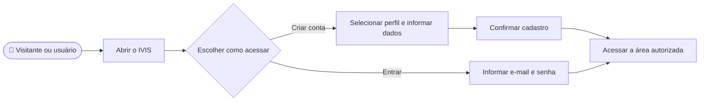

# CDU-01 - Acesso IVIS

## Atores

- Visitante
- Aluno
- Instituição de Ensino
- Sistema IVIS

## Pré-condições

- O usuário não possui sessão autenticada ativa.
- Para entrar, o usuário possui uma conta IVIS ativa.
- Para criar conta, o e-mail ainda não está associado a outra conta e o usuário tem os dados necessários para o perfil escolhido.

## Fluxo principal

1. O usuário abre a página pública do IVIS.
2. O sistema apresenta as opções Entrar e Criar conta.
3. O usuário escolhe como deseja acessar:
   - **Conta nova:** seleciona Aluno ou Instituição de Ensino e informa os dados correspondentes. Aluno informa nome, e-mail, CPF, telefone, endereço e senha. Instituição informa nome do responsável, nome da instituição, e-mail, CNPJ, telefone, endereço e senha.
   - **Conta existente:** informa e-mail e senha.
4. Para uma conta nova, o usuário confirma a senha e solicita o cadastro. O sistema valida os campos, CPF/CNPJ, unicidade dos documentos e do e-mail e aplica a política de senha do CDU-16; então cria a conta e o perfil correspondente, armazenando a senha como hash.
5. Para uma conta existente, o sistema verifica as credenciais e a situação da conta.
6. Se o cadastro ou a autenticação for concluído, o sistema inicia uma sessão associada à conta e ao tipo de usuário.
7. O sistema consulta o acesso vigente e direciona a Instituição à área institucional; direciona o Aluno com acesso ativo à área de treinos; e apresenta os planos disponíveis ao Aluno sem acesso ativo.

## Fluxos alternativos e exceções

- **A1 — Senhas divergentes no cadastro:** o sistema informa a divergência e não cria a conta.
- **A1.1 — Senha fora da política:** a validação segue CDU-16 e o cadastro não é enviado.
- **A2 — Dados de cadastro inválidos:** o sistema indica os campos que precisam de correção.
- **A3 — E-mail já cadastrado:** o sistema não cria outra conta e orienta o usuário a entrar ou recuperar o acesso.
- **A4 — E-mail ou senha inválidos no login:** o sistema informa que as credenciais não conferem e não inicia sessão.
- **A5 — Conta inexistente ou inativa:** o sistema não inicia sessão e apresenta mensagem genérica.
- **A6 — Esqueceu a senha:** o usuário solicita a recuperação conforme CDU-04.
- **A7 — Encerrar sessão:** o usuário aciona Sair; o sistema revoga a sessão de renovação, limpa os dados locais e retorna à área pública.
- **A8 — Consultar a mensagem de boas-vindas simulada:** após criar a conta, o usuário pode abrir a caixa de entrada simulada na própria página de cadastro; nenhuma mensagem real é enviada por essa ação.
- **E1 — Serviço indisponível ou falha de persistência:** o sistema informa que não foi possível concluir o cadastro ou o login e não cria sessão parcial.

## Pós-condições

- **Sucesso ao criar conta:** conta e perfil criados, credencial protegida e sessão iniciada.
- **Sucesso ao entrar:** sessão autenticada associada à conta existente.
- **Falha:** não é criada conta nem sessão inválida.
- A autorização e o acesso às funções seguem CDU-14.

## Situação atual no sistema

Implementado no frontend e backend. O cadastro de aluno ou instituição autentica a conta após a criação; o login usa e-mail e senha, com token de acesso e cookie de renovação protegido. A mensagem de boas-vindas mostrada no cadastro é simulada, sem envio de e-mail real.

## Diagrama de ações do ator

