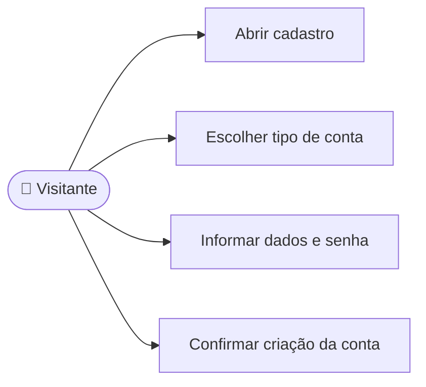

# CDU-01 - Criar conta

## Atores

- Visitante
- Sistema IVIS

## Pré-condições

- O visitante não está autenticado.
- O e-mail informado ainda não pertence a outra conta IVIS.
- O visitante possui dados e senha válidos para o tipo de conta escolhido.

## Fluxo principal

1. O visitante abre a tela Cadastro.
2. O sistema oferece os tipos de conta Aluno e Instituição de Ensino.
3. O visitante escolhe o tipo e informa os dados correspondentes:
   - Aluno: nome, e-mail e senha.
   - Instituição: nome da instituição, nome do administrador, e-mail e senha.
4. O visitante confirma a senha e solicita a criação.
5. O sistema valida os campos, a confirmação, a unicidade do e-mail e o mínimo de 12 caracteres da senha.
6. O sistema cria a conta e o perfil correspondente e armazena a senha como hash.
7. O sistema confirma o cadastro e permite continuar para escolher um plano. O acesso também pode vir de vínculo institucional ativo.

## Fluxos alternativos e exceções

- **A1 — Senhas divergentes:** o sistema informa a divergência e não cria a conta.
- **A2 — Dados inválidos:** o sistema indica os campos que precisam de correção.
- **A3 — E-mail já cadastrado:** o sistema não cria outra conta; o visitante pode ir ao login ou recuperar o acesso.
- **E1 — Falha no serviço ou na persistência:** o sistema informa que o cadastro não foi concluído.

## Pós-condições

- **Sucesso:** conta criada com credencial protegida e perfil correspondente.
- **Falha:** nenhuma conta nova é criada.

## Situação atual no sistema

Implementado no frontend e backend. A confirmação de boas-vindas exibida na interface é simulada; não há confirmação de e-mail real.

## Diagrama de ações do ator

