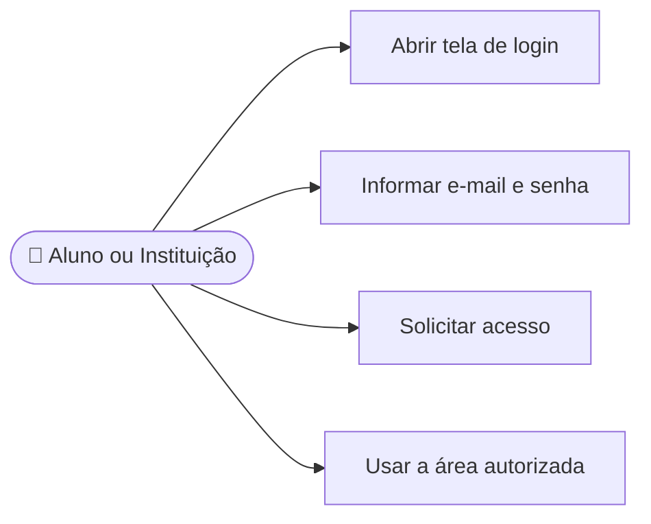

# CDU-02 - Fazer login

## Atores

- Aluno
- Instituição de Ensino
- Sistema IVIS

## Pré-condições

- O usuário possui conta IVIS ativa.
- O usuário não possui uma sessão autenticada válida.

## Fluxo principal

1. O usuário abre a tela Login.
2. O usuário informa e-mail e senha e solicita acesso.
3. O sistema verifica as credenciais e a situação da conta.
4. Se forem válidas, o sistema cria uma sessão associada à conta e ao tipo de usuário.
5. O sistema consulta se há plano individual vigente ou vínculo institucional que conceda acesso.
6. O sistema direciona a instituição para a área institucional; o aluno com acesso segue para os treinos. Sem acesso ativo, o aluno vê os planos disponíveis.
7. O sistema autoriza somente as áreas compatíveis com o tipo de conta e a modalidade.

## Fluxos alternativos e exceções

- **A1 — E-mail ou senha inválidos:** o sistema informa que as credenciais não conferem e não inicia sessão.
- **A2 — Conta inativa ou inexistente:** o sistema não inicia sessão e apresenta mensagem genérica.
- **A3 — Esqueceu a senha:** o usuário inicia o CDU-05 pela tela de login.
- **A4 — Encerrar sessão:** o usuário aciona Sair; o sistema revoga a sessão de renovação, limpa os dados locais e retorna à área pública.
- **E1 — Serviço indisponível:** o sistema informa a falha e não cria sessão parcial.

## Pós-condições

- **Sucesso:** sessão associada à identidade correta; recursos liberados conforme CDU-15.
- **Saída:** sessão de renovação revogada e dados da conta removidos do estado local.

## Situação atual no sistema

Implementado. A autenticação usa e-mail e senha, com token de acesso e cookie de renovação protegido. O plano determina o encaminhamento do aluno após o login.

## Diagrama de ações do ator

