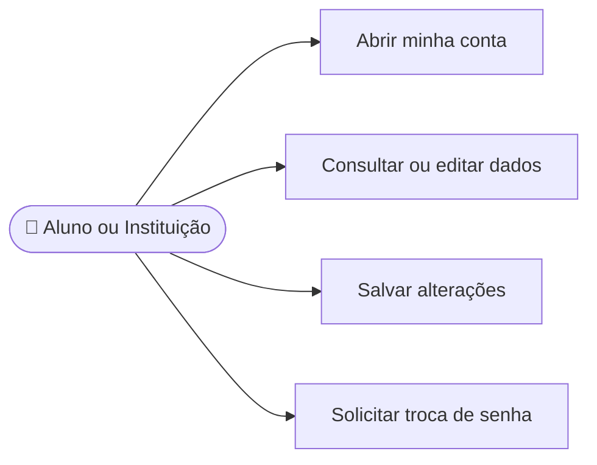

# CDU-02 - Gerenciar dados da conta

## Atores

- Aluno
- Instituição de Ensino
- Sistema IVIS

## Pré-condições

- O usuário está autenticado.
- O usuário altera somente os dados da própria conta.

## Fluxo principal

1. O usuário abre Minha conta.
2. O sistema apresenta os dados editáveis:
   - Aluno: nome e e-mail.
   - Instituição: razão social, nome do administrador e e-mail.
3. O usuário altera os campos e solicita salvar.
4. O sistema valida os dados e verifica a unicidade do novo e-mail.
5. O sistema grava a alteração na conta da sessão e confirma a atualização.
6. Para trocar a senha, o usuário informa a senha atual e uma nova senha válida; o sistema confere a senha atual, grava o novo hash e revoga as sessões de renovação existentes.

## Fluxos alternativos e exceções

- **A1 — Dados inválidos:** o sistema informa os campos que precisam de correção e não grava a alteração.
- **A2 — E-mail já utilizado:** o sistema rejeita a mudança e mantém o e-mail atual.
- **A3 — Senha atual incorreta:** o sistema não altera a senha.
- **A4 — Nova senha inválida:** o sistema informa os requisitos e não altera a credencial.
- **E1 — Falha ao salvar:** o sistema informa que a alteração não foi concluída.

## Pós-condições

- **Sucesso:** somente os dados da conta autenticada são atualizados.
- **Troca de senha:** novo hash persistido e sessões de renovação anteriores revogadas.

## Situação atual no sistema

Parcial. A tela edita os dados básicos descritos acima. O backend oferece troca segura de senha, mas falta a interface; foto/logo e outros dados pessoais não estão disponíveis.

## Diagrama de ações do ator

