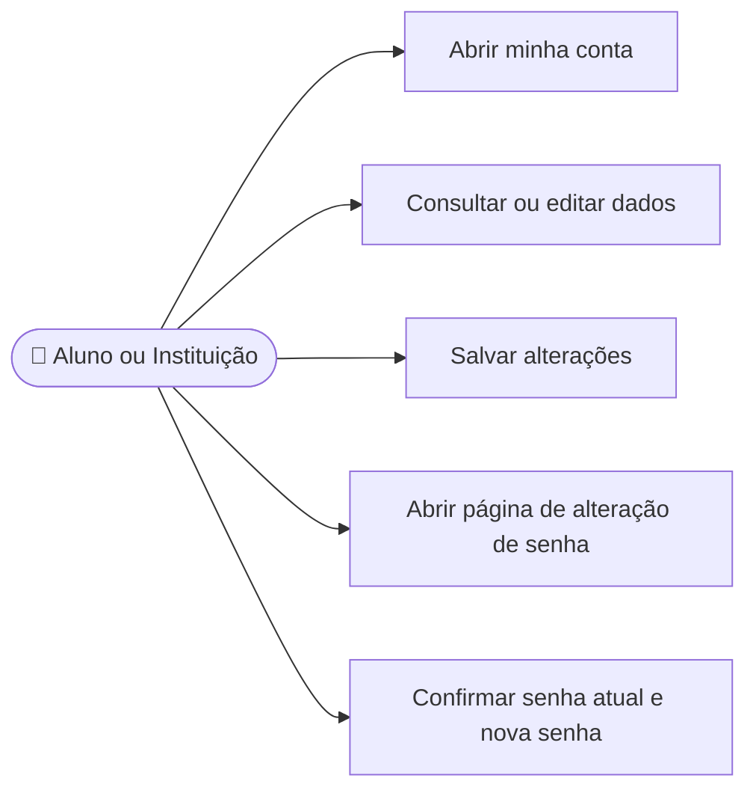

# CDU-02 - Gerenciar dados da conta

## Atores

- Aluno
- Instituição de Ensino
- Sistema IVIS

## Pré-condições

- O usuário está autenticado.
- O usuário altera somente os dados da própria conta.

## Fluxo principal

1. O usuário abre Minha conta.
2. O sistema apresenta os dados editáveis:
   - Aluno: nome, e-mail, CPF, telefone e endereço. Se estiver vinculado a uma instituição, o sistema exibe a referência da instituição associada.
   - Instituição: nome da instituição, nome do responsável, e-mail, CNPJ, telefone e endereço.
3. O usuário altera os campos e solicita salvar.
4. O sistema valida os dados e verifica a unicidade do novo e-mail.
5. O sistema grava a alteração na conta da sessão e confirma a atualização.
6. Na página Minha conta, o usuário escolhe a opção Alterar senha. Em uma página própria, informa a senha atual e uma nova senha válida; o sistema confere a senha atual, grava o novo hash e revoga as sessões de renovação existentes.
7. Os campos de texto e senha aparecem com fundo branco e borda visível; ao receber foco, a borda destaca a área interativa.

## Fluxos alternativos e exceções

- **A1 — Dados inválidos:** o sistema informa os campos que precisam de correção e não grava a alteração.
- **A2 — E-mail já utilizado:** o sistema rejeita a mudança e mantém o e-mail atual.
- **A3 — Senha atual incorreta:** o sistema não altera a senha.
- **A4 — Nova senha inválida:** o sistema informa os requisitos e não altera a credencial.
- **E1 — Falha ao salvar:** o sistema informa que a alteração não foi concluída.

## Pós-condições

- **Sucesso:** somente os dados da conta autenticada são atualizados.
- **Troca de senha:** novo hash persistido e sessões de renovação anteriores revogadas.

## Situação atual no sistema

Implementado para dados pessoais/institucionais e troca de senha. A troca de senha fica em uma página própria acessível pela tela Minha conta; o backend valida a senha atual e revoga sessões de renovação anteriores. Foto/logo não estão disponíveis.

## Cobertura automatizada

- `cypress/e2e/cdu/CDU-02-gerenciar-dados-da-conta.cy.js`: navegação para a página separada de senha, envio do payload de troca, limpeza dos campos após sucesso e edição dos dados de aluno/instituição com payload verificado.
- O spec também verifica que os campos da conta e da senha têm fundo branco e borda com contraste visível. Os cenários Cypress usam respostas simuladas; persistência da alteração, validação da senha atual e revogação de sessões são cobertas pelos testes do backend.

## Diagrama de ações do ator

