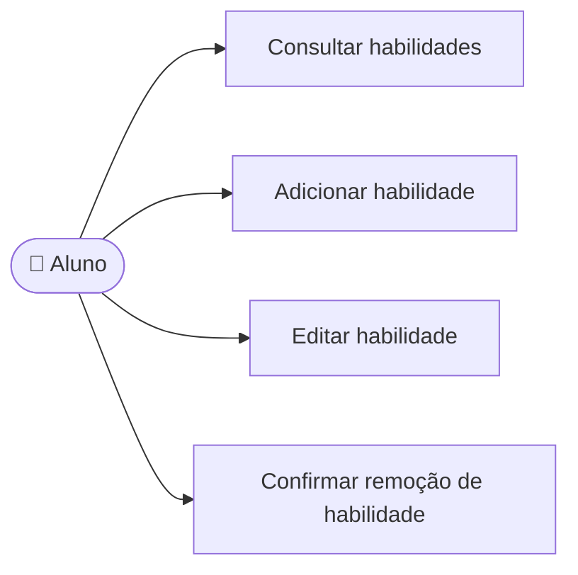

# CDU-03 - Gerenciar habilidades

## Atores

- Aluno
- Sistema IVIS

## Pré-condições

- O aluno está autenticado.
- O aluno acessa o próprio perfil de habilidades.

## Fluxo principal

1. O aluno abre Minhas habilidades.
2. O sistema lista as habilidades associadas à conta.
3. O aluno escolhe adicionar, editar ou remover uma habilidade.
4. Para adicionar ou editar, informa nome, categoria e nível de domínio.
5. O aluno confirma a operação; para remover, confirma a exclusão.
6. O sistema valida os dados, impede nomes duplicados no perfil e grava a alteração.
7. O sistema atualiza a lista. As habilidades podem ser usadas como contexto de novos treinos.

## Fluxos alternativos e exceções

- **A1 — Campos inválidos:** o sistema informa o que corrigir e não grava a habilidade.
- **A2 — Habilidade duplicada:** o sistema avisa que já existe habilidade com o mesmo nome no perfil.
- **A3 — Remoção cancelada:** o sistema preserva a habilidade.
- **E1 — Falha ao carregar ou salvar:** o sistema informa a falha e não confirma a operação.

## Pós-condições

- **Sucesso:** perfil de habilidades atualizado na conta do aluno.
- Treinos concluídos preservam o contexto registrado anteriormente.

## Situação atual no sistema

Implementado no frontend e backend, com persistência por conta. O nível vai de 1 a 5 e a lista é isolada pela identidade autenticada.

## Diagrama de ações do ator

