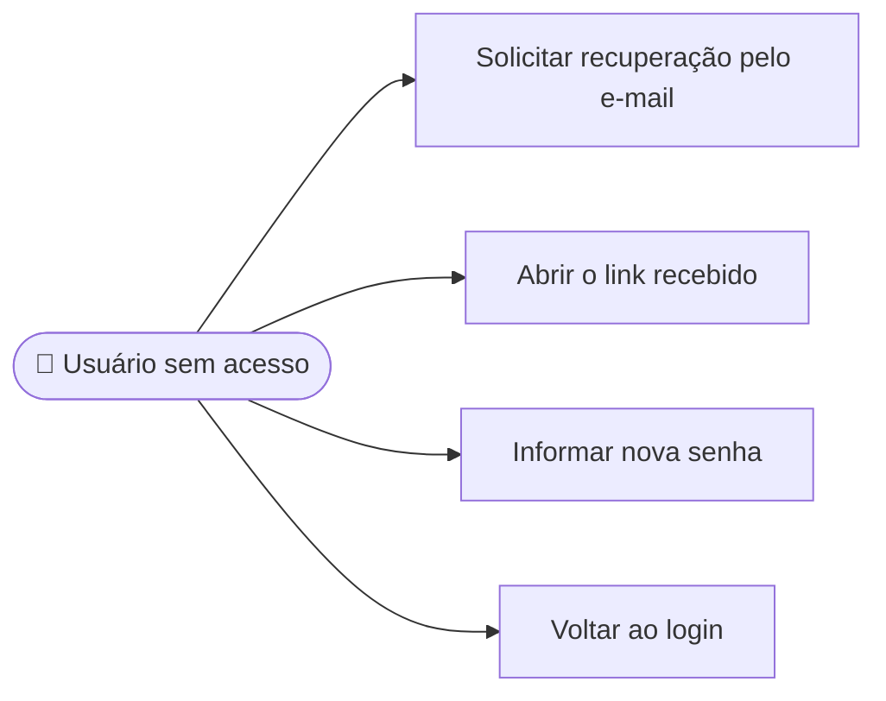

# CDU-04 - Recuperar acesso

## Atores

- Aluno ou Instituição de Ensino sem acesso à conta
- Serviço de e-mail (capturado pelo Mailpit no ambiente local)
- Sistema IVIS

## Pré-condições

- O usuário não está autenticado.
- O usuário pode acessar o e-mail informado.

## Fluxo principal

1. O usuário escolhe Esqueci minha senha na tela de login.
2. O usuário informa o e-mail e solicita a recuperação.
3. O sistema apresenta resposta neutra, sem revelar se existe conta para o e-mail.
4. Se houver conta ativa, o sistema invalida tokens anteriores, gera token de uso único com validade limitada e envia um link por SMTP.
5. O usuário abre o link e informa uma nova senha válida.
6. O sistema valida o token, grava o hash da nova senha, consome o token e revoga as sessões de renovação da conta.
7. O usuário volta ao login e entra com a nova senha conforme CDU-01.

## Fluxos alternativos e exceções

- **A1 — E-mail sem conta ativa:** o sistema mantém a mesma resposta neutra.
- **A2 — Link inválido, expirado ou utilizado:** o sistema rejeita a redefinição e orienta solicitar outro link.
- **A3 — Nova senha inválida:** o sistema rejeita a alteração sem consumir um token válido.
- **A4 — Muitas solicitações:** o sistema aplica limitação de tentativas.
- **E1 — Falha no envio:** o token não pode ser usado; o usuário poderá solicitar outro link.

## Pós-condições

- **Sucesso:** senha alterada, token consumido e sessões de renovação revogadas.
- **Falha:** senha inalterada.

## Situação atual no sistema

Implementado. A tela de login solicita recuperação e o backend gera e envia o token. No ambiente local, o Mailpit captura as mensagens. A rota pública `/redefinir-senha?token=...` recebe a nova senha, confirma sua repetição e apresenta sucesso ou erro de link inválido/expirado. O backend consome o token e revoga sessões de renovação anteriores.

## Diagrama de ações do ator

