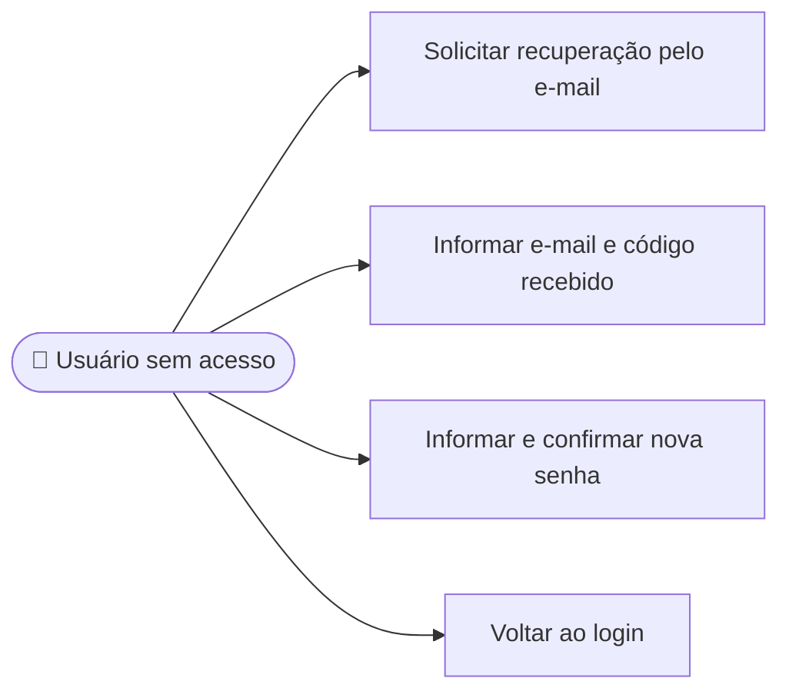

# CDU-04 - Recuperar acesso

## Atores

- Aluno
- Instituição de Ensino

## Pré-condições

- O usuário não está autenticado.
- O usuário pode acessar o e-mail informado para obter o código de recuperação.

## Fluxo principal

1. O usuário escolhe Esqueci minha senha na tela de login.
2. O usuário informa o e-mail e solicita a recuperação.
3. O sistema apresenta resposta neutra, sem revelar se existe conta para o e-mail.
4. Se houver conta ativa, o backend invalida códigos anteriores, gera um código de 8 dígitos com validade limitada e o envia por SMTP junto com o endereço da página de redefinição.
5. O usuário informa o e-mail e o código na página de redefinição. O backend valida e consome o código e cria uma autorização temporária em cookie protegido.
6. O usuário informa e confirma a nova senha conforme CDU-16. O backend valida a autorização, grava o hash, consome a autorização e revoga as sessões de renovação da conta.
7. O usuário volta ao login e entra com a nova senha conforme CDU-01.

## Fluxos alternativos e exceções

- **A1 — E-mail sem conta ativa:** o sistema mantém a mesma resposta neutra.
- **A2 — Código inválido, expirado ou utilizado:** o sistema não libera o formulário de nova senha e orienta solicitar outro código.
- **A2.1 — Autorização de redefinição expirada:** como o código anterior já foi consumido, o usuário solicita outro código e repete a verificação. Um link antigo com token na URL não é aceito.
- **A3 — Nova senha inválida:** o sistema rejeita a alteração sem consumir uma autorização válida.
- **A4 — Muitas solicitações:** o sistema aplica limitação de tentativas.
- **E1 — Falha no envio:** o código é invalidado; o usuário poderá solicitar outro.

## Pós-condições

- **Sucesso:** senha alterada, código e autorização consumidos e sessões de renovação revogadas.
- **Falha:** senha inalterada.

## Situação atual no sistema

Implementado. A tela de login solicita a recuperação e abre `/redefinir-senha`. No ambiente local, o Mailpit captura o e-mail com o código de 8 dígitos. A página valida e-mail e código em `POST /v1/senhas/validacao-codigo`; depois envia a nova senha a `POST /v1/senhas/redefinicao` usando a autorização em cookie HttpOnly. Após recarga, `GET /v1/senhas/redefinicao/autorizacao` permite retomar a etapa da senha enquanto a autorização estiver válida. Parâmetros antigos `token` na URL são removidos e rejeitados.

## Diagrama de ações do ator

