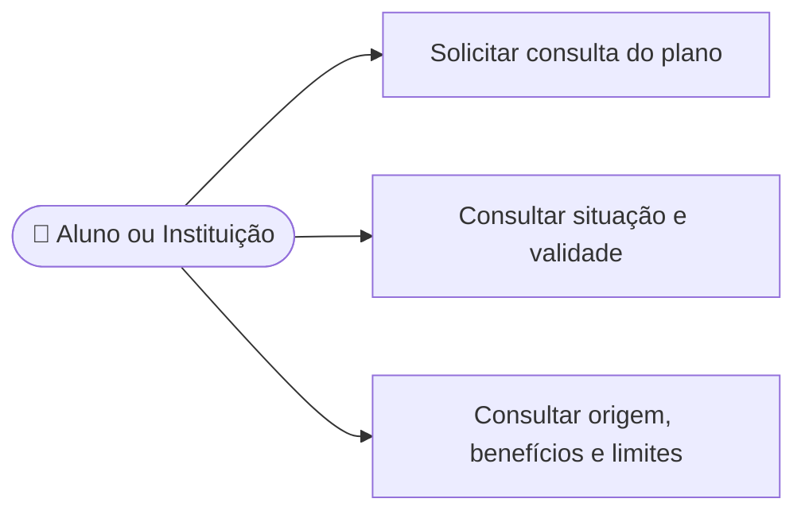

# CDU-06 - Consultar plano vigente

## Atores

- Aluno
- Instituição de Ensino
- Sistema IVIS

## Pré-condições

- O usuário está autenticado.
- O sistema identifica a conta pela sessão autenticada.

## Fluxo principal

1. O usuário solicita consultar seu plano ou situação de acesso.
2. O sistema consulta os contratos vigentes da conta.
3. Para o aluno, o sistema considera plano individual próprio e eventual vínculo institucional ativo.
4. Para a instituição, o sistema considera somente contratos cujo titular é a própria instituição.
5. O sistema apresenta modalidade, plano, origem do acesso, situação, validade, benefícios e limites disponíveis para aquele perfil.
6. Se não houver acesso vigente, o sistema informa a situação e permite consultar as ofertas públicas conforme CDU-10.

## Fluxos alternativos e exceções

- **A1 — Sem plano ou vínculo vigente:** o sistema informa que não há acesso ativo.
- **A2 — Contrato vencido ou encerrado:** o sistema não o apresenta como vigente.
- **A3 — Aluno com vínculo institucional:** o sistema informa a origem do acesso sem expor dados da instituição nem permitir administrar seu contrato.
- **E1 — Falha na consulta:** o sistema informa que não foi possível obter os dados do plano.

## Pós-condições

- Nenhuma alteração é feita; são consultados somente dados de acesso associados à conta.

## Situação atual no sistema

Parcial. A API retorna contratos próprios ou por vínculo e é usada para determinar acesso após login. Falta uma página dedicada que apresente ao usuário todos os detalhes do plano vigente.

## Diagrama de ações do ator

