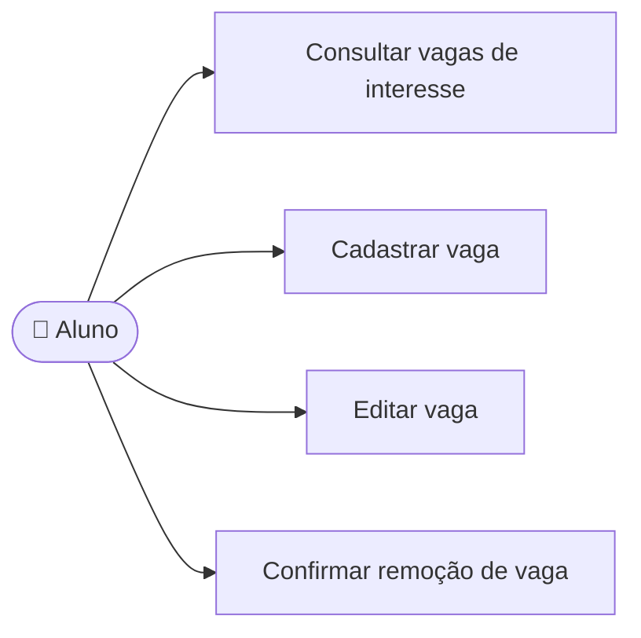

# CDU-06 - Gerenciar vaga de interesse

## Atores

- Aluno

## Pré-condições

- O aluno está autenticado.
- O aluno acessa somente vagas associadas à própria conta.

## Fluxo principal

1. O aluno abre Vagas de interesse e consulta a lista.
2. O aluno escolhe cadastrar, editar ou remover uma vaga.
3. Para cadastrar ou editar, informa título, empresa (opcional), senioridade, descrição (opcional) e de um a vinte requisitos.
4. O aluno confirma os dados; para remover, confirma a ação.
5. O sistema valida os campos e grava a vaga para a conta do aluno.
6. O sistema atualiza a lista. A vaga pode ser selecionada como contexto de um novo treino.

## Fluxos alternativos e exceções

- **A1 — Dados inválidos ou requisitos repetidos:** o sistema informa o que corrigir e não grava a alteração.
- **A2 — Vaga selecionada para o treino atual:** o sistema bloqueia edição ou remoção enquanto ela estiver em uso.
- **A3 — Remoção cancelada:** o sistema mantém a vaga.
- **A4 — Vaga inexistente ou de outra conta:** o sistema rejeita a operação.
- **E1 — Falha ao carregar ou salvar:** o sistema informa a falha e não confirma sucesso.

## Pós-condições

- **Sucesso:** vaga criada ou atualizada; remoção arquiva a vaga para preservar referências históricas.
- Treinos concluídos preservam o contexto registrado.

## Situação atual no sistema

Implementado no frontend e backend, com persistência por aluno. A exclusão arquiva a vaga; o histórico mantém o contexto usado no treino.

## Diagrama de ações do ator

