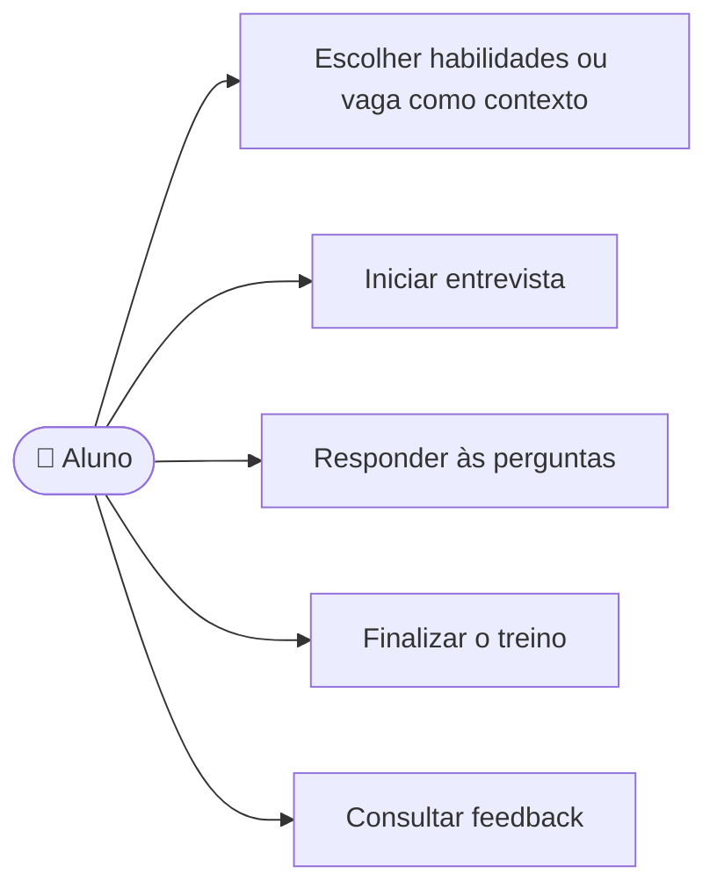

# CDU-07 - Realizar treinamento e receber feedback

## Atores

- Aluno
- Serviço de IA, acessado pelo backend
- Sistema IVIS

## Pré-condições

- O aluno está autenticado e possui plano individual ou vínculo institucional vigente.
- O aluno tem ao menos uma habilidade ou vaga para usar como contexto.
- A vaga escolhida pertence ao aluno e não está arquivada.

## Fluxo principal

1. O aluno abre Treinamentos e escolhe habilidades ou uma vaga como contexto.
2. O sistema verifica o acesso e apresenta o contexto escolhido.
3. O aluno inicia o treino.
4. O sistema envia o contexto ao serviço de IA e apresenta a primeira pergunta.
5. O aluno escreve e envia uma resposta; o sistema solicita a pergunta seguinte considerando as interações anteriores.
6. Os passos 4 e 5 se repetem até o aluno responder às três perguntas configuradas na interface.
7. O sistema solicita uma avaliação ao serviço de IA.
8. O aluno escolhe finalizar e ver o feedback.
9. O sistema persiste o treino, as perguntas e respostas, o contexto, a nota e os pontos fortes e de melhoria.
10. O sistema apresenta o feedback e disponibiliza o resultado no histórico conforme CDU-08.

## Fluxos alternativos e exceções

- **A1 — Sem acesso ativo:** o sistema não inicia o treino e direciona o aluno às opções de acesso.
- **A2 — Sem contexto válido:** o sistema orienta cadastrar habilidades ou vaga.
- **A3 — Falha ao gerar pergunta ou avaliação:** o sistema informa que não foi possível concluir a etapa e não apresenta resultado inexistente.
- **A4 — Treino cancelado antes de finalizar:** o estado local é descartado e o treino não aparece no histórico.
- **E1 — Falha ao salvar:** o sistema informa que o resultado não foi registrado.

## Pós-condições

- **Sucesso:** treino concluído e avaliação armazenada para o aluno autenticado.
- O resultado não inclui treinos de outros alunos.

## Situação atual no sistema

Implementado com geração de perguntas e avaliação pelo backend/API de IA com provedor NVIDIA. A interface usa três perguntas. Só o treino finalizado é persistido; treinos cancelados ou incompletos não aparecem no histórico.

## Diagrama de ações do ator

