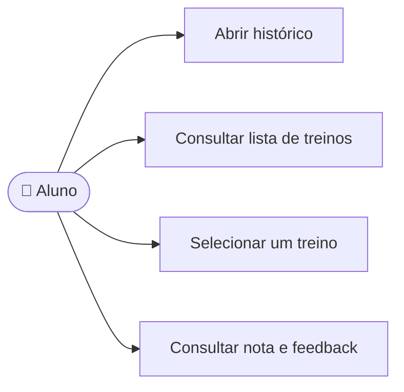

# CDU-08 - Consultar histórico de treinos

## Atores

- Aluno

## Pré-condições

- O aluno está autenticado e possui perfil de aluno; um plano vigente não é exigido para consultar seu histórico.
- O histórico é consultado para a conta autenticada.

## Fluxo principal

1. O aluno abre Histórico.
2. O sistema consulta os treinamentos concluídos e avaliados da conta.
3. O sistema apresenta data, contexto (habilidades ou vaga), nota e resumo do feedback.
4. O aluno seleciona um registro.
5. O sistema apresenta os detalhes disponíveis, incluindo pontos fortes e pontos de melhoria.

## Fluxos alternativos e exceções

- **A1 — Histórico vazio:** o sistema informa que ainda não há treinos concluídos. Iniciar novo treino exige acesso vigente conforme CDU-07.
- **A1.1 — Plano vencido ou vínculo removido:** o aluno continua consultando treinos concluídos, mas não pode iniciar outro treino sem acesso vigente.
- **A2 — Registro não encontrado ou fora da conta:** o sistema não apresenta os dados solicitados.
- **A3 — Treino incompleto:** não é listado, pois o histórico inclui somente treinos finalizados com avaliação.
- **E1 — Falha na consulta:** o sistema informa que não foi possível carregar o histórico.

## Pós-condições

- Nenhuma alteração é feita.
- Os resultados pertencem somente ao aluno autenticado.

## Situação atual no sistema

Implementado para treinos concluídos. `GET /v1/treinos` exige perfil de aluno ativo e filtra pela identidade autenticada, sem exigir plano vigente. As rotas `/historico` e `/feedback` também permanecem disponíveis ao aluno autenticado sem plano. A interface só oferece Novo treino quando há acesso ativo.

## Diagrama de ações do ator

