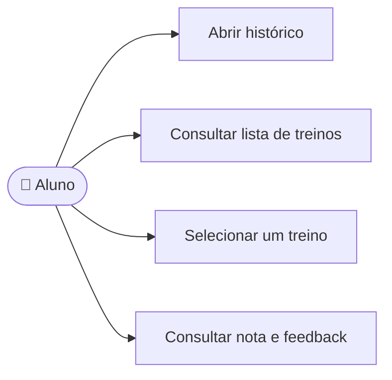

# CDU-08 - Consultar histórico de treinos

## Atores

- Aluno
- Sistema IVIS

## Pré-condições

- O aluno está autenticado e tem acesso aos recursos de treinamento.
- O histórico é consultado para a conta autenticada.

## Fluxo principal

1. O aluno abre Histórico.
2. O sistema consulta os treinamentos concluídos e avaliados da conta.
3. O sistema apresenta data, contexto (habilidades ou vaga), nota e resumo do feedback.
4. O aluno seleciona um registro.
5. O sistema apresenta os detalhes disponíveis, incluindo pontos fortes e pontos de melhoria.

## Fluxos alternativos e exceções

- **A1 — Histórico vazio:** o sistema informa que ainda não há treinos concluídos e permite iniciar um treino conforme CDU-07.
- **A2 — Registro não encontrado ou fora da conta:** o sistema não apresenta os dados solicitados.
- **A3 — Treino incompleto:** não é listado, pois o histórico inclui somente treinos finalizados com avaliação.
- **E1 — Falha na consulta:** o sistema informa que não foi possível carregar o histórico.

## Pós-condições

- Nenhuma alteração é feita.
- Os resultados pertencem somente ao aluno autenticado.

## Situação atual no sistema

Implementado para treinos concluídos. A API filtra pela identidade autenticada e a interface permite acessar o feedback associado a cada registro.

## Diagrama de ações do ator

