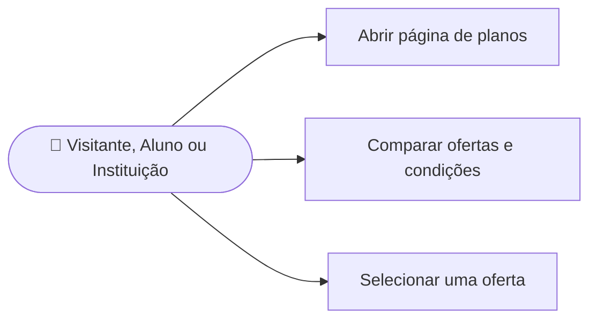

# CDU-09 - Visualizar planos disponíveis

## Atores

- Visitante
- Aluno
- Instituição de Ensino
- Sistema IVIS

## Pré-condições

- Nenhuma para consultar o catálogo público.

## Fluxo principal

1. O usuário abre a página pública Planos.
2. O sistema apresenta as ofertas ativas com modalidade, preço, duração, benefícios e vagas incluídas, quando aplicável.
3. O usuário compara as opções e seleciona uma oferta.
4. Se não estiver autenticado, o sistema encaminha para login ou cadastro e preserva a oferta para continuar a compra.
5. Se estiver autenticado, o sistema permite seguir ao checkout de uma modalidade compatível com o tipo de conta.

## Fluxos alternativos e exceções

- **A1 — Oferta incompatível com a conta:** o sistema não permite iniciar aquele checkout.
- **A2 — Oferta removida ou inativa:** o sistema informa que a oferta não está disponível e solicita nova seleção.
- **A3 — Usuário já possui acesso:** o sistema informa a situação do acesso e mantém o catálogo disponível para consulta.
- **E1 — Falha ao carregar o catálogo:** o sistema informa que não foi possível obter ofertas atualizadas.

## Pós-condições

- Consultar o catálogo não altera conta, plano ou contrato.
- A contratação começa somente após autenticação e confirmação nos CDU-10 ou CDU-11.

## Situação atual no sistema

Implementado. A página e os endpoints de consulta do catálogo são públicos e mostram ofertas ativas do backend.

## Diagrama de ações do ator

