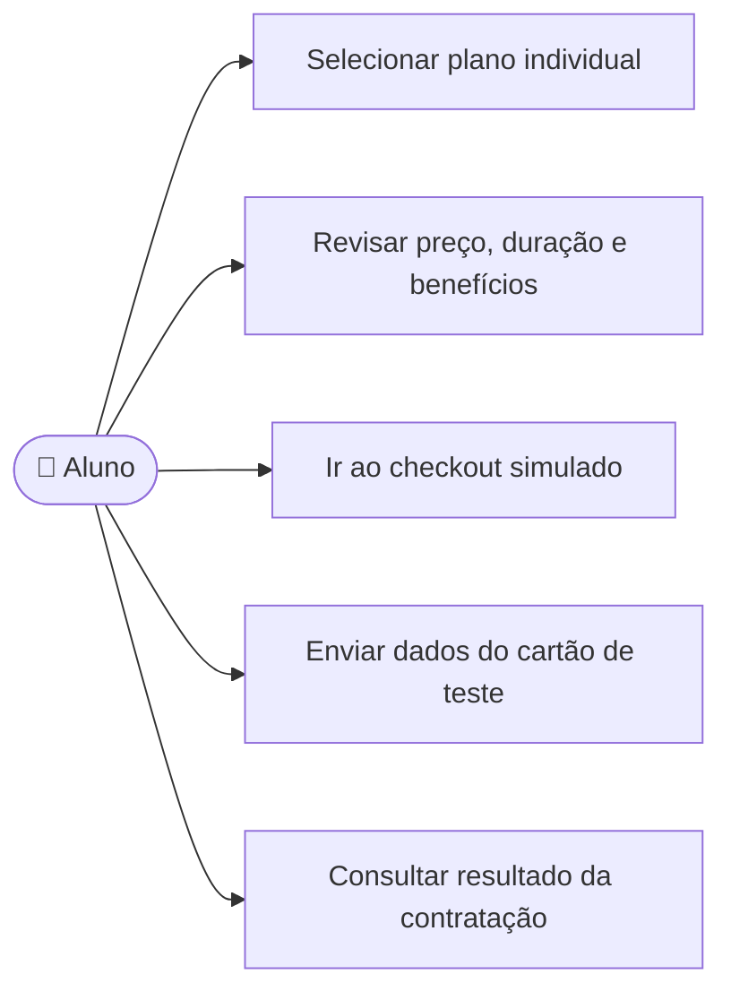

# CDU-10 - Contratar plano individual

## Atores

- Aluno

## Pré-condições

- O aluno está autenticado.
- Existe oferta individual ativa.
- O aluno não possui vínculo institucional ativo nem contrato individual vigente.

## Fluxo principal

1. O aluno seleciona uma oferta individual conforme CDU-09.
2. O sistema verifica o tipo da conta e a elegibilidade do aluno.
3. O sistema apresenta preço ilustrativo, duração e benefícios.
4. O aluno revisa as condições e segue ao checkout simulado conforme CDU-12.
5. O backend valida a oferta, a modalidade e o resultado da simulação.
6. Se aprovado, o backend registra o pagamento e ativa o contrato pelo período do catálogo.
7. O sistema registra evento da contratação simulada e confirma que o plano está ativo.

## Fluxos alternativos e exceções

- **A1 — Vínculo institucional ativo:** o sistema bloqueia a contratação individual enquanto o vínculo vigorar.
- **A2 — Conta institucional tenta contratar plano individual:** o sistema rejeita a operação.
- **A3 — Plano individual já vigente:** o sistema impede duplicidade e informa a situação.
- **A4 — Pagamento simulado recusado:** o sistema não ativa o plano e informa que não houve cobrança.
- **A5 — Mesma solicitação reenviada:** a chave de idempotência impede duplicar pagamento ou contrato.
- **E1 — Oferta indisponível ou falha do backend:** o sistema não ativa o plano e informa que a contratação não foi concluída.

## Pós-condições

- **Aprovado:** contrato individual ativo e associado ao aluno; evento de contratação gerado.
- **Recusado:** plano não ativado e nenhum valor cobrado.

## Situação atual no sistema

Implementado de ponta a ponta no escopo acadêmico, usando simulador controlado pelo backend. Não há gateway externo nem cobrança real.

## Diagrama de ações do ator

