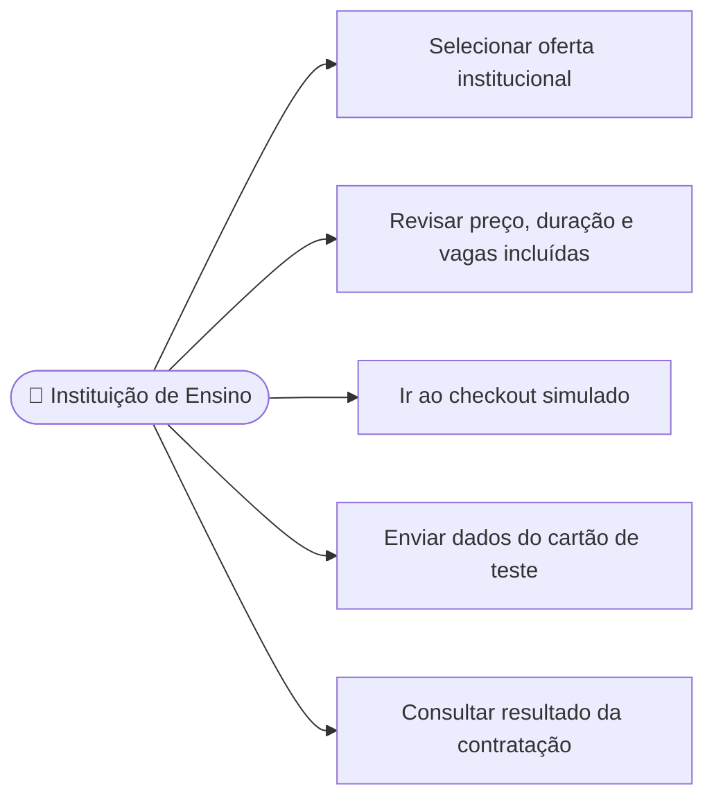

# CDU-11 - Contratar plano institucional

## Atores

- Instituição de Ensino
- Sistema IVIS

## Pré-condições

- A instituição está autenticada.
- Existe oferta institucional ativa.
- Não há contrato institucional vigente que impeça nova contratação.

## Fluxo principal

1. A instituição seleciona uma oferta institucional conforme CDU-09.
2. O sistema verifica o tipo da conta e apresenta preço, duração, benefícios e capacidade incluída na oferta.
3. A instituição revisa as condições e segue ao checkout simulado conforme CDU-12.
4. O backend valida o resultado do pagamento simulado.
5. Se aprovado, o sistema registra contrato, preço e capacidade definidos pelo catálogo.
6. O sistema registra evento de contratação e confirma a ativação.
7. A instituição pode seguir para gerenciar alunos e vagas conforme CDU-13.

## Fluxos alternativos e exceções

- **A1 — Conta de aluno tenta contratar a modalidade institucional:** o sistema rejeita a operação.
- **A2 — Já existe contrato institucional vigente:** o sistema impede duplicidade e informa a situação.
- **A3 — Pagamento simulado recusado:** o contrato não é ativado nem libera vagas.
- **A4 — Oferta indisponível ou inativa:** o sistema solicita outra seleção.
- **E1 — Falha ao registrar ou confirmar:** o sistema não apresenta o contrato como ativo.

## Pós-condições

- **Aprovado:** contrato institucional ativo, com validade e vagas definidas no catálogo.
- **Recusado:** contrato não ativado e nenhuma vaga liberada.

## Situação atual no sistema

Parcial em relação ao requisito de escolher a quantidade de vagas. A contratação e o pagamento simulado funcionam, mas a capacidade é definida pela oferta atual (Plano Acadêmico com 10 vagas); não há campo para escolher outra quantidade.

## Diagrama de ações do ator

