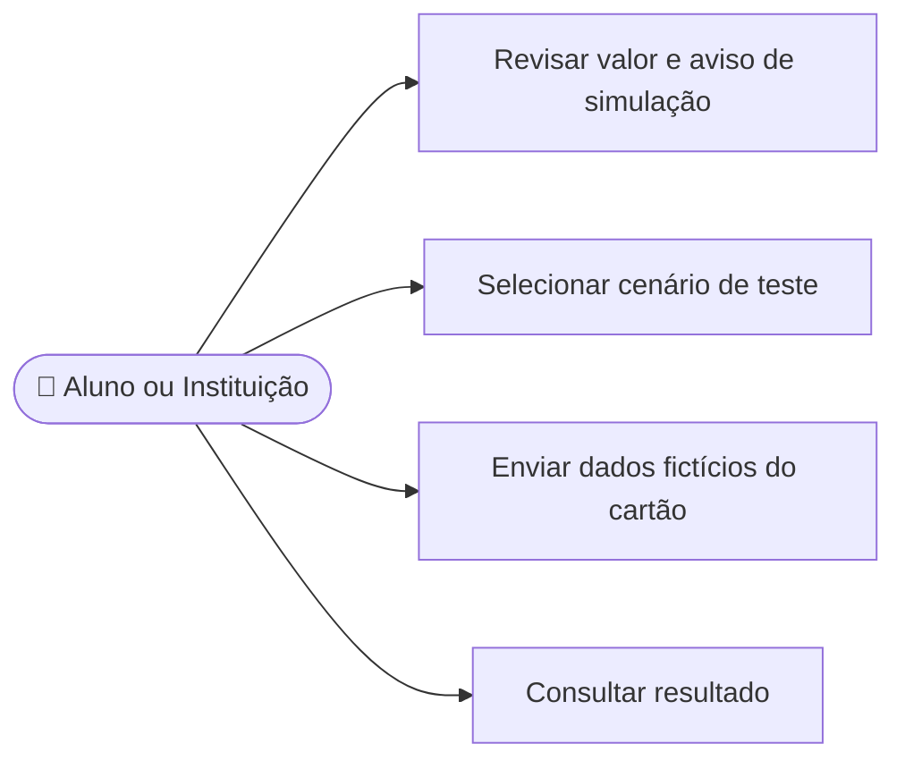

# CDU-12 - Efetuar pagamento

## Atores

- Aluno
- Instituição de Ensino

## Pré-condições

- O usuário está autenticado e elegível para a modalidade.
- Uma oferta ativa foi selecionada.
- O checkout apresenta o valor calculado pelo backend.

## Fluxo principal

1. O sistema apresenta o plano e informa que o checkout é uma simulação acadêmica.
2. O usuário seleciona o cenário aprovado ou recusado e fornece os dados fictícios aceitos.
3. O usuário envia a solicitação de contratação.
4. O backend verifica oferta, modalidade, validade dos dados de teste e chave de idempotência.
5. O backend registra a tentativa como SIMULADO, sem armazenar número do cartão ou CVV e sem encaminhar dados a um gateway.
6. Se aprovada, o backend ativa o contrato; se recusada, não concede acesso.
7. O sistema apresenta o resultado e informa que não houve cobrança real.

## Fluxos alternativos e exceções

- **A1 — Cartão de teste aprovado:** o simulador retorna aprovação e o backend ativa o contrato.
- **A2 — Cartão de teste recusado:** o contrato não é ativado.
- **A3 — Dados de teste inválidos:** o backend rejeita a solicitação e explica que somente cartões fictícios aceitos podem ser usados.
- **A4 — Repetição da solicitação:** a mesma chave retorna o resultado anterior, sem duplicar a operação.
- **E1 — Falha de comunicação:** o sistema informa que não conseguiu processar a simulação.

## Pós-condições

- **Aprovado:** tentativa registrada como simulada e contrato ativo segundo a oferta.
- **Recusado:** tentativa simulada registrada e contrato não ativo.
- Os dados de cartão não são mantidos como dados de pagamento.

## Situação atual no sistema

Implementado para demonstração acadêmica. O backend aceita cartões fictícios específicos e registra pagamentos como simulados. Gateway externo e cobrança real não fazem parte do código atual.

## Diagrama de ações do ator

