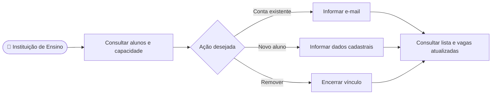

# CDU-13 - Gerenciar alunos vinculados

## Atores

- Instituição de Ensino

## Pré-condições

- A instituição está autenticada.
- Para incluir aluno, possui contrato institucional ativo com vaga disponível. A consulta e a remoção se limitam aos vínculos da própria instituição.
- Para vincular, a instituição pode selecionar uma conta IVIS ativa de aluno ou cadastrar uma nova conta com nome, e-mail, CPF, telefone, endereço e senha.

## Fluxo principal

1. A instituição abre a área de gestão institucional.
2. O sistema apresenta alunos vinculados e, por contrato, as vagas de alunos totais, utilizadas e disponíveis.
3. Para adicionar, a instituição escolhe entre informar o e-mail de uma conta de aluno existente, conforme CDU-20, ou preencher o cadastro de um novo aluno.
4. O sistema verifica titularidade do contrato, vaga disponível e ausência de outro vínculo institucional ativo para o aluno.
5. Se for um novo aluno, o sistema exige a política de senha do CDU-16 e cria a conta e o perfil com a senha protegida por hash; se for existente, localiza a conta pelo e-mail.
6. O sistema cria o vínculo e grava no perfil do aluno o código do objeto da instituição em `codigo_objeto_perfis_instituicao`, exposto como `objetoInstituicao` na conta. A conta e o vínculo são persistidos na mesma transação.
7. O sistema atualiza lista e capacidade.
8. Para remover, a instituição seleciona um vínculo e aciona Remover.
9. O sistema encerra o vínculo, preserva seu registro histórico, limpa `objetoInstituicao` quando corresponde à instituição e libera a vaga.
10. O acesso do aluno passa a depender de vínculo e contrato vigentes, conforme CDU-14.

## Fluxos alternativos e exceções

- **A1 — Conta de aluno ativa não encontrada:** o sistema não cria o vínculo.
- **A2 — Aluno já possui vínculo ativo:** o sistema rejeita a inclusão.
- **A3 — Sem vagas ou contrato elegível:** o sistema rejeita a inclusão e apresenta a capacidade atual.
- **A4 — Vínculo fora da instituição autenticada ou já encerrado:** o sistema rejeita a operação.
- **A5 — Duas tentativas disputam a última vaga:** o backend valida a capacidade ao gravar e não permite excedê-la.
- **E1 — Falha ao carregar ou salvar:** o sistema informa que a operação não foi concluída.

## Pós-condições

- **Inclusão:** vínculo ativo criado e capacidade atualizada.
- **Remoção:** vínculo encerrado, histórico preservado e vaga liberada.
- As operações ficam limitadas aos contratos da instituição autenticada.

## Situação atual no sistema

Implementado no frontend e backend. A instituição lista, vincula por e-mail contas de aluno existentes, cadastra e vincula novos alunos e remove vínculos. O backend verifica capacidade e titularidade e mantém o objeto institucional atual no perfil do aluno. Inclusão e remoção geram eventos de auditoria na mesma transação (CDU-15).

## Diagrama de ações do ator

