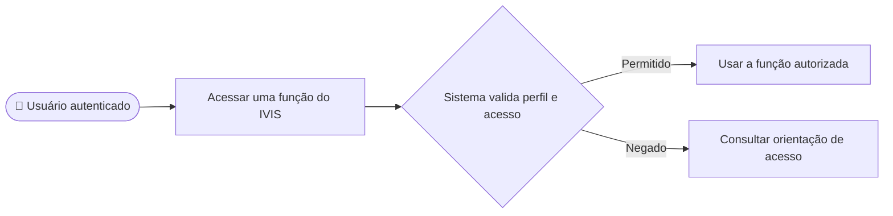

# CDU-14 - Aplicar acesso conforme modalidade

## Atores

- Aluno
- Instituição de Ensino

## Pré-condições

- O usuário tem sessão autenticada.
- O sistema consulta conta, contrato ou vínculo necessários para decidir o acesso.

## Fluxo principal

1. O usuário tenta acessar uma área ou executar uma operação protegida.
2. O sistema identifica o tipo de conta e verifica plano individual ou vínculo institucional vigente.
3. Para funções de aluno, o sistema confirma perfil de aluno e acesso coberto por plano individual ou vínculo institucional.
4. Para funções da instituição, o sistema confirma o tipo da conta e limita consultas e alterações aos contratos e vínculos próprios.
5. O sistema concede a operação somente quando perfil, titularidade e acesso atendem às regras.
6. Sem acesso ativo, o sistema bloqueia recursos de treinamento e orienta consultar ou contratar um plano.
7. O backend valida novamente as operações que exigem plano, como treino e histórico; também verifica o tipo de conta e a titularidade nas operações de conta e gestão institucional. A proteção de navegação do frontend não substitui as validações da API.

## Fluxos alternativos e exceções

- **A1 — Aluno com plano individual vigente:** o sistema permite as funções cobertas pela oferta.
- **A2 — Aluno com vínculo institucional vigente:** o sistema permite as funções cobertas, sem acesso à gestão do contrato da instituição.
- **A3 — Aluno vinculado tenta contratar plano individual:** o backend rejeita a contratação conforme RF19 e CDU-10.
- **A4 — Plano expirado ou vínculo removido:** o sistema nega novas operações protegidas.
- **A5 — Tipo de conta incompatível:** o sistema rejeita a chamada e mantém o usuário na área correspondente ao seu perfil.
- **E1 — Estado de acesso não verificável:** o sistema nega a operação protegida.

## Pós-condições

- Acesso autorizado ou negado com base na situação persistida da conta, contrato e vínculo.
- Uma instituição não consulta nem altera dados de outra instituição.

## Situação atual no sistema

Implementado nas rotas do frontend, com verificação de plano no backend para treinos e histórico e validações de perfil/titularidade nas APIs de conta e gestão institucional. A modalidade do aluno é determinada por contrato individual ou vínculo institucional; não há perfil separado salvo como AlunoPagante/AlunoConsórcio.

## Diagrama de ações do ator

