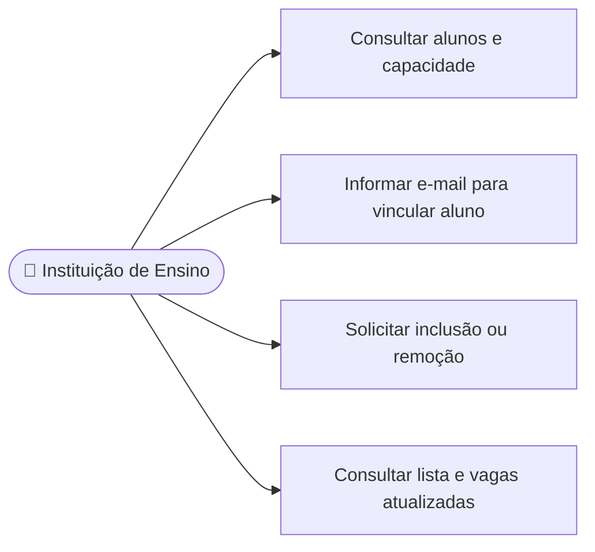

# CDU-14 - Gerenciar alunos vinculados

## Atores

- Instituição de Ensino
- Sistema IVIS

## Pré-condições

- A instituição está autenticada.
- Para incluir aluno, possui contrato institucional ativo com vaga disponível. A consulta e a remoção se limitam aos vínculos da própria instituição.
- O aluno a vincular já possui conta IVIS ativa do tipo Aluno.

## Fluxo principal

1. A instituição abre a área de gestão institucional.
2. O sistema apresenta alunos vinculados e, por contrato, as vagas contratadas, utilizadas e disponíveis.
3. Para adicionar, a instituição informa o e-mail de uma conta IVIS de aluno.
4. O sistema identifica a conta e verifica titularidade do contrato, vaga disponível e ausência de outro vínculo institucional ativo para o aluno.
5. O sistema cria o vínculo e atualiza lista e capacidade.
6. Para remover, a instituição seleciona um vínculo e aciona Remover.
7. O sistema encerra o vínculo, preserva seu registro histórico e libera a vaga.
8. O acesso do aluno passa a depender de vínculo e contrato vigentes, conforme CDU-15.

## Fluxos alternativos e exceções

- **A1 — Conta de aluno ativa não encontrada:** o sistema não cria o vínculo.
- **A2 — Aluno já possui vínculo ativo:** o sistema rejeita a inclusão.
- **A3 — Sem vagas ou contrato elegível:** o sistema rejeita a inclusão e apresenta a capacidade atual.
- **A4 — Vínculo fora da instituição autenticada ou já encerrado:** o sistema rejeita a operação.
- **A5 — Duas tentativas disputam a última vaga:** o backend valida a capacidade ao gravar e não permite excedê-la.
- **E1 — Falha ao carregar ou salvar:** o sistema informa que a operação não foi concluída.

## Pós-condições

- **Inclusão:** vínculo ativo criado e capacidade atualizada.
- **Remoção:** vínculo encerrado, histórico preservado e vaga liberada.
- As operações ficam limitadas aos contratos da instituição autenticada.

## Situação atual no sistema

Implementado no frontend e backend. A instituição lista, vincula por e-mail contas de aluno já existentes e remove vínculos. O backend verifica capacidade, perfil e titularidade. Inclusão e remoção ainda não geram eventos de auditoria (CDU-16).

## Diagrama de ações do ator

