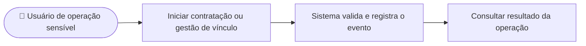

# CDU-15 - Registrar auditoria de operações sensíveis

## Atores

- Aluno
- Instituição de Ensino

## Pré-condições

- O usuário está autenticado.
- Uma operação sensível coberta pela política de auditoria está sendo executada.
- O sistema consegue identificar o responsável e a operação associada.

## Fluxo principal

1. O usuário inicia uma contratação, pagamento, inclusão ou remoção de vínculo institucional.
2. O sistema executa as validações de acesso e de negócio.
3. O sistema registra ator, ação, resultado, recurso afetado e data/hora, sem incluir dados sensíveis desnecessários.
4. O sistema associa o evento à operação para permitir rastreabilidade.
5. O sistema conclui a operação e apresenta o resultado ao usuário.

## Fluxos alternativos e exceções

- **A1 — Operação recusada:** quando coberto pela política, o sistema registra o resultado como recusado, distinguindo-o de uma alteração concluída.
- **A2 — Operação repetida:** a chave de idempotência evita eventos de sucesso duplicados para a mesma contratação.
- **E1 — Falha ao registrar auditoria:** a operação coberta falha na mesma transação, sem confirmar uma contratação ou alteração de vínculo sem o evento correspondente.
- **A3 — Ação automatizada:** o sistema identifica a origem técnica e preserva o ator que iniciou a operação quando disponível.

## Pós-condições

- **Sucesso:** evento de auditoria associado à operação sensível.
- Consulta, proteção e retenção seguem perfis autorizados e política definida.

## Situação atual no sistema

O backend registra aprovações e recusas de contratação/pagamento simulados e inclusões/remoções de vínculos na mesma transação da operação. Os eventos incluem ator, contrato, resultado, horário e identificadores do vínculo/aluno, sem senha ou dados de cartão. A migration V8 impede UPDATE e DELETE dos eventos por comandos comuns; a V10 permite DELETE quando a transação define o sinalizador de limpeza controlada. A API que define esse sinalizador está disponível somente em desenvolvimento ou homologação. Administradores do banco ainda precisam de controles operacionais próprios. Não há visualizador. O prazo de retenção do RNF09 permanece pendente de definição da equipe.

## Diagrama de ações do ator

