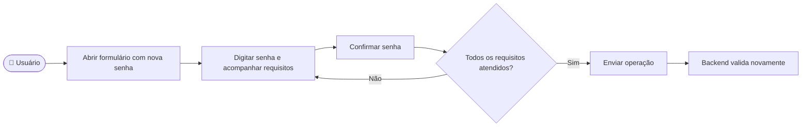

# CDU-16 - Validar requisitos de senha

## Atores

- Visitante que cria uma conta de Aluno ou Instituição de Ensino
- Aluno ou Instituição de Ensino que altera a própria senha
- Usuário que redefine a senha após solicitar recuperação
- Instituição de Ensino que cadastra um novo aluno
- Sistema IVIS

## Pré-condições

- O usuário está em um formulário de criação, alteração ou redefinição de senha.
- Na alteração de senha, a conta está autenticada; na redefinição, o usuário possui um token de recuperação válido.

## Fluxo principal

1. O sistema apresenta os requisitos da nova senha junto ao campo: pelo menos oito caracteres, uma letra maiúscula, uma minúscula, um número e um caractere especial.
2. O usuário digita a senha. A interface marca em verde cada requisito assim que ele é atendido e retira a marcação se o usuário remover o caractere correspondente.
3. O usuário confirma a senha no segundo campo.
4. Ao enviar, o frontend exige os cinco requisitos e a igualdade entre senha e confirmação. O campo aceita no máximo 128 caracteres.
5. O backend valida novamente a política de 8 a 128 caracteres antes de criar ou alterar a credencial.
6. Se as demais regras do formulário forem satisfeitas, a operação de cadastro, alteração ou redefinição prossegue no caso de uso que a iniciou.

## Fluxos alternativos e exceções

- **A1 — Requisito não atendido:** o sistema informa que a senha ainda não atende aos requisitos e não envia a operação.
- **A2 — Senhas divergentes:** o sistema informa a divergência e não envia a operação.
- **A3 — Senha rejeitada pelo backend:** o backend responde com erro de validação e não altera a credencial.
- **A4 — Indicador deixa de ser atendido:** ao apagar parte da senha, a indicação correspondente deixa de aparecer em verde.

## Pós-condições

- **Validação aprovada:** a senha pode seguir para a operação solicitada; o armazenamento em hash e as regras de sessão pertencem aos CDUs de cadastro, alteração ou recuperação.
- **Validação rejeitada:** a operação não cria nem altera uma credencial.

## Situação atual no sistema

Implementado nas telas de cadastro de conta, alteração de senha, redefinição de senha e cadastro institucional de aluno. O componente compartilhado exibe os cinco indicadores, e o backend aplica a mesma política nos contratos de entrada. O spec Cypress cobre a atualização visual no cadastro; testes unitários do frontend cobrem a validação e o bloqueio de envio nas demais telas, enquanto os testes do backend verificam sua rejeição no servidor.

## Diagrama de ações do ator

