# CDU-17 - Jornada feliz do aluno pagante

Este caso de uso encadeia operações dos CDU-01, CDU-02, CDU-03, CDU-06, CDU-07, CDU-08, CDU-09, CDU-10, CDU-12 e CDU-14. Ele documenta a jornada ponta a ponta exercitada por [`perfil_aluno.cy.js`](../../cypress/e2e/caminho_feliz/perfil_aluno.cy.js), sem criar um requisito funcional novo.

## Atores

- Aluno

## Pré-condições

- O aluno ainda não possui conta com o e-mail e CPF usados no cadastro.
- Há uma oferta individual ativa e o simulador acadêmico de pagamento está disponível.
- Frontend, backend, banco de dados e API de IA estão disponíveis para a jornada completa.

## Fluxo principal

1. O visitante abre o cadastro de aluno, informa nome, e-mail, CPF, telefone, endereço e senha, confirma a senha e cria a conta (CDU-01 e CDU-16).
2. O sistema confirma o cadastro e inicia a sessão. O aluno segue para as ofertas de planos (CDU-09).
3. O aluno seleciona a oferta individual e abre o checkout (CDU-10).
4. O aluno usa o cartão fictício de aprovação e envia o pagamento simulado. O backend aprova a simulação, ativa o contrato individual e a interface informa que não houve cobrança real (CDU-12).
5. O aluno entra em sua área com acesso ativo (CDU-14).
6. O aluno abre os dados da conta, altera telefone e endereço e salva as mudanças (CDU-02).
7. O aluno cadastra uma habilidade com nome, categoria e nível (CDU-03).
8. O aluno cadastra uma vaga de interesse com título, empresa, nível e requisitos (CDU-06).
9. O aluno abre Treinamentos, escolhe o modo por vaga e seleciona a vaga cadastrada. O sistema apresenta a vaga como contexto do treino (CDU-07).
10. O aluno inicia a entrevista com IA, responde às três perguntas e finaliza o treino. O sistema apresenta o feedback com a vaga e uma nota (CDU-07).
11. O aluno abre o histórico, encontra o treino concluído com contexto e nota e reabre seu feedback (CDU-08).

## Interrupções e exceções

- Cadastro inválido ou e-mail/CPF já usado: o fluxo para no CDU-01; a política de senha segue CDU-16.
- Oferta indisponível, contratação rejeitada ou pagamento simulado recusado: não há acesso ao treino; aplicam-se CDU-09, CDU-10 e CDU-12.
- Erro ao salvar dados, habilidade ou vaga: a jornada só prossegue após a respectiva operação ser concluída; aplicam-se CDU-02, CDU-03 e CDU-06.
- Acesso sem contrato vigente ou falha da IA durante o treino: aplicam-se CDU-14 e CDU-07. O histórico do CDU-08 apresenta apenas treinos concluídos e avaliados.

## Pós-condições

- Conta de aluno e contrato individual ativo, resultante de pagamento **simulado**.
- Dados de contato atualizados, habilidade e vaga cadastradas.
- Treino por vaga concluído, avaliação armazenada e feedback acessível pelo histórico do próprio aluno.

## Situação atual e cobertura

O fluxo é exercitado pelo Cypress contra os serviços e o banco reais, sem interceptações que substituam respostas. O teste verifica os resultados visíveis de cada etapa, incluindo a nota e a reabertura do feedback; não verifica diretamente todos os registros de banco ou eventos de auditoria. A contratação continua acadêmica, sem cobrança real. A jornada depende de acesso ao provedor de IA configurado e dos dados de teste reservados para a suíte.

## Diagrama de ações do ator

```mermaid
flowchart LR
    aluno(["🧍 Aluno"])
    aluno --> cadastro["Criar conta"]
    cadastro --> plano["Contratar plano individual com pagamento simulado"]
    plano --> conta["Atualizar telefone e endereço"]
    conta --> habilidade["Cadastrar habilidade"]
    habilidade --> vaga["Cadastrar vaga"]
    vaga --> treino["Responder a três perguntas da IA"]
    treino --> feedback["Consultar feedback"]
    feedback --> historico["Reabrir feedback pelo histórico"]
```

