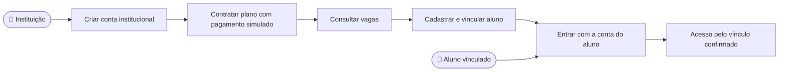

# CDU-18 - Jornada feliz da instituição e do aluno vinculado

Este caso de uso encadeia operações dos CDU-01, CDU-09, CDU-11, CDU-12, CDU-13 e CDU-14. Ele documenta a jornada ponta a ponta exercitada por [`perfil_instituicao.cy.js`](../../cypress/e2e/caminho_feliz/perfil_instituicao.cy.js), sem criar um requisito funcional novo.

## Atores

- Instituição de Ensino
- Aluno

## Pré-condições

- A instituição ainda não possui conta com o e-mail e CNPJ usados no cadastro.
- Há uma oferta institucional ativa, com capacidade disponível após a contratação, e o simulador acadêmico de pagamento está disponível.
- O e-mail e CPF do novo aluno ainda não pertencem a outra conta.
- Frontend, backend e banco de dados estão disponíveis.

## Fluxo principal

1. O representante abre o cadastro de instituição, informa os dados exigidos, define e confirma a senha e cria a conta (CDU-01 e CDU-16).
2. O sistema confirma o cadastro e inicia a sessão. A instituição segue para a lista de ofertas (CDU-09).
3. A instituição escolhe a oferta institucional e abre o checkout (CDU-11).
4. A instituição usa o cartão fictício de aprovação e envia o pagamento simulado. O backend ativa o contrato, e a interface informa que não houve cobrança real (CDU-12).
5. A instituição abre sua área e consulta a quantidade de vagas disponíveis do contrato (CDU-13).
6. A instituição cadastra um novo aluno e o vincula ao contrato. O sistema apresenta o aluno na lista e reduz a quantidade de vagas livres. Após recarregar a página, o vínculo continua visível (CDU-13 e CDU-16).
7. A instituição encerra a sessão. O aluno entra com a conta criada pela instituição e acessa a área de aluno por meio do vínculo vigente (CDU-01 e CDU-14).

## Fluxo complementar — Encerrar o vínculo

1. Depois de confirmar o acesso do aluno, ele encerra a sessão.
2. A instituição entra novamente e remove o vínculo do aluno (CDU-01 e CDU-13).
3. Após recarregar a página, o aluno deixa de constar da lista e a vaga volta a ficar disponível.

## Interrupções e exceções

- Cadastro da instituição ou do aluno inválido ou duplicado: aplicam-se CDU-01, CDU-13 e CDU-16.
- Oferta indisponível, contrato já vigente ou pagamento simulado recusado: não há vagas liberadas; aplicam-se CDU-11 e CDU-12.
- Contrato sem vaga, aluno já vinculado ou tentativa de gerir vínculo de outra instituição: a inclusão ou remoção é rejeitada conforme CDU-13 e CDU-14.

## Pós-condições

- Conta institucional e contrato ativo, resultante de pagamento **simulado**.
- Ao final do fluxo principal, o aluno está vinculado, ocupa uma vaga e consegue entrar na área de aluno.
- Após o fluxo complementar, o cadastro do aluno permanece, o vínculo institucional está encerrado e a vaga foi liberada.
- O acesso concedido pelo vínculo deixa de valer após a remoção.

## Situação atual e cobertura

O fluxo principal e o complementar são exercitados pelo Cypress contra frontend, backend e banco reais, sem interceptações que substituam respostas. A oferta institucional atual define uma capacidade fixa de 10 vagas; a interface não permite escolher outra quantidade, lacuna do RF14 descrita no CDU-11. O teste verifica o vínculo antes e depois de recarregar a página, o login do aluno e, depois, a remoção e a capacidade restaurada. Ele não faz um novo login do aluno após a remoção para verificar a perda de acesso nem consulta diretamente os registros de auditoria; essa última verificação pertence ao CDU-15.

## Diagrama de ações dos atores

