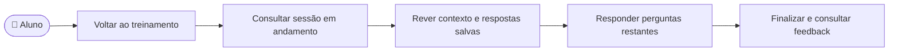

# CDU-19 - Retomar treinamento em andamento

## Atores

- Aluno com acesso ativo
- Sistema IVIS
- Serviço de IA, acessado pelo backend quando o aluno continuar a entrevista

## Pré-condições

- O aluno possui um plano individual ou vínculo institucional vigente (CDU-14).
- Existe uma sessão de treinamento do próprio aluno em situação `EM_ANDAMENTO`, iniciada conforme CDU-07.
- O aluno interrompeu a navegação, recarregou a página ou iniciou uma nova sessão de acesso antes de concluir o treino.

## Fluxo principal

1. O aluno volta ao IVIS e abre a área de treinamento.
2. O sistema consulta a sessão em andamento da conta autenticada no backend.
3. O backend devolve o contexto, as perguntas já geradas e as respostas registradas, mantendo a ordem e o progresso.
4. O sistema apresenta a entrevista no ponto em que parou, com a pergunta ainda sem resposta. O aluno confere as interações anteriores.
5. O aluno responde às perguntas restantes. O backend registra cada resposta e solicita a próxima pergunta à IA conforme CDU-07.
6. Após responder às três perguntas, o aluno finaliza a entrevista e consulta o feedback conforme CDU-07 e CDU-08.

## Fluxos alternativos e exceções

- **A1 — Nenhum treino em andamento:** o backend retorna ausência de sessão; a tela apresenta a preparação de um novo treino.
- **A2 — Acesso expirado ou vínculo removido:** a consulta e a continuação são negadas até que o aluno tenha acesso vigente, conforme CDU-14.
- **A3 — Outra conta tenta recuperar o treino:** o backend limita a consulta ao aluno autenticado e não expõe a sessão de outro aluno.
- **A4 — Falha da IA ao continuar ou concluir:** o sistema preserva a sessão e a resposta pendente para nova tentativa, conforme CDU-07.
- **A5 — Aluno decide cancelar:** o treino passa para `CANCELADO` e não entra no histórico de concluídos, conforme CDU-07.
- **E1 — Falha ao consultar a sessão:** o sistema não inventa progresso e a retomada depende de nova consulta.

## Pós-condições

- **Retomada sem conclusão:** a sessão permanece em andamento, com as respostas registradas preservadas.
- **Conclusão:** avaliação e treino concluído ficam disponíveis no histórico do aluno.
- A retomada não cria outra sessão para substituir a existente.

## Situação atual no sistema

Implementado no frontend e no backend. A API `GET /v1/treinos/em-andamento` recupera a sessão persistida da conta autenticada; `POST /v1/treinos` também reaproveita uma sessão ativa. A interface carrega o perfil e a sessão ao restabelecer o acesso, incluindo após recarregar a página. O cenário de recarga está no teste Cypress do CDU-07; os testes de integração do backend verificam a persistência e a retomada em nova sessão HTTP. Os dois caminhos felizes CDU-17 e CDU-18 não exercitam esta interrupção.

## Relação com requisitos e testes

- **RF07, RF09:** continuidade do treino processado por IA e preservação do registro das perguntas e respostas.
- **RF08, RF10:** avaliação e consulta do resultado após a conclusão, conforme CDU-07 e CDU-08.
- **Cobertura:** [`CDU-07-realizar-treinamento.cy.js`](../../cypress/e2e/cdu/CDU-07-realizar-treinamento.cy.js) verifica a apresentação após recarga com resposta de API simulada; [`FluxosAplicacaoIntegracaoTest.java`](../../backend/src/test/java/br/ivis/FluxosAplicacaoIntegracaoTest.java) verifica o estado persistido no backend.

## Diagrama de ações do ator

