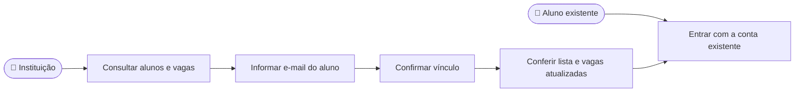

# CDU-20 - Vincular aluno com conta existente

## Atores

- Instituição de Ensino
- Aluno

## Pré-condições

- A instituição está autenticada e possui contrato institucional ativo com vaga livre (CDU-11 e CDU-13).
- O aluno já possui conta IVIS ativa e perfil de aluno, com e-mail conhecido pela instituição.
- O aluno não possui outro vínculo institucional ativo.

## Fluxo principal

1. A instituição abre a gestão de alunos e consulta a lista de vínculos e as vagas disponíveis (CDU-13).
2. A instituição informa o e-mail da conta existente no formulário **Vincular aluno**.
3. O sistema localiza uma conta ativa de aluno pelo e-mail e verifica o contrato da instituição, a vaga livre e a ausência de outro vínculo ativo.
4. O backend cria o vínculo, associa a instituição ao perfil do aluno e registra o evento de auditoria na mesma transação (CDU-15).
5. A interface apresenta o aluno na lista e atualiza a capacidade utilizada e disponível.
6. Enquanto o vínculo e o contrato estiverem vigentes, o aluno entra com suas credenciais existentes e obtém acesso às funções de aluno permitidas pela modalidade institucional (CDU-01 e CDU-14).

## Fluxos alternativos e exceções

- **A1 — E-mail não corresponde a conta ativa de aluno:** o sistema não cria vínculo e informa que não foi possível localizar o aluno elegível.
- **A2 — Aluno já possui vínculo institucional ativo:** o sistema rejeita um segundo vínculo, inclusive com outra instituição.
- **A3 — Contrato inexistente, expirado, de outra instituição ou sem vaga:** o sistema rejeita a inclusão sem exceder a capacidade.
- **A4 — Inclusões simultâneas disputam a última vaga:** o backend valida a capacidade durante a gravação; apenas uma operação pode ocupá-la.
- **A5 — Instituição remove o vínculo depois:** a conta do aluno permanece; o histórico do vínculo é preservado e a vaga é liberada, conforme CDU-13.
- **E1 — Falha ao salvar:** o vínculo e a atualização do perfil não são apresentados como concluídos.

## Pós-condições

- Um vínculo institucional ativo ocupa uma vaga do contrato da instituição autenticada.
- A conta e a senha preexistentes do aluno são preservadas; o acesso passa a depender do vínculo e do contrato vigentes.
- A criação do vínculo é registrada para auditoria (CDU-15).

## Situação atual no sistema

Implementado no frontend e no backend. O formulário institucional aceita o e-mail de uma conta existente e chama `POST /v1/instituicao/vinculos/por-email`. O backend verifica o perfil, o contrato e a capacidade e persiste vínculo, associação institucional e auditoria. O teste Cypress do CDU-20 cobre o envio, o resultado visível e a rejeição de vínculo duplicado com API simulada. O caminho feliz CDU-18 usa a outra opção, cadastrar um novo aluno e vinculá-lo, portanto não cobre esta entrada.

## Relação com requisitos e testes

- **RF16, RF18:** vincular um aluno dentro da capacidade contratada e atualizar as vagas disponíveis.
- **RF17:** acesso do aluno conforme o vínculo institucional vigente.
- **RF20:** auditoria da criação do vínculo.
- **Cobertura:** [`CDU-20-vincular-aluno-existente.cy.js`](../../cypress/e2e/cdu/CDU-20-vincular-aluno-existente.cy.js) verifica a interface; [`VinculoInstitucionalServiceTest.java`](../../backend/src/test/java/br/ivis/identity/VinculoInstitucionalServiceTest.java) verifica regras do serviço.

## Diagrama de ações dos atores

