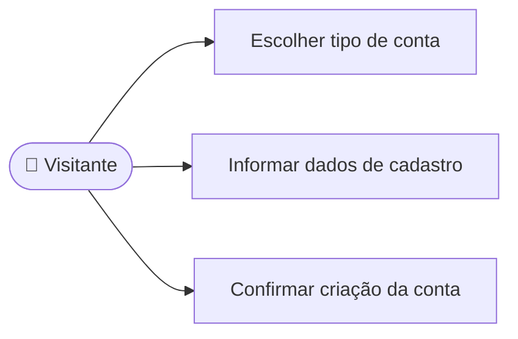

# UC01 — Criar conta

**RF:** RF01  
**Ator principal:** Visitante (Aluno ou Instituição de Ensino)  
**Atores secundários:** Serviço de e-mail, se confirmação for adotada  
**Objetivo:** Criar uma identidade IVIS adequada ao tipo de usuário.  
**Pré-condições:** O visitante não está autenticado.

## Fluxo principal

1. O visitante escolhe criar conta e informa se é Aluno ou Instituição de Ensino.
2. O sistema apresenta os campos correspondentes ao perfil.
3. O visitante informa os dados obrigatórios e confirma.
4. O sistema valida formato, obrigatoriedade e unicidade dos identificadores (por exemplo, e-mail; CNPJ para instituição, se exigido).
5. O sistema armazena a conta com credencial protegida e o tipo de perfil.
6. O sistema confirma o cadastro e encaminha o usuário para autenticação ou inicia sessão, conforme política definida.

## Alternativas e exceções

- **A1 — Dados inválidos:** o sistema identifica os campos inválidos, preserva os demais valores e não cria a conta.
- **A2 — E-mail já utilizado:** o sistema informa que a conta já existe e oferece o acesso ao login/recuperação, sem revelar dados de outra pessoa.
- **A3 — Confirmação de e-mail necessária:** o sistema envia instruções de confirmação e mantém a conta pendente até a validação. A exigência e o prazo ainda precisam ser definidos.
- **E1 — Falha de persistência ou envio:** não sinalizar criação concluída quando a operação necessária falhar; informar que é possível tentar novamente.

**Pós-condições de sucesso:** Conta criada com tipo de usuário definido; credencial protegida segundo as decisões de segurança do backend.  
**Implementação observada:** Não há tela, rota ou serviço de cadastro no frontend atual.

## Diagrama de ações do ator

