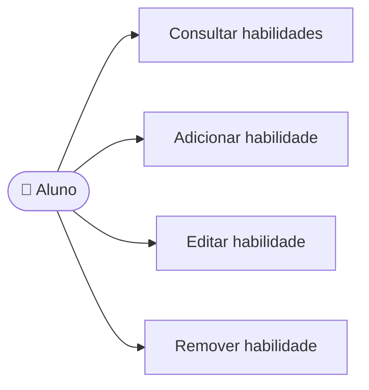

# UC04 — Gerenciar habilidades

**RF:** RF03 *(não listado no PDF; mantido do escopo e já iniciado no frontend)*  
**Ator principal:** Aluno  
**Pré-condições:** Aluno autenticado; perfil de habilidades acessível.

## Fluxo principal

1. O aluno abre Minhas Habilidades e o sistema lista as habilidades cadastradas.
2. O aluno escolhe adicionar, editar ou remover uma habilidade.
3. Para adicionar/editar, informa nome, categoria e nível de domínio; para remover, seleciona o item e confirma.
4. O sistema valida os campos e evita duplicatas segundo a regra de normalização definida.
5. O sistema persiste a alteração e atualiza a lista.

## Alternativas e exceções

- **A1 — Campos inválidos:** indicar o que corrigir sem descartar os dados do formulário.
- **A2 — Habilidade duplicada:** informar a duplicidade e permitir editar a existente.
- **A3 — Confirmação de remoção cancelada:** manter o registro.
- **E1 — Falha ao persistir:** manter a lista anterior e avisar que a alteração não foi salva.

**Pós-condições:** Perfil atualizado para uso em novos treinos; treinos anteriores preservam seu contexto histórico.  
**Implementação observada:** Tela e operações locais de adicionar/editar/remover existem; os dados são demonstrativos e mantidos em memória, sem autenticação ou persistência no servidor.

## Diagrama de ações do ator

