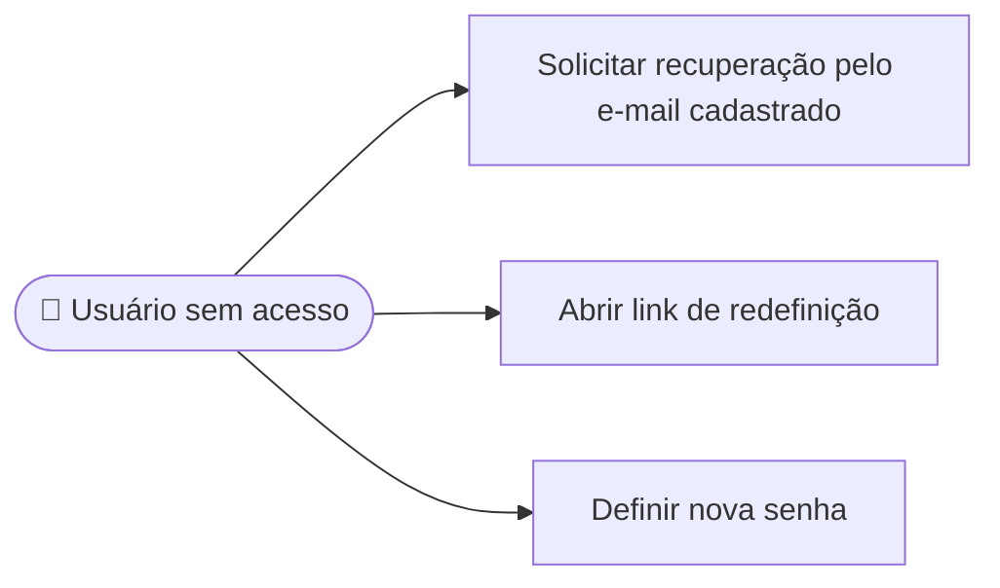

# UC05 — Recuperar acesso

**RF:** RF04  
**Ator principal:** Aluno ou Instituição de Ensino sem acesso à conta  
**Ator secundário:** Mailpit no ambiente de apresentação (captura SMTP); futuro provedor de envio real, se adotado  
**Pré-condições:** Usuário não autenticado; possui acesso ao e-mail associado à conta.

## Fluxo principal

1. O usuário escolhe “Esqueci minha senha” e informa o e-mail cadastrado.
2. O sistema responde com mensagem neutra, sem confirmar se o endereço tem conta.
3. Para uma conta elegível, o sistema gera um token de uso único, com validade limitada, e envia o link de redefinição por SMTP. No ambiente de apresentação, a mensagem fica capturada no Mailpit e não é enviada à caixa postal real.
4. O usuário abre o link e informa uma nova senha válida e sua confirmação.
5. O sistema valida o token, atualiza o hash da senha, invalida o token e confirma a redefinição.
6. O usuário faz login com a nova senha (UC02).

## Alternativas e exceções

- **A1 — E-mail sem conta:** manter resposta indistinguível da resposta de sucesso para reduzir enumeração de contas.
- **A2 — Link expirado ou já utilizado:** rejeitar a redefinição e oferecer solicitar novo link.
- **A3 — Senha inválida ou confirmação divergente:** apontar os requisitos sem consumir o token válido.
- **E1 — Falha de envio:** informar que não foi possível concluir e permitir nova solicitação, aplicando limites contra abuso.

**Pós-condições:** Credencial atualizada com hash; token invalidado. Política de validade, limitação e revogação de sessões precisa ser definida.  
**Implementação observada:** Não há recuperação de senha no código atual.

## Diagrama de ações do ator

