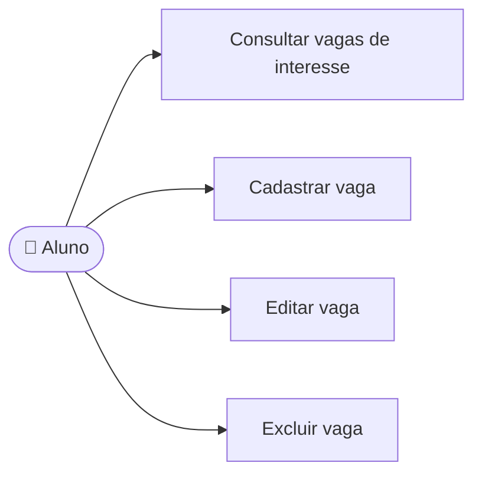

# UC07 — Gerenciar vaga de interesse

**RF:** RF06 *(não listado no PDF; mantido do escopo e já iniciado no frontend)*  
**Ator principal:** Aluno  
**Pré-condições:** Aluno autenticado; para editar/remover, vaga pertencente ao aluno.

## Fluxo principal

1. O aluno abre Vagas de Interesse e consulta suas vagas.
2. O aluno escolhe cadastrar, editar ou excluir uma vaga.
3. Informa/atualiza cargo, organização (se disponível), nível e requisitos/habilidades; ou confirma a exclusão.
4. O sistema valida os dados e a propriedade da vaga.
5. O sistema persiste a operação e atualiza a lista.

## Alternativas e exceções

- **A1 — Dados inválidos:** destacar os campos que precisam de correção.
- **A2 — Vaga usada por treino em andamento:** bloquear edição/exclusão que altere o contexto daquele treino; orientar o aluno.
- **A3 — Exclusão cancelada:** preservar a vaga.
- **E1 — Falha de gravação:** informar que a alteração não foi concluída.

**Pós-condições:** Vaga criada/alterada/removida; dados de contexto de treinos já iniciados não mudam retroativamente.  
**Implementação observada:** CRUD local, busca e bloqueio de exclusão da vaga atualmente selecionada para o treino existem. Não há persistência, autenticação nem proteção completa de edição.

## Diagrama de ações do ator

