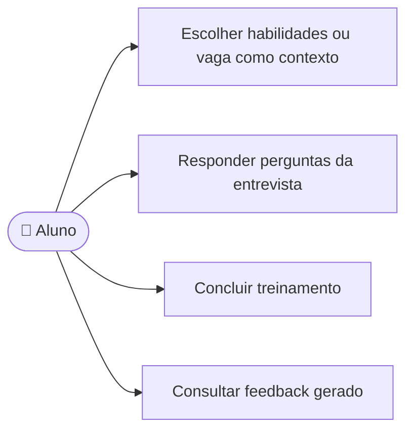

# UC08 — Realizar treinamento e receber feedback

**RF:** RF07, RF08 e RF09 *(não listados no PDF; fluxo já iniciado no frontend como demonstração)*  
**Ator principal:** Aluno  
**Atores secundários:** Serviço de IA  
**Pré-condições:** Aluno autenticado com acesso de plano válido (UC15); possui habilidades (UC04) ou vaga (UC07) para contextualizar o treino.

## Fluxo principal

1. O aluno escolhe treinar pelo perfil de habilidades ou por uma vaga.
2. O sistema valida acesso e contexto, cria um treino em andamento e solicita a primeira pergunta à IA.
3. O sistema apresenta cada pergunta; o aluno escreve e envia uma resposta.
4. O sistema associa a resposta ao treino e solicita à IA a próxima pergunta, repetindo até a conclusão definida.
5. Ao concluir, o sistema envia o conjunto de perguntas/respostas à IA para avaliação.
6. O sistema apresenta o feedback (pontos fortes, melhorias e resultado, conforme contrato da IA).
7. O sistema persiste treino, contexto, respostas, datas e feedback no histórico do aluno (RF09).

## Alternativas e exceções

- **A1 — Sem plano válido:** não iniciar o treino; encaminhar para consultar/obter acesso.
- **A2 — Sem contexto:** explicar como cadastrar habilidades ou vaga e não criar sessão vazia.
- **A3 — Encerramento antecipado:** confirmar; se aceito, registrar estado de encerramento e solicitar feedback apenas se houver dados suficientes, conforme regra de negócio a definir.
- **A4 — Falha temporária da IA:** preservar respostas já registradas, informar a falha e permitir retomar/repetir sem duplicar a resposta.
- **A5 — Feedback indisponível:** manter o treino concluído pendente de avaliação e permitir nova tentativa.
- **E1 — Falha ao persistir:** não afirmar que o histórico foi salvo; preservar estado recuperável se tecnicamente possível.

**Pós-condições:** Treino concluído com resultado persistido e disponível no UC09; ou estado explícito de interrupção/pendência.  
**Implementação observada:** Há entrevista local com perguntas fixas, respostas em memória e feedback com nota/texto demonstrativos. Não há chamada de IA, autenticação, plano, persistência durável nem garantia de salvamento.

## Diagrama de ações do ator

