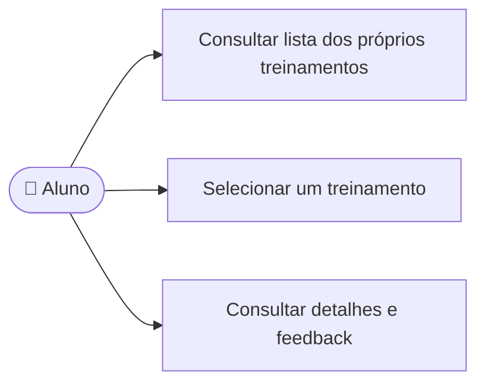

# UC09 — Consultar histórico de treinos

**RF:** RF10 *(não listado no PDF; consulta iniciada no frontend)*  
**Ator principal:** Aluno  
**Pré-condições:** Aluno autenticado; sistema identifica o histórico pertencente à conta.

## Fluxo principal

1. O aluno abre Histórico.
2. O sistema lista os treinos do próprio aluno com data, contexto (vaga/habilidades) e resultado.
3. O aluno seleciona um treino.
4. O sistema apresenta detalhes e feedback daquele registro.

## Alternativas e exceções

- **A1 — Histórico vazio:** informar que ainda não há treinos e oferecer iniciar um (UC08).
- **A2 — Registro sem feedback:** exibir o estado pendente/interrompido e os dados disponíveis.
- **E1 — Falha na consulta:** informar indisponibilidade sem mostrar dados de outro usuário.

**Pós-condições:** Nenhuma alteração. A autorização deve isolar os registros por aluno.  
**Implementação observada:** Lista e navegação para feedback existem com dados locais de demonstração; estatísticas são fixas e não representam cálculo confiável; não há isolamento entre contas por inexistir autenticação.

## Diagrama de ações do ator

