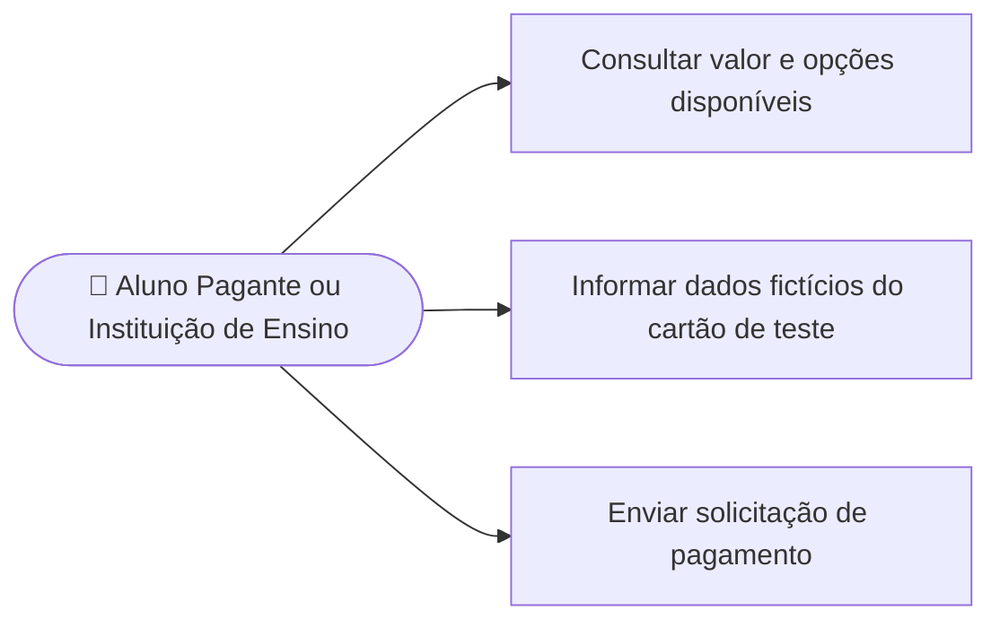

# UC13 — Efetuar pagamento

**RF:** RF15; relacionado a UC11 e UC12  
**Ator principal:** Aluno Pagante ou Instituição de Ensino  
**Ator secundário:** Simulador de pagamento do backend (apresentação); gateway externo somente se vier a ser adotado  
**Pré-condições:** Contratação iniciada; valor e oferta definidos; usuário autenticado e elegível.

## Fluxo principal

1. O sistema apresenta o valor e as opções de pagamento suportadas pelo gateway.
2. O usuário escolhe uma opção e fornece os dados no componente seguro do gateway ou em seu ambiente hospedado.
3. No modo de apresentação, o backend valida o cartão fictício padrão e determina o resultado simulado; o navegador não escolhe nem envia como confiável o resultado ou o modo.
4. O backend registra a tentativa como simulada, sem cobrança, sem armazenar PAN/CVV, e devolve o resultado ao caso de contratação.
5. Se futuramente houver gateway real, o backend encaminhará os dados pelo mecanismo seguro do provedor e confirmará o resultado por canal confiável (por exemplo, notificação assinada validada ou consulta).
6. O plano só é ativado após decisão aprovada pelo backend; no modo de apresentação o estado deve permanecer explicitamente marcado como simulado.

## Alternativas e exceções

- **A1 — Cartão fictício inválido ou cenário recusado:** não ativar o plano; apresentar motivo de demonstração e permitir nova tentativa.
- **A2 — Pagamento pendente:** informar que a confirmação está em processamento; não duplicar pedido.
- **A3 — Falha de comunicação:** manter transação em estado verificável e permitir consultar/reconciliar antes de uma nova cobrança.
- **A4 — Notificação inválida ou repetida:** rejeitar assinatura inválida e processar evento repetido de forma idempotente.

**Pós-condições:** Transação registrada com identificador, estado e referência ao contrato; ativação delegada ao caso de contratação após confirmação.  
**Restrições:** O cartão de teste é fictício; não persistir PAN/CVV nem encaminhar seus dados ao gateway real no modo de apresentação (ver ADR-0008).  
**Implementação observada:** Simulador ainda não implementado. Provedor e métodos para eventual cobrança real ainda não foram definidos. A interface precisa informar que a compra apresentada é simulada.

## Diagrama de ações do ator

