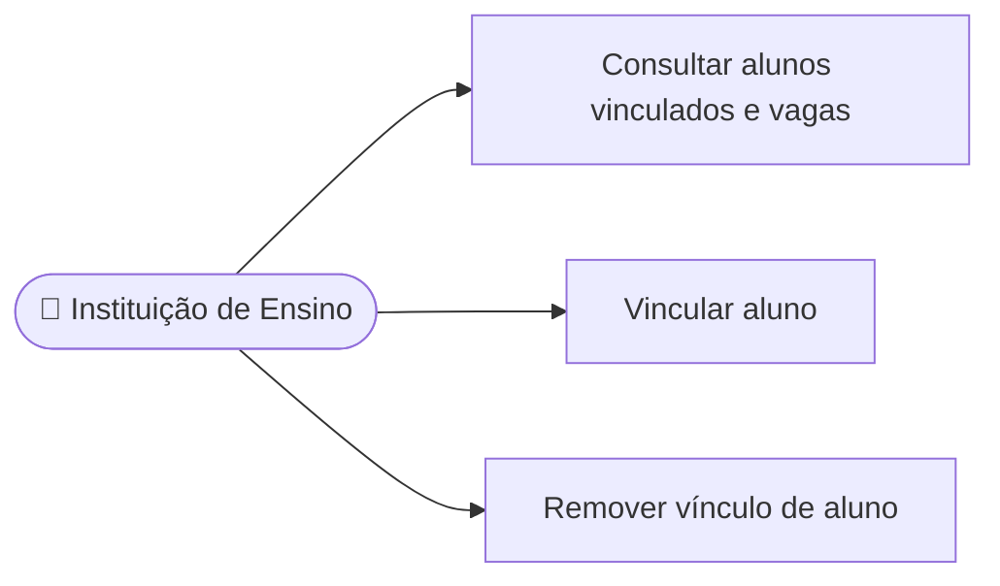

# UC14 — Gerenciar alunos e vagas vinculadas

**RF:** RF16 e RF18  
**Ator principal:** Instituição de Ensino  
**Pré-condições:** Instituição autenticada; plano institucional ativo; ações restritas aos próprios vínculos (RNF07).

## Fluxo principal

1. A instituição abre Alunos Vinculados.
2. O sistema exibe alunos associados e total contratado, utilizado e disponível.
3. A instituição solicita vincular um aluno por identificador definido pelo produto (por exemplo, e-mail) ou remover um vínculo existente.
4. Para vincular, o sistema valida a identidade do aluno, a elegibilidade, a ausência de vínculo incompatível e a existência de vaga livre.
5. Para remover, o sistema confirma a seleção e aplica a regra de encerramento/revogação de acesso do aluno.
6. O sistema persiste a alteração, atualiza os totais e registra a ação no UC16.

## Alternativas e exceções

- **A1 — Sem vagas disponíveis:** rejeitar o vínculo e informar total contratado/utilizado; oferecer consultar contratação (UC12).
- **A2 — Aluno já vinculado à mesma instituição:** informar o vínculo existente sem consumir outra vaga.
- **A3 — Aluno vinculado a outra instituição ou pagante:** aplicar regra de coexistência definida; não transferir automaticamente.
- **A4 — Remoção cancelada:** manter vínculo e contagem.
- **A5 — Plano inativo/expirado:** impedir novas inclusões e aplicar política de acesso vigente, ainda a definir.
- **E1 — Alteração concorrente da última vaga:** validar disponibilidade na operação de gravação; não ultrapassar capacidade.

**Pós-condições:** Vínculos e contagens consistentes; acesso do aluno ajustado segundo UC15; auditoria gravada.  
**Implementação observada:** Não há painel institucional ou vínculo de alunos no frontend. Critérios de transferência, remoção, expiração e reuso da vaga precisam de decisão.

## Diagrama de ações do ator

