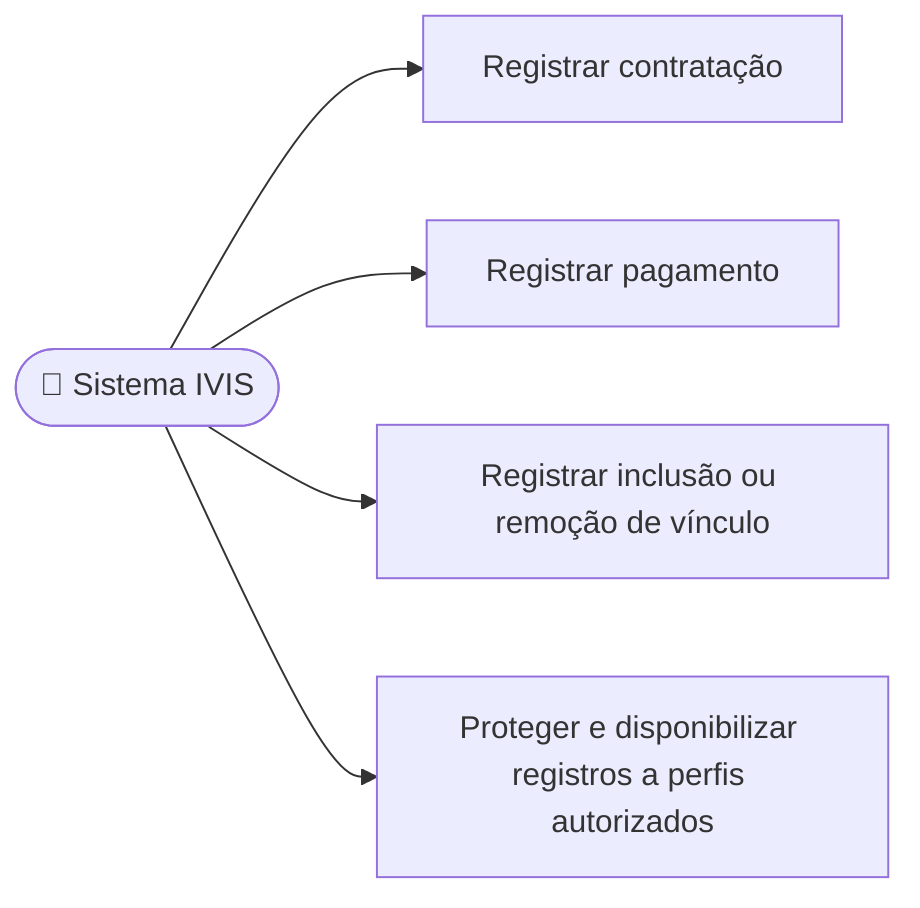

# UC16 — Registrar ações sensíveis de auditoria

**RF:** RF20; suporte aos casos UC11–UC14  
**Ator principal:** Sistema IVIS (caso de uso interno disparado por operação sensível)  
**Atores relacionados:** Usuário autenticado e serviços responsáveis pela operação  
**Pré-condições:** Operação sensível identificada pela política de auditoria; identidade do responsável ou origem técnica disponível.

## Fluxo principal

1. Uma contratação, pagamento ou inclusão/remoção de vínculo solicita o registro de auditoria.
2. O sistema registra tipo da ação, resultado, identificador do responsável, data/hora e referência à entidade afetada, minimizando dados pessoais.
3. O sistema protege o registro contra alteração por usuários comuns e restringe sua consulta a perfis autorizados.
4. O sistema associa o registro à operação para permitir rastreabilidade.

## Alternativas e exceções

- **A1 — Operação rejeitada:** registrar resultado recusado quando a política de auditoria assim exigir, distinguindo tentativas de alterações efetivadas.
- **E1 — Falha ao registrar:** não declarar a operação concluída se a política exigir auditoria transacional; caso contrário, gerar alerta operacional e retentativa segura. A escolha deve ser definida.
- **E2 — Ação automatizada:** registrar identidade do serviço e, quando disponível, o ator que originou a operação.

**Pós-condições:** Evento rastreável, com integridade e retenção segundo RNF09. Prazo mínimo e perfis de consulta pendem de definição jurídica/operacional.  
**Implementação observada:** Não há backend, trilha de auditoria ou visualizador de logs no repositório atual.

## Diagrama de ações do ator

