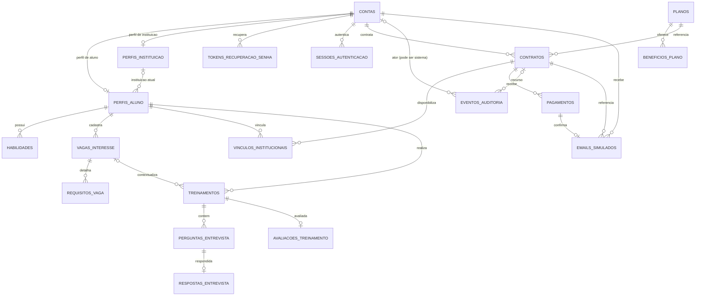

# Modelo relacional do IVIS — proposta inicial

Este documento descreve o modelo relacional do IVIS e suas regras de relacionamento. É o detalhamento associado ao [ADR-0010](../adr/ADR-0010-modelagem-relacional-do-banco.md). O schema parte das migrações V2–V6 e é padronizado pela [`V7__padronizar_objetos_e_perfis.sql`](../../../backend/src/main/resources/db/migration/V7__padronizar_objetos_e_perfis.sql), que preserva os UUIDs existentes. O **backend** é o único módulo que lê e grava os dados de negócio.

## Modelo relacional implementado

A primeira versão do schema cria as tabelas relacionais centrais do produto. As migrações usam UUIDs, timestamps com fuso, chaves estrangeiras, índices e restrições estruturais:

- **Contas e segurança:** `contas`, `perfis_aluno`, `perfis_instituicao`, `tokens_recuperacao_senha` e `sessoes_autenticacao`.
- **Perfil e preparação:** `habilidades`, `vagas_interesse` e `requisitos_vaga`.
- **Treinamentos e resultados:** `treinamentos`, `perguntas_entrevista`, `respostas_entrevista`, `avaliacoes_treinamento` e `itens_feedback_treinamento`.
- **Planos e cobrança:** `planos`, `beneficios_plano`, `contratos`, `pagamentos` e `emails_simulados`.
- **Gestão institucional e rastreabilidade:** `vinculos_institucionais` e `eventos_auditoria`.

O banco está disponível no serviço Docker Compose `ivis-banco`, com volume persistente `ivis-banco-dados`. O Flyway do backend aplica as migrações na inicialização. A existência do schema não significa que todos os módulos de domínio já estejam implementados: endpoints, repositórios e regras transacionais para cada conjunto de tabelas ainda precisam ser construídos no backend.

## Princípios e convenções

- PostgreSQL relacional; não utilizar NoSQL.
- Todas as tabelas têm uma chave primária UUID chamada `objeto`. Quando uma coluna referencia outra tabela, seu nome é `codigo_objeto_<nome_da_tabela_relacionada>` (por exemplo, `codigo_objeto_perfis_aluno`). Os nomes são em português brasileiro, `snake_case` e sem acentos. Eventos de auditoria usam FKs específicas conforme a tabela do recurso; a V7 converte as referências de contrato já existentes. Classes de entidade e funções/métodos do backend também usam nomes em português brasileiro (`PascalCase` para classes e `camelCase` para funções/métodos), sem acentos nos identificadores.
- Horários em `TIMESTAMPTZ`, armazenados em UTC. Valores monetários em centavos (`BIGINT` ou `INTEGER` conforme limite) e código da moeda (`CHAR(3)`), nunca ponto flutuante.
- Regras de domínio são validadas no backend em toda operação. Constraints no banco reforçam unicidade, nulabilidade, cardinalidade e limites simples.
- Proibir `ON DELETE CASCADE` em contratos, transações, treinos e auditoria. Usar estado de desativação/encerramento e política de retenção definida pela equipe.
- Armazenar somente os dados necessários. Não criar colunas para PAN/número de cartão, CVV, senha em texto puro ou segredos de integração.
- `JSONB` pode ser considerado apenas para snapshot imutável do contexto enviado à IA ou metadados técnicos controlados; dados consultados e relacionados ficam em colunas/tabelas relacionais.

## Diagrama de relacionamentos

`CONTAS` distingue `ALUNO` e `INSTITUICAO`. Cada conta deve ter exatamente um perfil do subtipo correspondente. A coerência entre discriminador e perfil é assegurada pelo backend; pode ser reforçada por restrições/gatilhos se o projeto precisar.

## Catálogo proposto de tabelas

### Identidade e perfis

| Tabela | Colunas principais | Regras e finalidade |
|---|---|---|
| `contas` | `objeto` PK, `tipo_conta`, `email`, `email_normalizado`, `hash_senha`, `situacao`, `criado_em`, `atualizado_em` | Identidade e autenticação. `email_normalizado` único; senha sempre em hash. `tipo_conta` limitado a `ALUNO` ou `INSTITUICAO`. Desativar em vez de apagar sem avaliar dependências. |
| `perfis_aluno` | `objeto` PK, `codigo_objeto_contas` FK/único, `nome`, `cpf`, `telefone`, `endereco`, `codigo_objeto_perfis_instituicao` FK opcional, `url_foto`, datas | Extensão 1:1 da conta `ALUNO`. `objeto` e `codigo_objeto_contas` guardam o mesmo UUID para preservar a chave compartilhada existente. CPF único quando informado. O código da instituição atual é sincronizado com o vínculo ativo e pode ser nulo para aluno sem instituição. |
| `perfis_instituicao` | `objeto` PK, `codigo_objeto_contas` FK/único, `nome_responsavel`, `nome_instituicao`, `email` (na tabela `contas`), `cnpj`, `telefone`, `endereco`, `url_logo`, datas | Extensão 1:1 da conta `INSTITUICAO`. O CNPJ é único quando informado. O e-mail e a senha protegida ficam na tabela `contas`. |
| `tokens_recuperacao_senha` | `objeto` PK, `codigo_objeto_contas` FK, `hash_token`, `expira_em`, `consumido_em`, `criado_em` | Tokens de recuperação de uso único (RF04). Persistir apenas hash do token, expirar e marcar consumo; limitar solicitações no backend. A mensagem/link é capturada pelo Mailpit no ambiente de apresentação. |
| `sessoes_autenticacao` | `objeto` PK, `codigo_objeto_contas` FK, `hash_token_renovacao`, `expira_em`, `revogada_em`, `codigo_objeto_sessoes_autenticacao` FK opcional, `criado_em` | Sessão de renovação conforme ADR-0011. Armazenar somente o hash do token opaco; permitir revogação e rotação sem persistir o token legível. |

Não duplicar `AlunoPagante`/`AlunoConsórcio` como papel editável no cliente. A modalidade é derivada pelo backend a partir do plano individual ativo ou de vínculo institucional ativo, aplicando RF17 e RF19.

### Habilidades e vagas

| Tabela | Colunas principais | Regras e finalidade |
|---|---|---|
| `habilidades` | `objeto` PK, `codigo_objeto_perfis_aluno` FK, `nome`, `nome_normalizado`, `categoria`, `nivel`, datas | Uma habilidade pertence a um aluno. `nivel` limitado ao intervalo definido pelo produto (1–5). Impedir duplicata do mesmo nome normalizado por aluno. |
| `vagas_interesse` | `objeto` PK, `codigo_objeto_perfis_aluno` FK, `titulo`, `empresa`, `senioridade`, `descricao`, datas, `arquivado_em` | Uma vaga pertence a um aluno. Arquivar ou preservar o contexto quando já referenciada por um treino; não excluir histórico associado. |
| `requisitos_vaga` | `objeto` PK, `codigo_objeto_vagas_interesse` FK, `texto_requisito`, `ordem` | Requisitos/tecnologias da vaga em linhas próprias, na ordem informada. Evita lista delimitada ou array opaco na coluna da vaga. |

### Planos, contratos e vínculos institucionais

| Tabela | Colunas principais | Regras e finalidade |
|---|---|---|
| `planos` | `objeto` PK, `codigo`, `modalidade`, `nome`, `descricao`, `preco_centavos`, `moeda`, `ativo`, datas, `duracao_dias`, `vagas_incluidas` | Catálogo; `modalidade` limitado a individual/institucional; preço não negativo. Só backend administra ofertas e preço vigente. |
| `beneficios_plano` | `objeto` PK, `codigo_objeto_planos` FK, `texto_beneficio`, `ordem` | Benefícios de exibição do catálogo, ordenados por `ordem`. |
| `contratos` | `objeto` PK, `codigo_objeto_contas` FK, `codigo_objeto_planos` FK, `situacao`, `quantidade_vagas`, `preco_centavos_contratado`, `moeda`, datas | Contratação/histórico de plano. `codigo_objeto_contas` referencia aluno para plano individual e instituição para plano institucional. Guardar preço contratado como registro histórico. `quantidade_vagas=1` para individual; institucional com capacidade positiva. A compatibilidade plano/conta é validada no backend. |
| `vinculos_institucionais` | `objeto` PK, `codigo_objeto_contratos` FK, `codigo_objeto_perfis_aluno` FK, `situacao`, `vinculado_em`, `desvinculado_em`, `codigo_objeto_contas` FK (criador) | Histórico de vínculo do aluno a uma contratação institucional. Cada linha referencia o contrato institucional, do qual se deriva a instituição proprietária. Índice único parcial impede mais de um vínculo institucional ativo por aluno. |

A quantidade de vagas usadas é a contagem de `vinculos_institucionais` ativos para o contrato. Vagas disponíveis = `contratos.quantidade_vagas` menos essa contagem. Não armazenar a quantidade de vagas usadas como valor independente, pois poderia divergir dos vínculos.

### Pagamentos

| Tabela | Colunas principais | Regras e finalidade |
|---|---|---|
| `pagamentos` | `objeto` PK, `codigo_objeto_contratos` FK, `modo`, `situacao`, `valor_centavos`, `moeda`, `metodo`, `referencia_provedor`, datas, `chave_idempotencia` | Tentativas e resultado associado a uma contratação. `modo` distingue `SIMULADO` de futuro `REAL`; `situacao` é controlada pelo backend. Para simulação, registrar apenas resultado e referência/cenário fictício se necessário; nunca PAN/CVV. Uma compra simulada jamais deve ser confundida com pagamento real. |

Uma contratação pode ter várias tentativas; cada tentativa pertence a exatamente uma contratação. A ativação do plano é uma decisão do backend após resultado aprovado (simulado no modo acadêmico ou confirmação confiável do gateway real, se adotado futuramente). Usar chave de idempotência/identificador de operação para não duplicar efeito ao repetir requisições.

### Entrevistas e histórico

| Tabela | Colunas principais | Regras e finalidade |
|---|---|---|
| `treinamentos` | `objeto` PK, `codigo_objeto_perfis_aluno` FK, `codigo_objeto_vagas_interesse` FK opcional, `tipo_contexto`, `situacao`, `contexto_registrado`, datas | Uma sessão pertence a um aluno e opcionalmente a uma vaga. `tipo_contexto` distingue treino por habilidades ou vaga. O contexto registrado conserva os dados usados mesmo após edição/arquivamento da vaga ou das habilidades. RF09 é atendido pela persistência da sessão e seus dados relacionados. |
| `perguntas_entrevista` | `objeto` PK, `codigo_objeto_treinamentos` FK, `numero_sequencial`, `texto_pergunta`, versões do modelo/prompt, `criado_em` | Perguntas da sessão em ordem única por sessão. |
| `respostas_entrevista` | `objeto` PK, `codigo_objeto_perguntas_entrevista` FK/único, `texto_resposta`, `criado_em` | Uma resposta registrada por pergunta no fluxo inicial; deixar a cardinalidade explícita. Não enviar conteúdo a serviços além do necessário para a operação de IA. |
| `avaliacoes_treinamento` | `objeto` PK, `codigo_objeto_treinamentos` FK/único, `nota`, versões do modelo/prompt, `gerado_em` | No máximo uma avaliação vigente por sessão. `nota` limitada à escala adotada. RF08 e consulta detalhada do RF10 usam estes dados. |
| `itens_feedback_treinamento` | `objeto` PK, `codigo_objeto_avaliacoes_treinamento` FK, `tipo`, `ordem`, `texto` | Pontos fortes e de melhoria vinculados à avaliação, com ordem própria por tipo. |

RF10 consulta sessões do aluno autenticado, nunca um identificador de conta de aluno escolhido livremente pelo cliente sem verificação de propriedade. Para preservar histórico, mudanças posteriores nas entidades de origem não reescrevem perguntas, respostas, avaliações ou contexto registrado do treinamento.

### Auditoria

| Tabela | Colunas principais | Regras e finalidade |
|---|---|---|
| `eventos_auditoria` | `objeto` PK, `codigo_objeto_contas` FK opcional, `codigo_objeto_contratos` FK opcional, `acao`, `resultado`, `tipo_recurso`, `ocorrido_em`, `detalhes` (JSONB restrito) | Eventos de contratação, pagamento e inclusão/remoção de vínculo (RF20). `codigo_objeto_contas` nulo apenas para ação automática sem ator humano identificável. A coluna do recurso referencia a tabela concreta auditada. Papel da aplicação sem permissão de alteração/remoção; acesso de leitura restrito. `detalhes` não deve guardar senha, token, PAN/CVV ou conteúdo completo da requisição. Aplicar retenção definida pelo RNF09. |

| `emails_simulados` | `objeto` PK, `codigo_objeto_contas` FK, `codigo_objeto_contratos` FK, `codigo_objeto_pagamentos` FK/único, destinatário, assunto, corpo e `criado_em` | Mensagem de confirmação fictícia gerada após aprovação do pagamento simulado. Não representa envio de e-mail real. |

Mailpit captura mensagens SMTP fora do banco de domínio. Não criar tabela que replique seu conteúdo ou tokens de redefinição sem necessidade funcional e política de retenção definida.

## Regras de relacionamento e integridade

1. **Conta e subtipo:** uma conta é exatamente Aluno ou Instituição; tem apenas o perfil de subtipo correspondente. O cliente não define nem altera o tipo como regra de autorização.
2. **Propriedade do aluno:** habilidades, vagas, sessões e consultas de histórico sempre são escopadas ao aluno autenticado pelo backend. FK e índice ajudam integridade/performance, mas autorização é feita no servidor.
3. **Propriedade institucional (RNF07):** o histórico deriva do contrato institucional; o `codigo_objeto_perfis_instituicao` do aluno representa a instituição do vínculo ativo. Toda leitura/escrita valida que o contrato pertence à instituição autenticada; códigos enviados pelo cliente não provam propriedade.
4. **Plano e contrato:** um contrato pertence a uma única conta e referencia um plano. O backend valida a modalidade do plano contra o tipo de conta antes de gravar. Situação ativa, vigência e preço vêm dos dados do servidor, nunca de campos confiados ao navegador.
5. **Vagas institucionais:** vínculo ativo só pode ser criado para um contrato institucional ativo e com capacidade livre. A checagem e inserção ocorrem em transação com bloqueio/concorrência apropriado; ao remover vínculo, encerrar linha histórica e liberar a capacidade. A soma de vínculos ativos não ultrapassa `quantidade_vagas`.
6. **Vínculo único:** um aluno não pode ter mais de um vínculo institucional ativo por vez. A regra RF19 também impede contrato individual enquanto houver vínculo institucional ativo. Casos de transferência e coexistência ainda precisam de definição da equipe.
7. **Pagamentos:** um pagamento pertence a um contrato; contrato pode ter múltiplas tentativas. Só backend cria ou atualiza estado. Notificação duplicada deve ser idempotente. Estado simulado não pode ser apresentado como cobrança real.
8. **Histórico de treino:** sessão pertence a um aluno; pergunta pertence à sessão; resposta pertence à pergunta; feedback pertence a uma sessão. Sessões preservam snapshot e não são apagadas em cascata junto com vaga/perfil.
9. **Auditoria e retenção (RNF09):** evento inclui quem/quando/o quê/resultado, é somente acrescentado, tem acesso restrito e segue prazo mínimo de retenção a definir. Não permitir edição pelo usuário ou remoção em cascata.
10. **Chaves e exclusões:** FKs usam política restritiva por padrão. `SET NULL` só quando a relação for opcional e o histórico puder continuar inteligível; soft delete/arquivamento é preferível para entidades referenciadas.

## Índices e constraints recomendados

- `UNIQUE (email_normalizado)` em `contas`; índices únicos parciais em `perfis_aluno(cpf)` e `perfis_instituicao(cnpj)` quando informados.
- `CHECK` em `tipo_conta`, situação/modalidade, nível de habilidade, valores monetários não negativos e nota dentro da escala.
- `UNIQUE (codigo_objeto_perfis_aluno, nome_normalizado)` em `habilidades`.
- `UNIQUE (codigo_objeto_vagas_interesse, ordem)` e `UNIQUE (codigo_objeto_treinamentos, numero_sequencial)`.
- índice de treinamentos por `(codigo_objeto_perfis_aluno, iniciado_em DESC)` para RF10.
- índices em chaves estrangeiras usadas em consultas de titularidade: `contratos(codigo_objeto_contas,situacao)`, `vinculos_institucionais(codigo_objeto_contratos,situacao)` e `vinculos_institucionais(codigo_objeto_perfis_aluno,situacao)`.
- índice único parcial em `vinculos_institucionais(codigo_objeto_perfis_aluno) WHERE situacao='ATIVO'` para vínculo ativo único.
- `UNIQUE (codigo_objeto_perguntas_entrevista)` em respostas e `UNIQUE (codigo_objeto_treinamentos)` em avaliações.
- índice em pagamentos por `(codigo_objeto_contratos, criado_em DESC)` e chave de idempotência única.
- índice de auditoria por `(tipo_recurso, codigo_objeto_contratos, ocorrido_em DESC)` e `(codigo_objeto_contas, ocorrido_em DESC)`.

Constraints que dependem de outras linhas/tabelas (por exemplo, capacidade de vagas, modalidade e transições de estado) não devem depender apenas de `CHECK`: o backend implementa a regra em transação e o banco reforça a integridade possível.

## Evolução com Flyway

- Criar cada alteração por migração versionada e revisada; não editar migrações já aplicadas em ambientes compartilhados.
- A primeira migração cria tabelas, FKs, constraints e índices em ordem de dependência.
- Evoluções de situação/colunas devem preservar dados existentes e incluir estratégia de preenchimento retroativo quando necessário. A V7 renomeia as chaves `id` para `objeto`, normaliza os nomes das FKs e preserva os UUIDs já gravados.
- Usar dados de demonstração separados de migrações de schema; nunca inserir segredos, senhas reais, tokens ou cartões em massa.

## Pendências de evolução do modelo

- Foto/logo continuam fora do formulário de cadastro; validar posteriormente se serão necessários.
- Moeda, ciclo de vigência, renovação e regras de preço/capacidade dos planos.
- Transferência de aluno entre instituições e efeito de remoção/vencimento do plano no acesso.
- Política de exclusão/anonimização e períodos concretos de retenção para conta, treino e auditoria.
- Formalizar o formato e a versão do snapshot de contexto da IA.
- Esquema de estados e cenários do simulador de pagamento.
