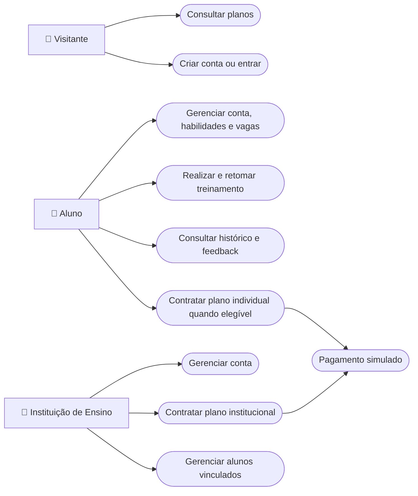
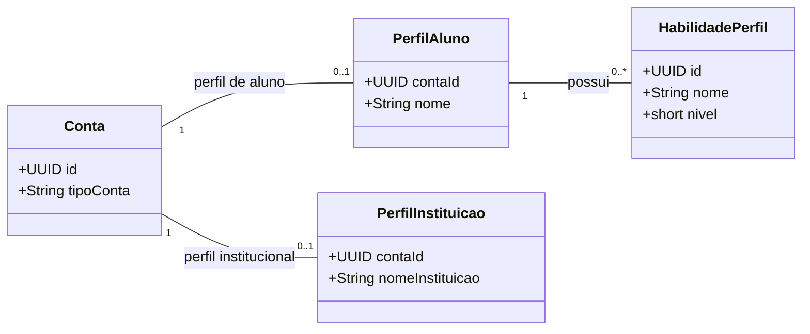
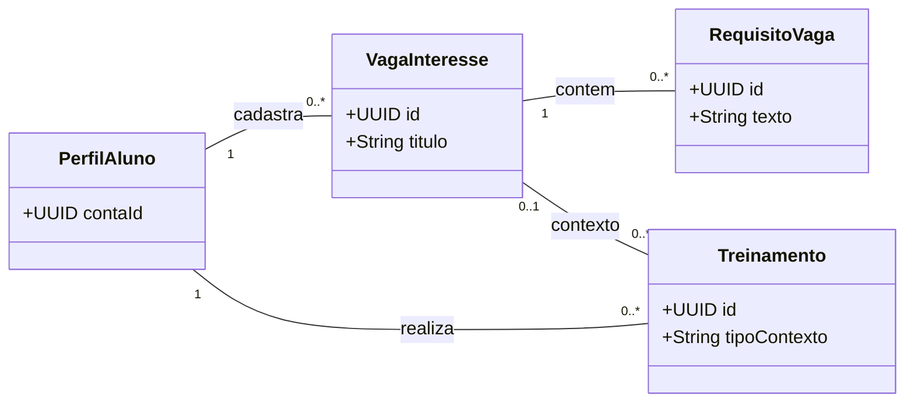
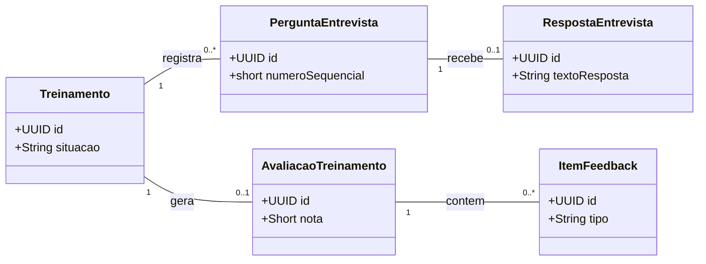
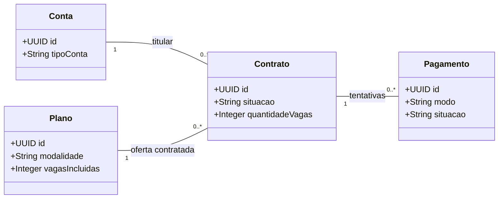
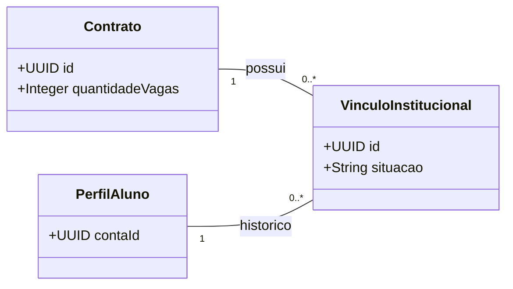
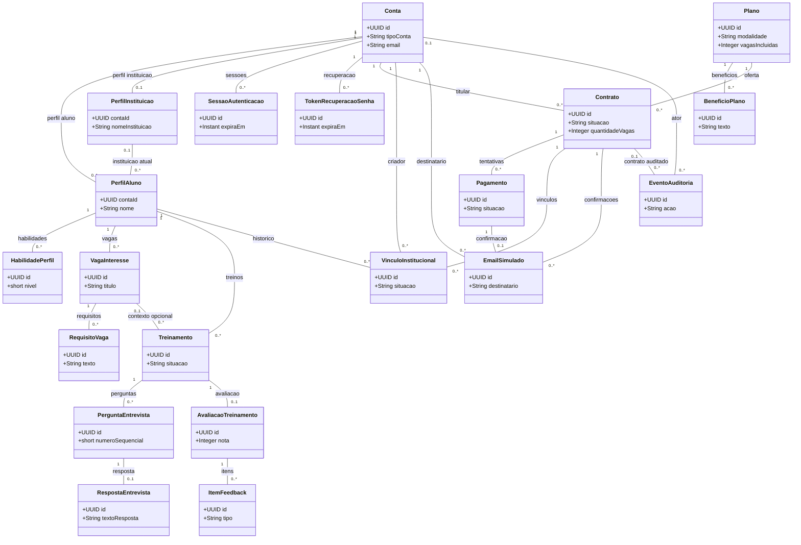

# IVIS — Intelligent Virtual Interview System
### Documento de visão e escopo — revisão de 18/11/2026

---

## 1. Visão Geral

O **IVIS (Intelligent Virtual Interview System)** é uma plataforma web baseada em Inteligência Artificial voltada ao treinamento de candidatos para entrevistas de emprego na área de tecnologia.

O sistema conduz o candidato por uma simulação de entrevista, apresentando perguntas de acordo com o perfil de habilidades do usuário ou os requisitos de uma vaga específica cadastrada por ele. As respostas são processadas pela API de IA, que gera feedback ao concluir o treino. No modo stub, não há avaliação qualitativa nem nota.

Além do treinamento em si, a plataforma contempla o **ciclo comercial do produto**: planos públicos, contratação individual pelo aluno elegível ou institucional pela Instituição de Ensino e controle da conta dos usuários. O pagamento atual é simulado, sem cobrança real.

**Problema que o projeto resolve:** candidatos de tecnologia frequentemente têm dificuldade em praticar entrevistas técnicas de forma realista, personalizada e recorrente, pois isso normalmente depende de mentoria humana, que é escassa, cara ou pouco acessível.

**Proposta de valor:** oferecer prática recorrente de entrevistas, personalizada por vaga ou habilidade, com avaliação por IA, via plano individual ou institucional. O resultado da IA pode conter erros; a avaliação mostra critérios e limitações quando o provedor real está configurado.

---

## 2. Escopo do Projeto

### 2.1 Objetivo Geral
Desenvolver uma aplicação web que permita a alunos treinarem entrevistas técnicas de tecnologia de forma automatizada, personalizada e com feedback gerado por IA, com suporte à contratação de planos individuais e institucionais.

### 2.2 Objetivos Específicos
- Permitir o cadastro, login e gerenciamento (controle de perfil) de contas de Aluno e de Instituição de Ensino.
- Permitir o cadastro e gerenciamento do perfil de habilidades técnicas do aluno.
- Permitir o gerenciamento de vagas de interesse, para gerar treinos direcionados.
- Simular uma entrevista técnica interativa, conduzida por IA, com feedback ao final.
- Manter um histórico de treinos realizados para acompanhamento de evolução.
- Exibir uma Home com os planos disponíveis (individual e institucional).
- Permitir que um aluno elegível contrate um plano individual.
- Permitir que uma Instituição de Ensino contrate um plano de consórcio e vincule seus alunos a ele.

### 2.3 Dentro do escopo atual
- Cadastro, login, recuperação de acesso e manutenção de dados e senha de Aluno e de Instituição de Ensino. Foto e logo existem no modelo, mas não no formulário atual.
- Cadastro/edição/exclusão de perfil e habilidades do Aluno.
- Gerenciamento (cadastro, edição e exclusão) de vaga de interesse, usada para gerar o treino.
- Simulação de entrevista textual com sessão persistida, retomada e feedback ao final.
- Histórico de treinos por aluno.
- Home com apresentação dos planos disponíveis (individual e institucional/consórcio).
- Contratação de plano individual pelo aluno sem vínculo institucional ativo, com pagamento no modo acadêmico.
- Contratação de plano de consórcio pela Instituição de Ensino, com pagamento no modo acadêmico e escolha entre capacidades de 50, 100 e alunos ilimitados.
- Cadastro de novos alunos e vínculo de contas existentes pela Instituição de Ensino ao plano contratado.
- Controle de acesso conforme contrato individual ou vínculo institucional ativo.

### 2.4 Fora do escopo atual
- Entrevistas por voz/vídeo com IA (apenas texto no MVP).
- Painel administrativo completo para Gestão ADM/Gestão Suporte (métricas internas, relatórios financeiros etc.).
- Integração com vagas reais de plataformas externas (ex.: LinkedIn, Gupy).
- Gamificação, ranking entre alunos ou certificações.
- Upgrade/downgrade automático de plano, renovação automática e faturamento recorrente avançado.
- Suporte a múltiplos idiomas.

### 2.5 Público-Alvo
Estudantes e profissionais em transição de carreira para tecnologia, com acesso individual ou institucional, e Instituições de Ensino que desejam oferecer o treinamento aos seus alunos.

---

## 3. Stakeholders (Modelo Cebola)

Link do diagrama original: https://canva.link/obupwdeokzl3ggs

| Camada | Stakeholder | Papel em relação ao IVIS |
|---|---|---|
| Núcleo | IVIS | O próprio sistema/produto |
| Infraestrutura | NVIDIA | Provedor configurável para perguntas e avaliações por IA |
| Usuário direto | Alunos | Utilizam a plataforma para treinar entrevistas |
| Usuário direto | Instituição de Ensino | Contrata plano de consórcio e gerencia seus alunos vinculados |
| Operação interna | Gestão Suporte | Suporte técnico/atendimento aos alunos e instituições |
| Operação interna | Gestão ADM | Gestão administrativa e de negócio do produto |
| Agência reguladora | ANPD | Regulação de proteção de dados (LGPD) |
| Órgão regulador | PROCON | Defesa do consumidor |
| Referências de mercado | Alacuna, PRAMP, interviewing.io | Concorrentes/referências de mercado (plataformas de mock interview) |

A Instituição de Ensino participa diretamente dos fluxos implementados. ANPD e PROCON são referências do contexto regulatório; não operam o sistema.

---

## 4. Atores e modalidades de acesso

Os atores de negócio são **Visitante**, **Aluno** e **Instituição de Ensino**. O visitante consulta planos públicos e pode criar conta. O aluno gerencia sua conta, habilidades, vagas e treinos; a instituição contrata um plano institucional e gerencia seus alunos vinculados.

O aluno pode ter **acesso individual**, por contrato próprio vigente, ou **acesso institucional**, por vínculo ativo com contrato institucional vigente. Essas origens de acesso não criam novos tipos de conta nem subclasses de Aluno. A API de IA e o simulador de pagamento são componentes técnicos do IVIS, não atores externos. Gestão de suporte e gestão administrativa permanecem interessados, sem fluxo de usuário implementado neste escopo.

---

## 5. Casos de uso vigentes

O catálogo atual reúne **20 CDU**: 16 fluxos funcionais, duas jornadas ponta a ponta e dois fluxos complementares. O [índice de casos de uso](../cdu/IVIS_Casos_de_Uso.md) contém a rastreabilidade com RF, estado observado, exceções e testes. Implementação no código não significa aceite formal ou validação em produção. No diagrama abaixo, o boneco identifica cada ator; as formas ovais representam casos de uso.

| Área | Casos de uso |
|---|---|
| Acesso e conta | CDU-01 a CDU-05; CDU-16 valida a política de senha. |
| Preparação e entrevista | CDU-06 a CDU-08; CDU-19 detalha a retomada de treino. |
| Planos e contratação | CDU-09 a CDU-12. |
| Instituição e acesso | CDU-13 e CDU-14; CDU-20 detalha o vínculo de conta existente. |
| Auditoria e jornadas | CDU-15 registra ações sensíveis; CDU-17 e CDU-18 encadeiam as jornadas do aluno e da instituição. |

---

## 6. Diagramas de classes por etapa

Os diagramas mostram os **conceitos do domínio e suas cardinalidades**, com nomes próximos aos modelos do backend. Cada desenho foca uma etapa do uso do IVIS; uma classe pode reaparecer para ligar as etapas. Os números ficam **na ponta da classe a que se referem**: em `Conta "1" -- "0..*" Contrato`, uma conta pode ter vários contratos e cada contrato pertence a uma conta. `0..1` significa nenhum ou um; `0..*` significa nenhum ou vários.

As associações representam chaves estrangeiras e regras dos serviços. As entidades JPA nem sempre possuem campos de referência entre objetos. As tabelas `planos` e `contratos` têm modelos parciais em módulos diferentes do backend; aqui cada uma aparece como uma classe de domínio.

### Etapa 1 — Conta e perfil do aluno

Uma conta possui um tipo (`ALUNO` ou `INSTITUICAO`) e o perfil correspondente. O aluno registra suas habilidades com nível de domínio.

| Relação | Leitura da cardinalidade |
|---|---|
| Conta → PerfilAluno | Uma conta pode ter zero ou um perfil de aluno. Cada perfil de aluno pertence a uma conta. |
| Conta → PerfilInstituicao | Uma conta pode ter zero ou um perfil de instituição. Cada perfil de instituição pertence a uma conta. |
| PerfilAluno → HabilidadePerfil | Um aluno pode ter várias habilidades. Cada habilidade pertence a um aluno. |

**Regra adicional:** a conta tem exatamente um dos dois tipos de perfil, conforme `tipoConta`; os dois `0..1` do desenho não autorizam ausência de ambos nem dois perfis simultâneos.

### Etapa 2 — Vaga e início do treino

O aluno pode cadastrar vagas e realizar treinos. Um treino usa uma vaga **ou** as habilidades do aluno como contexto.

| Relação | Leitura da cardinalidade |
|---|---|
| PerfilAluno → VagaInteresse | Um aluno pode cadastrar várias vagas. Cada vaga pertence a um aluno. |
| VagaInteresse → RequisitoVaga | Uma vaga pode conter vários requisitos. Cada requisito pertence a uma vaga. |
| PerfilAluno → Treinamento | Um aluno pode realizar vários treinos. Cada treino pertence a um aluno. |
| VagaInteresse → Treinamento | Uma vaga pode servir a vários treinos. Um treino usa no máximo uma vaga; quando treina por habilidades, não usa vaga. |

### Etapa 3 — Perguntas e avaliação

A sessão persiste as perguntas, as respostas e, ao concluir, uma avaliação. O histórico mantém esses dados mesmo se o aluno alterar depois suas habilidades ou vaga.

| Relação | Leitura da cardinalidade |
|---|---|
| Treinamento → PerguntaEntrevista | Um treino pode registrar várias perguntas. Cada pergunta pertence a um treino. |
| PerguntaEntrevista → RespostaEntrevista | Uma pergunta recebe no máximo uma resposta; pode ainda estar sem resposta. Cada resposta pertence a uma pergunta. |
| Treinamento → AvaliacaoTreinamento | Um treino tem no máximo uma avaliação, criada na conclusão. |
| AvaliacaoTreinamento → ItemFeedback | Uma avaliação pode conter vários pontos fortes ou de melhoria. Cada item pertence a uma avaliação. |

No modo stub da IA, a nota permanece vazia quando não há avaliação qualitativa.

### Etapa 4 — Plano, contrato e pagamento

O plano é a oferta. O contrato registra a contratação de uma conta, inclusive a capacidade e o preço acordados. No modo acadêmico, o pagamento é simulado e não gera cobrança real.

| Relação | Leitura da cardinalidade |
|---|---|
| Conta → Contrato | Uma conta pode ter vários contratos ao longo do tempo. Cada contrato tem um titular. |
| Plano → Contrato | Um plano pode ser contratado várias vezes. Cada contrato se refere a um plano. |
| Contrato → Pagamento | Um contrato pode registrar várias tentativas de pagamento. Cada tentativa pertence a um contrato. |

### Etapa 5 — Vínculo institucional e auditoria

O vínculo associa o aluno a um **contrato institucional**. A instituição titular desse contrato controla a capacidade e os alunos vinculados. A remoção encerra o vínculo, preservando seu histórico.

| Relação | Leitura da cardinalidade |
|---|---|
| Contrato → VinculoInstitucional | Um contrato institucional pode ter vários vínculos ao longo do tempo. Cada vínculo pertence a um contrato. |
| PerfilAluno → VinculoInstitucional | Um aluno pode ter vários vínculos históricos. Cada vínculo corresponde a um aluno. |

**Regra adicional:** um aluno pode ter **no máximo um vínculo institucional ativo** por vez. Para os planos de 50 e 100 alunos, contam-se apenas os vínculos ativos; no plano ilimitado não há teto numérico. O contrato institucional tem como titular a conta da instituição, conforme a etapa 4.

A auditoria é transversal às etapas de contratação, pagamento e vínculo: cada `EventoAuditoria` registra ação, resultado e momento, podendo apontar para zero ou uma `Conta` como ator; uma conta pode ser ator de vários eventos. Sessões de autenticação, tokens de recuperação, benefícios de plano e e-mails simulados ficaram fora dos desenhos por etapa para preservar a leitura. O diagrama consolidado abaixo inclui essas classes.

---

## 7. Diagrama de classes completo

Esta é a visão consolidada das **20 classes persistidas do domínio**. Ela mostra atributos essenciais e associações principais, inclusive as entidades que os serviços manipulam diretamente pelo banco sem classe JPA própria. Leia `1`, `0..1` e `0..*` junto à ponta da classe correspondente; as etapas da seção 6 explicam as relações centrais em linguagem comum. Os campos e constraints completos estão nas [migrations Flyway](../../backend/src/main/resources/db/migration/) e no [modelo relacional](BD/Modelo_Relacional_IVIS.md).

As associações de `VinculoInstitucional` representam o contrato, o aluno e a conta que criou o vínculo; a instituição titular é obtida pelo contrato. A ligação direta entre `PerfilAluno` e `PerfilInstituicao` espelha a instituição atual e é sincronizada com o vínculo ativo. A origem de acesso do aluno é calculada a partir de contrato individual ou vínculo institucional ativo. Um aluno pode ter vários vínculos históricos, mas apenas um ativo. O diagrama omite somente relações técnicas que não alteram essas regras, como a rotação de uma sessão de autenticação para outra.

---

## 8. Histórias de usuário

As 20 histórias iniciais desta versão do documento foram uma proposta de planejamento, não a fonte vigente de critérios de aceite. Para fluxos e exceções atualizados, consulte os [CDU](../cdu/IVIS_Casos_de_Uso.md); para a redação e prioridades aprovadas, consulte os [requisitos](IVIS_Requisitos.md). Os critérios de teste e pendências de validação constam no [plano de teste](../plano%20de%20teste.md).

---

## 9. Requisitos Funcionais (RF)

Os códigos e descrições vigentes são mantidos em [`IVIS_Requisitos.md`](IVIS_Requisitos.md). O quadro aprovado contém 20 RF. Sua divisão entre lista de requisitos e implementados em validação é administrativa e não descreve sozinha o estado atual do código. O [índice de CDU](../cdu/IVIS_Casos_de_Uso.md) registra a situação observada por fluxo.

| Situação no quadro | RF |
|---|---|
| Lista de requisitos (14) | RF01, RF02, RF04, RF05, RF11, RF12, RF13, RF14, RF15, RF16, RF17, RF18, RF19, RF20 |
| Implementados, em validação (6) | RF03, RF06, RF07, RF08, RF09, RF10 |

No modo de apresentação acadêmica, o RF15 é atendido por um simulador de pagamento controlado pelo backend, sem cobrança real. Consulte o [ADR-0008](adr/ADR-0008-pagamento-simulado-para-demonstracao.md).

## 10. Requisitos Não Funcionais (RNF)

O conjunto aprovado contém **4 RNF**. Seus textos completos estão em [`IVIS_Requisitos.md`](IVIS_Requisitos.md).

| Código | Requisito |
|---|---|
| RNF01 | Aplicação Web |
| RNF03 | Meta p95 de até 10 s para pergunta e avaliação, a medir com o provedor real |
| RNF07 | Isolamento de dados entre instituições |
| RNF09 | Proteção e retenção mínima de 4 anos dos logs de auditoria; backup e descarte requerem procedimento operacional |

---

## 11. Interfaces atuais

- **Tela de Cadastro/Login** — criação de conta e autenticação de Aluno e Instituição de Ensino.
- **Apresentação e Planos** — páginas públicas com planos individuais e institucionais.
- **Checkout simulado** — seleção do plano e pagamento acadêmico sem cobrança real.
- **Conta, Alterar Senha e Meu Plano** — dados da conta, senha e contrato vigente; os campos de foto/logo existem no modelo, mas não no formulário atual.
- **Tela de Perfil de Habilidades** — edição das habilidades técnicas do Aluno.
- **Tela de Gerenciamento de Vagas** — cadastro, edição e exclusão dos requisitos da vaga desejada.
- **Treinamento** — entrevista por habilidades ou vaga, com retomada de sessão em andamento.
- **Tela de Feedback** — exibição do resultado/avaliação ao fim do treino.
- **Histórico** — consulta de treinos concluídos.
- **Área institucional** — cadastro ou vínculo de alunos existentes, remoção de vínculo e capacidade usada/disponível.

---

## 12. Glossário

| Termo | Significado |
|---|---|
| IVIS | Intelligent Virtual Interview System |
| Aluno | Usuário final da plataforma que realiza os treinos |
| Instituição de Ensino | Organização que contrata um plano de consórcio para seus alunos |
| Consórcio | Modalidade de acesso via instituição de ensino parceira |
| Plano | Oferta comercial (individual ou institucional) que dá acesso à plataforma |
| Home | Tela inicial com a apresentação dos planos disponíveis |
| Simulador de pagamento | Componente do backend que registra aprovação ou recusa fictícia, sem cobrança real |
| Treinamento | Sessão de simulação de entrevista |
| Feedback | Avaliação gerada pela IA ao final do treino |

---

## 13. Próximas validações

1. Registrar o aceite formal dos RF e RNF conforme o [plano de teste](../plano%20de%20teste.md), distinguindo cobertura automatizada de validação integrada.
2. Medir o RNF03 com o provedor real, usando entradas representativas e pergunta e avaliação separadas.
3. Definir regras de renovação, troca e cancelamento de planos e transferência de aluno entre instituições.
4. Formalizar procedimentos de retenção, backup e descarte dos eventos de auditoria.
