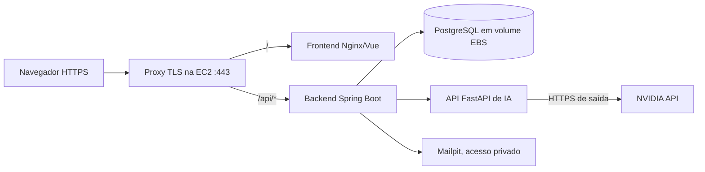

# Plano de implantação do IVIS na AWS Academy

**Estado:** planejamento, sem recursos AWS criados. **Data:** 08/11/2026.

## 1. Objetivo e limites

Publicar uma **demonstração acadêmica** do frontend, backend, API de IA e PostgreSQL, com cadastro, login, contratação simulada, vínculo institucional e treino acessíveis por HTTPS. Não tratar o laboratório como ambiente de produção permanente. O pagamento continua fictício. A recuperação de senha só será demonstrada com Mailpit acessível à equipe por túnel privado; entrega real de e-mail exige trabalho adicional no backend e um provedor SMTP compatível.

**Evidência recebida:** a captura da página inicial do console mostra acesso por uma identidade `voclabs` e a região **US East (N. Virginia), `us-east-1`** selecionada. O painel *Custo e uso* exibe **US$ 8,01 no mês** e **US$ 37,13 de previsão até o fim do mês** no momento da captura. Esses valores são do painel da conta; não indicam saldo de créditos, verba disponível para o IVIS nem custo estimado desta implantação. A imagem não identifica se o ambiente é Learner Lab ou laboratório de curso, não comprova quais serviços são permitidos e não mostra domínio próprio.

**Consulta ao Route 53:** a tela *Domínios registrados* retornou `AccessDeniedException` para `route53domains:ListDomains`. A tabela vazia nessa tela **não permite concluir** que a conta não possui domínios; a identidade do laboratório não tem permissão para listá-los. Consultar *Zonas hospedadas* separadamente, se permitido, e perguntar ao responsável pela turma se existe domínio ou subdomínio utilizável, inclusive fora da AWS. Não registrar nem transferir domínio como parte desta verificação.

Antes de escolher recursos, registrar: tipo de laboratório (Learner Lab ou exercício de curso), confirmar se `us-east-1` é permitida pela turma, saldo/créditos, tempo restante do laboratório, tipos de EC2 disponíveis, permissões para IP público, snapshots, orçamento e DNS, e disponibilidade de um nome de domínio. A AWS Academy descreve o Learner Lab como ambiente com **serviços selecionados**; a disponibilidade efetiva deve ser confirmada no console da turma, sem presumir acesso a RDS, Route 53, ACM ou Load Balancer. [AWS Academy](https://aws.amazon.com/training/awsacademy/).

**Decisão inicial:** uma EC2 Linux com Docker Compose e volume EBS, sem serviços gerenciados adicionais. É uma arquitetura de demonstração com ponto único de falha, adequada apenas se o orçamento e as cotas do laboratório permitirem. Se a turma exigir arquitetura distribuída ou alta disponibilidade, revisar este plano antes da criação de recursos.

## 2. Arquitetura proposta

O proxy deve servir frontend e API na **mesma origem**. Isso preserva o cookie de renovação `HttpOnly`, `Secure` e `SameSite=Strict` e evita publicar a API em uma origem diferente. O tráfego do navegador deve usar apenas 443; 80 serve somente para emissão/renovação do certificado e redirecionamento. PostgreSQL, backend, API de IA e Mailpit não recebem portas públicas. A configuração de grupo de segurança para servidor web e SSH restrito segue as [regras de referência da EC2](https://docs.aws.amazon.com/AWSEC2/latest/UserGuide/security-group-rules-reference.html).

**HTTPS é condição de entrada.** Com o IP público e HTTP apenas, não considerar o login validado: `IVIS_COOKIE_SEGURO=true` exige HTTPS para o cookie de renovação. Definir um domínio/subdomínio que aponte para a instância e uma forma de emitir certificado antes de abrir o teste de usuários. Se o laboratório não permitir domínio ou serviço equivalente com HTTPS, limitar a etapa inicial a smoke tests de infraestrutura e decidir o endpoint seguro com a turma antes de continuar. Confirmar se o IP muda ao parar/iniciar a EC2; um IPv4 público automático pode mudar, enquanto um Elastic IP tem cobrança própria. [Ciclo de vida da EC2](https://docs.aws.amazon.com/AWSEC2/latest/UserGuide/how-ec2-instance-stop-start-works.html), [preço de IPv4 público](https://aws.amazon.com/vpc/pricing/).

## 3. Preparação do repositório

Estas mudanças são **trabalho futuro**, necessário antes do primeiro deploy; não usar o `docker-compose.yml` local sem revisão.

| Item | Situação atual | Alteração necessária |
|---|---|---|
| Frontend | `frontend/Dockerfile` define `VITE_API_URL=http://localhost:8081/api` durante o build | Compilar com `VITE_API_URL=/api` ou remover o argumento para usar o padrão relativo de `frontend/src/servicos/clienteHttp.ts`. Conferir no navegador que nenhuma chamada aponta para `localhost`. |
| Entrada HTTPS | `frontend/nginx.conf` serve a SPA na porta 80, sem proxy de `/api` | Adicionar proxy TLS (por exemplo, Caddy ou Nginx com certificado) que encaminhe `/` ao frontend e `/api/*` ao backend, preservando caminho, cabeçalhos e cookies. |
| Portas | Compose publica 8080, 8081 e 8000 no host; PostgreSQL e Mailpit têm portas locais | Criar arquivo Compose específico para AWS que publique somente 80/443 no proxy e mantenha os demais serviços em redes Docker internas. Não alterar a configuração local usada pelos testes. |
| Perfil | `SPRING_PROFILES_ACTIVE` usa `dev` por padrão | Definir `prod` no ambiente AWS; não habilitar `IVIS_LIMPEZA_CHAVE` nem publicar a API de limpeza. |
| Segredos | `.env` e `api-ia/.env` são arquivos locais; Compose tem senhas de desenvolvimento como fallback | Gerar senhas/chaves exclusivas para AWS; fornecer valores obrigatórios fora do Git, com permissões restritas. Não aceitar `ivis_local`. Proteger `IVIS_JWT_CHAVE_ASSINATURA`, `IVIS_IA_CHAVE_SERVICO` e `NVIDIA_API_KEY`. |
| Origem e links | CORS e redefinição de senha apontam para `localhost` | Configurar `IVIS_CORS_ORIGENS` com a origem HTTPS exata, `IVIS_URL_REDEFINICAO_SENHA` com o domínio público e `IVIS_COOKIE_SEGURO=true`. |
| E-mail | Mailpit captura SMTP local; backend expõe host/porta, sem configuração de autenticação/TLS SMTP | Manter Mailpit privado para demonstração. Se usuários externos precisarem receber recuperação, implementar e testar SMTP autenticado com TLS antes da publicação dessa função. |

## 4. Etapas de execução

1. **Confirmar laboratório e orçamento.** Verificar serviços, permissão de uso da região `us-east-1` já observada, crédito, prazo e política da turma. Estimar EC2, EBS, snapshot, IPv4 e transferência na calculadora/console da conta; definir um limite de gasto e alerta se AWS Budgets estiver disponível. Não confundir laboratório da AWS Academy com Free Tier de conta pessoal. [AWS Budgets](https://docs.aws.amazon.com/cost-management/latest/userguide/budgets-best-practices.html).
2. **Preparar a aplicação.** Implementar o Compose de AWS e o proxy; ajustar o build do frontend; fixar versões de imagens; configurar variáveis de produção e documentação do rollback. Rodar build, testes unitários, integração backend/API de IA e Cypress local antes de publicar.
3. **Criar a EC2.** Escolher AMI Linux e tamanho conforme cota. Usar **t3.medium (2 vCPU, 4 GiB) como ponto de partida para medir memória**, se permitido, pois cinco contêineres e builds Java/Python podem pressionar instâncias menores; confirmar o custo antes de ligar. [Especificações T3](https://aws.amazon.com/ec2/instance-types/general-purpose/). Usar EBS criptografado e espaço para imagens, logs, banco e backup. Instalar Docker e Compose conforme a AMI escolhida. [Guia AWS para Docker em EC2](https://docs.aws.amazon.com/AmazonECS/latest/developerguide/create-container-image.html).
4. **Restringir a rede.** Permitir entrada 443 e, se necessário, 80 para certificado. Restringir 22 ao IP da equipe ou usar Session Manager se autorizado. Não abrir 5432/5433, 8080, 8081, 8000, 1025 ou 8025. Garantir saída HTTPS para NVIDIA, repositórios de imagens e atualizações.
5. **Instalar e configurar.** Clonar um commit identificado; colocar segredos fora do repositório com permissões restritas; conferir `docker compose config` sem expor os valores em capturas/logs; construir e iniciar. Flyway aplicará as migrations no banco selecionado. Evitar builds simultâneos na instância pequena; se a memória for insuficiente, construir as imagens fora dela e transferi-las por um registro permitido pela turma.
6. **Habilitar DNS/TLS.** Apontar o domínio ao IP público escolhido, emitir certificado, ativar redirecionamento HTTP → HTTPS e testar renovação. Manter a mesma origem para frontend e `/api`. Não usar `IVIS_COOKIE_SEGURO=false` para contornar falta de HTTPS.
7. **Validar e registrar evidências.** Abrir `/`, `/login`, `/planos` e uma rota interna da SPA diretamente; verificar `/api/v1/pronto` via proxy; testar cadastro, login, renovação após recarga, logout, 20 minutos de inatividade, contrato simulado, vínculo, histórico e treino com NVIDIA. Conferir que `/saude` da API de IA e `/pronto` têm os resultados esperados; sem `NVIDIA_API_KEY`, treinos devem ser declarados indisponíveis. Verificar no navegador que não há chamadas a `localhost` e que portas internas não respondem externamente. Usar dados fictícios.
8. **Operar e encerrar.** Acompanhar uso de CPU, memória, disco, logs e créditos. Fazer backup lógico do PostgreSQL e/ou snapshot EBS antes de mudanças; testar restauração em ambiente separado. A AWS informa que snapshots não são automáticos. [Snapshots EBS](https://docs.aws.amazon.com/ebs/latest/userguide/ebs-snapshots.html). Ao terminar a demonstração, parar recursos e revisar volumes, snapshots e IPv4 que continuam gerando custo; documentar o destino dos dados. [Ciclo de vida da EC2](https://docs.aws.amazon.com/AWSEC2/latest/UserGuide/ec2-instance-lifecycle.html).

## 5. Critérios para considerar o deploy concluído

- URL HTTPS pública definida e certificado válido; frontend e API respondem na mesma origem.
- Nenhuma porta interna aberta à Internet e nenhum segredo no Git, imagem, HTML ou logs.
- Banco mantém dados após recriar contêiner; backup e procedimento de restauração documentados.
- Cadastro/login/renovação/logout e restrição por inatividade funcionam com cookie seguro.
- Contratação simulada, vínculo institucional e acesso do aluno passam com dados fictícios.
- Treino com IA passa se houver chave NVIDIA; sem chave, a indisponibilidade é informada claramente.
- Custos e prazo do laboratório acompanhados; procedimento de parada/remoção documentado.

## 6. Decisões pendentes da turma

| Decisão | Por que precisa ser confirmada |
|---|---|
| Tipo de laboratório, permissão para `us-east-1`, créditos e prazo | A captura mostra a região selecionada, mas não identifica as regras, os limites nem o tempo de vida do ambiente. |
| Domínio/subdomínio ou outra entrada HTTPS autorizada | Necessário para autenticação com cookie `Secure`. A consulta a domínios registrados foi negada; verificar zonas hospedadas e confirmar com a turma. |
| Tamanho e arquitetura da EC2 permitidos | Determina se o Compose inteiro cabe na instância e se o build ocorre nela. |
| Política de acesso administrativo (SSH ou Session Manager) | Determina regras de rede e permissões. |
| Retenção de dados e acesso ao Mailpit | Define backup, descarte e se recuperação de senha pode ser demonstrada. |

**Próximo entregável técnico após essas decisões:** arquivo Compose de AWS, configuração do proxy TLS e ajuste do build do frontend, acompanhados de um roteiro de deploy e rollback reproduzível. Este plano não cria recursos nem publica a aplicação.
