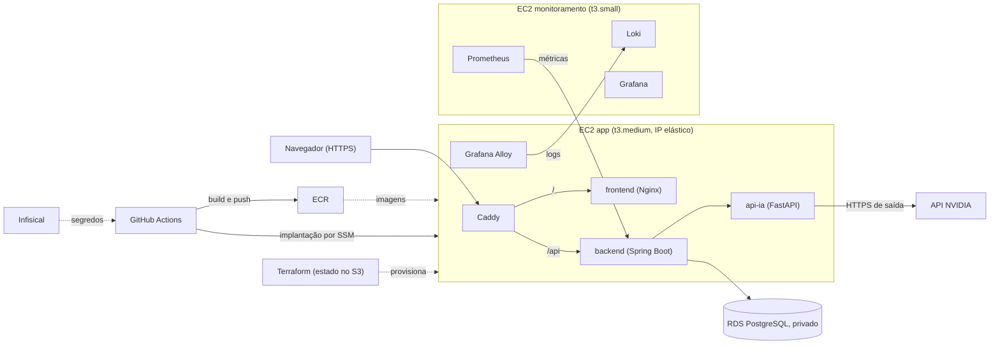

# Proposta inicial: IVIS na AWS

**Disciplina:** Computação em Nuvem (UFRPE), Projeto Integrador: Desenvolvimento e Implantação em Nuvem

**Aula de acompanhamento**

**Repositório:** https://github.com/lucifer-son/IVIS

**Grupo:** Rafael Melo (lucifer-son), Mariana Oliveira (Mari-olima), João Lucas Ribeiro (JoaoLRS), João Lucas Cosme (joaoluc90)

**Situação:** esperando aprovação

## 1. Problema

O IVIS (Intelligent Virtual Interview System) é uma plataforma web para treinar entrevistas técnicas de tecnologia, com perguntas e feedback gerados por IA, a partir das habilidades do aluno ou de uma vaga de interesse. A oferta é individual (aluno pagante) ou institucional (instituição de ensino que vincula seus alunos).

A versão atual está publicada na Vercel, e o backend (Spring Boot) sofre **partida a frio**: depois de um período sem uso, a primeira requisição espera a inicialização da aplicação. Esse é o problema técnico que motiva a migração. Hospedar a pilha na AWS como processos permanentes elimina a partida a frio e permite aplicar, de ponta a ponta, infraestrutura como código, CI/CD, gestão de segredos, testes e observabilidade.

Há ainda uma restrição de segurança: o cookie de renovação de sessão (`ivis_refresh`) é `HttpOnly`, `Secure` e `SameSite=Strict` ([ADR-0011](adr/ADR-0011-autenticacao-do-mvp.md)). Por isso o frontend e a API precisam ser servidos pela **mesma origem**.

## 2. Funcionalidades

A aplicação já possui 20 casos de uso especificados ([IVIS_Casos_de_Uso.md](../cdu/IVIS_Casos_de_Uso.md)), com frontend, backend e persistência funcionando. Os principais são:

- cadastro, acesso e recuperação de senha de alunos e instituições;
- gestão de habilidades e de vagas de interesse;
- treino de entrevista com IA, com retomada e feedback ao final, e histórico de treinos;
- consulta de planos, contratação individual e institucional com **pagamento simulado** (sem cobrança real, [ADR-0008](adr/ADR-0008-pagamento-simulado-para-demonstracao.md));
- gestão de alunos vinculados pela instituição;
- auditoria de contratação, pagamento e vínculos.

O que muda neste projeto é a implantação, a automação e a operação da aplicação na AWS, e não o conjunto de funcionalidades.

## 3. Arquitetura preliminar

- **EC2 "app":** Caddy, frontend, backend e api-ia em Docker Compose. Só as portas 80 e 443 ficam abertas ao público.
- **RDS PostgreSQL (db.t3.micro):** sem acesso público; o grupo de segurança aceita a porta 5432 somente da EC2 "app".
- **EC2 "monitoramento":** Prometheus, Loki e Grafana, com acesso restrito.
- **Administração:** pelo AWS Systems Manager (SSM), sem a porta 22.

A decisão completa está no [ADR-0012](adr/ADR-0012-hospedagem-aws.md).

## 4. Tecnologias e justificativas

| Tecnologia | Uso | Justificativa |
|---|---|---|
| Amazon EC2 | Execução da aplicação e do monitoramento | Processo permanente (sem partida a frio) e controle sobre o proxy e as redes internas. |
| Amazon RDS (PostgreSQL) | Persistência | Serviço gerenciado, isolado por grupo de segurança, compatível com o PostgreSQL já usado e com as migrations do Flyway. |
| Amazon ECR | Imagens dos contêineres | Registro integrado à AWS; a EC2 puxa as imagens pelo perfil de instância, sem credencial no servidor. |
| Amazon S3 | Estado do Terraform | Estado remoto com travamento por arquivo (`use_lockfile`), validado no laboratório sem precisar de DynamoDB. |
| AWS Systems Manager | Acesso e implantação | Dispensa a porta 22 e permite executar comandos na EC2 pelo pipeline. |
| Docker e Docker Compose | Empacotamento e execução | A aplicação já é composta por contêineres. |
| Terraform | Infraestrutura como código | Exigido pelo enunciado; reproduz e remove o ambiente (`apply` e `destroy`). |
| GitHub Actions | CI/CD | Integrado ao repositório; os testes bloqueiam a implantação em caso de falha. |
| Infisical | Segredos | Mantém as credenciais fora do código; o GitHub guarda só uma credencial de acesso a ele. |
| Prometheus, Loki e Grafana | Métricas, logs e painéis | Atendem aos três itens mínimos de observabilidade do enunciado. |

## 5. Tecnologias fora da lista do enunciado: pedido de aprovação

| Tecnologia | Papel | Por que é necessária |
|---|---|---|
| **Caddy** | Proxy reverso na EC2 "app" | Serve `/` e `/api` na mesma origem e obtém e renova o certificado HTTPS sozinho. |
| **DuckDNS** | Nome de domínio gratuito | O laboratório não oferece domínio próprio nem permissões de DNS (o Route 53 negou até a listagem). O cookie `Secure` exige HTTPS, e HTTPS exige um nome de domínio. |
| **Let's Encrypt** | Autoridade certificadora | Emite o certificado para o subdomínio do DuckDNS, de graça e de forma automática pelo Caddy. |
| **Grafana Alloy** | Coleta de logs dos contêineres | Envia os logs ao Loki. Substitui o Promtail, que foi descontinuado. O Telegraf, da lista, é voltado a métricas. |

## 6. Alternativas consideradas e não adotadas

- **Application Load Balancer:** o certificado gerenciado (ACM) precisa ser validado por DNS no domínio do grupo, e o DuckDNS não oferece o tipo de registro necessário (a confirmar na documentação deles). O ALB também tem custo fixo por hora, que pesa no crédito do laboratório (a estimativa precisa ser confirmada na página de preços da AWS). Com uma única instância "app", ele não traria balanceamento real. A decisão vale para a entrega, e o ADR registra o ponto único de falha como risco aceito.
- **Ansible:** a instalação inicial cabe no `user_data` do Terraform, e a atualização da aplicação cabe no SSM com Docker Compose. O Ansible por SSH exigiria a porta 22, e por SSM exigiria um bucket auxiliar. Pode ser introduzido depois, sem mudar a arquitetura.
- **Instância única para tudo, ou duas instâncias com balanceador:** manter uma instância "app" e medir memória e CPU na implantação manual. Se a medição mostrar que a t3.medium não comporta a pilha, reavaliar.
- **Contêineres gerenciados ou funções sem servidor:** fora da lista do enunciado e com permissões do laboratório não validadas.

## 7. Como cada requisito do enunciado será atendido

| Requisito | Proposta |
|---|---|
| Aplicação | Frontend, backend, api-ia e RDS na nuvem, com funcionalidades reais e demonstráveis. |
| Infraestrutura como código | Terraform em `infra/`, com rede, grupos de segurança, EC2, RDS, ECR e estado no S3. Ciclo `apply` e `destroy` validado. |
| CI/CD | Verificação e testes, construção e envio das imagens ao ECR, implantação por SSM e verificação automática de disponibilidade (`/api/v1/pronto`). |
| Segurança e segredos | Infisical, ausência de segredos no repositório (gitleaks no histórico e no CI), banco privado, porta 22 fechada, HTTPS e cookie seguro. |
| Testes e qualidade | Testes automatizados existentes (backend, api-ia e frontend) executados no pipeline; a falha bloqueia a implantação. |
| Observabilidade | Prometheus (métricas do backend e do servidor), Loki (logs) e painéis no Grafana. O backend ainda não expõe métricas e será ajustado. |
| Documentação | README, guia de implantação e remoção, segurança, testes, observabilidade e divisão de tarefas. |

## 8. Validação do ambiente

As premissas da arquitetura foram testadas no Learner Lab em 09 e 10/11/2026 e estão em [Validacao_Learner_Lab.md](Validacao_Learner_Lab.md). RDS, ECR, S3 e SSM estão disponíveis, e o estado remoto com travamento por arquivo funciona. A VPC própria, o IP elástico persistente e o RDS privado também foram confirmados. Os testes do ciclo de End Lab e Start Lab mostraram que o laboratório religa as EC2 paradas e não para o RDS, então o consumo de crédito exige apagar o que não estiver em uso.

## 9. Riscos principais

- Crédito limitado do laboratório: acompanhar o consumo e destruir o ambiente fora do trabalho.
- Credenciais temporárias do laboratório (sessão de cerca de 4 horas): ficam no Infisical e são renovadas a cada sessão.
- Memória da t3.medium: medir na implantação manual.
- Ponto único de falha na EC2 "app": aceito para a demonstração.
- Recuperação de senha: o Mailpit não serve em produção; a decisão (limitação documentada ou SMTP real) fica para a fase da aplicação.

## 10. Pontos para discussão na aula

1. Aprovação de Caddy, DuckDNS, Let's Encrypt e Grafana Alloy.
2. Aceitação das justificativas para não usar ALB e Ansible.
3. Se o professor espera alguma evidência específica na demonstração (por exemplo, uma alteração pequena que percorra todo o pipeline até a implantação).