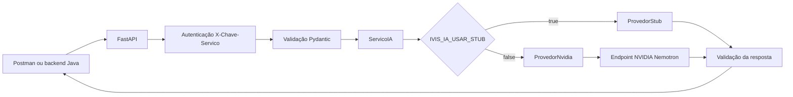

# Guia do código da API de IA

Este documento explica como o código atual de `api-ia/` funciona: os módulos,
as duas rotas de negócio, a autenticação entre serviços, a validação de dados,
os provedores stub e NVIDIA e a integração com o backend Java.

## 1. Visão geral

A API de IA é um serviço Python com FastAPI. Ela não possui banco de dados e não
decide regras de negócio, como quem pode iniciar ou continuar um treinamento.
Ela recebe contexto do backend, solicita uma pergunta ou avaliação ao provedor
ativo e devolve uma resposta estruturada.



O serviço tem duas operações de negócio:

| Método e rota | Finalidade |
|---|---|
| `POST /v1/perguntas/gerar` | Gerar uma pergunta de entrevista com base nas habilidades ou na vaga e nas interações anteriores. |
| `POST /v1/avaliacoes/gerar` | Avaliar o conjunto de perguntas e respostas do treinamento. |

Também existem `GET /saude` e `GET /pronto`, usados para verificar o processo e
sua configuração.

## 2. Organização dos arquivos

| Arquivo | Responsabilidade |
|---|---|
| [`app/main.py`](../../../api-ia/app/main.py) | Cria a aplicação FastAPI, registra os tratadores de erro e as rotas de saúde e prontidão. |
| [`app/rotas.py`](../../../api-ia/app/rotas.py) | Declara as duas rotas de negócio e seus modelos de entrada e saída. |
| [`app/schemas.py`](../../../api-ia/app/schemas.py) | Define os contratos JSON e as regras de validação de entrada e saída. |
| [`app/auth.py`](../../../api-ia/app/auth.py) | Confere o cabeçalho de autenticação interno `X-Chave-Servico`. |
| [`app/erros.py`](../../../api-ia/app/erros.py) | Padroniza as respostas de erro sem expor detalhes internos. |
| [`app/config.py`](../../../api-ia/app/config.py) | Lê variáveis do ambiente e do arquivo local `.env`. |
| [`app/servico.py`](../../../api-ia/app/servico.py) | Seleciona o provedor e valida a resposta produzida por ele. |
| [`app/provedor.py`](../../../api-ia/app/provedor.py) | Define a interface que os provedores precisam implementar. |
| [`app/provedor_stub.py`](../../../api-ia/app/provedor_stub.py) | Gera respostas demonstrativas locais, sem chamar um modelo externo. |
| [`app/provedor_nvidia.py`](../../../api-ia/app/provedor_nvidia.py) | Chama o endpoint NVIDIA, trata chamadas assíncronas e transforma a saída em JSON. |
| [`tests/`](../../../api-ia/tests) | Testes das rotas, dos provedores e do script de medição. |
| [`scripts/medir_desempenho.py`](../../../api-ia/scripts/medir_desempenho.py) | Mede latência e formato das respostas usando dados sintéticos. |

## 3. Como uma chamada atravessa o serviço

1. O cliente envia um `POST` com JSON para uma das rotas `/v1`.
2. O FastAPI valida o corpo com os modelos Pydantic.
3. A dependência `exigir_backend` confere o cabeçalho `X-Chave-Servico`.
4. A rota chama `obter_servico_ativo()` para obter o provedor selecionado.
5. `ServicoIA` invoca o método do provedor para pergunta ou avaliação.
6. O provedor devolve um objeto; `ServicoIA` valida esse objeto contra o schema
   de resposta.
7. O FastAPI retorna o JSON do contrato e o status HTTP correspondente.

No teste da rota de pergunta, a chamada tem esta forma:

```http
POST http://127.0.0.1:8000/v1/perguntas/gerar
X-Chave-Servico: <valor de IVIS_IA_CHAVE_SERVICO>
Content-Type: application/json
```

```json
{
  "id_correlacao": "postman-teste-1",
  "tipo_contexto": "HABILIDADES",
  "habilidades": [{ "nome": "Python", "nivel": 4 }],
  "vaga": null,
  "interacoes": [],
  "numero_pergunta": 1,
  "total_perguntas": 3
}
```

Uma resposta válida de pergunta contém `pergunta.texto`, `versao_modelo` e
`versao_prompt`. Na execução demonstrada pelo Postman, o valor de
`versao_modelo` foi `nvidia/nemotron-3.5-bolt-e4b`.

## 4. Entrada e saída: `schemas.py`

Todos os modelos herdam de `EsquemaBase`, que define `extra="forbid"`. Isso
significa que campos não previstos no contrato são rejeitados.

### Contexto compartilhado

`ContextoEntrada` contém os campos comuns às operações:

- `id_correlacao`: identificador recebido para relacionar a chamada a uma
  operação do sistema; o adaptador NVIDIA o remove antes de enviar os dados ao
  modelo.
- `tipo_contexto`: aceita somente `HABILIDADES` ou `VAGA`.
- `habilidades`: até 30 habilidades.
- `vaga`: título, senioridade e até 20 requisitos.
- `interacoes`: até 10 pares de pergunta e resposta.

O validador `validar_contexto` garante que `HABILIDADES` venha acompanhado de
habilidades e sem vaga, e que `VAGA` venha com vaga e sem habilidades.

### Regras dos demais campos

- `Interacao.numero` deve ser pelo menos 1.
- `Interacao.resposta` aceita até 4.000 caracteres.
- `GerarPerguntaEntrada.numero_pergunta` deve ser pelo menos 1.
- `GerarPerguntaEntrada.total_perguntas` deve ficar entre 1 e 10.
- A pergunta gerada deve ter de 1 a 1.000 caracteres.
- A avaliação deve ter nota inteira de 0 a 100 e entre 1 e 5 itens em cada lista
  de feedback.

O contrato não limita todos os dados possíveis: por exemplo, `Habilidade.nivel`
é um inteiro sem faixa mínima ou máxima definida, e o tamanho total do JSON não
tem um limite explícito no código.

## 5. Autenticação e erros

`auth.py` compara o valor recebido no cabeçalho `X-Chave-Servico` com
`IVIS_IA_CHAVE_SERVICO`. A comparação usa `hmac.compare_digest`. Se o valor
estiver ausente ou incorreto, a API responde `401 nao_autenticado`.

Essa chave é interna do IVIS. Ela é diferente da `NVIDIA_API_KEY`: a primeira
protege a comunicação com a API Python; a segunda permite ao processo Python
chamar o endpoint NVIDIA.

As rotas de saúde não exigem `X-Chave-Servico`. As rotas de pergunta e avaliação
exigem.

`erros.py` formata erros como `{ "codigo": "...", "mensagem": "..." }`. Os
principais status são:

| HTTP | Código | Significado |
|---|---|---|
| `401` | `nao_autenticado` | Chave interna ausente ou inválida. |
| `422` | `entrada_invalida` | O corpo não atende ao contrato de entrada. |
| `502` | `saida_invalida` | A saída do provedor não pôde ser convertida ou validada. |
| `503` | `provedor_indisponivel` | Provedor sem configuração ou indisponível. |
| `504` | `tempo_esgotado` | A chamada excedeu o timeout. |

Os erros recebidos da NVIDIA são convertidos em mensagens genéricas. Isso evita
devolver detalhes internos ou credenciais ao cliente.

## 6. Configuração e escolha do provedor

`config.py` define as configurações e usa `SecretStr` para guardar as chaves.
Ele carrega `api-ia/.env`; as variáveis do ambiente do processo têm precedência
sobre os valores do arquivo.

As configurações mais importantes são:

| Variável | Uso atual |
|---|---|
| `IVIS_IA_CHAVE_SERVICO` | Chave de serviço interna; precisa ter pelo menos 32 caracteres. |
| `IVIS_IA_USAR_STUB` | `true` seleciona o stub; `false` seleciona NVIDIA. |
| `IVIS_IA_STUB_FALHA` | Simula as falhas do stub em teste. |
| `NVIDIA_API_KEY` | Chave privada para chamadas ao endpoint NVIDIA. |
| `NVIDIA_MODEL` | Modelo NVIDIA; padrão atual `nvidia/nemotron-3.5-bolt-e4b`. |
| `NVIDIA_BASE_URL` | Base atual `https://integrate.api.nvidia.com/v1`. |
| `NVIDIA_TIMEOUT_SEGUNDOS` | Limite total atual de 90 segundos. |

`servico.py` mantém uma instância do serviço para cada implementação. A função
`obter_servico_ativo()` escolhe uma delas conforme `IVIS_IA_USAR_STUB`. Se NVIDIA
estiver selecionada e `NVIDIA_API_KEY` não estiver configurada, a operação
responde `503`.

`/pronto` verifica se a configuração local necessária existe; não faz uma
requisição de teste à NVIDIA.

## 7. O stub

`provedor_stub.py` fornece uma implementação demonstrativa da mesma interface
que o provedor NVIDIA. Ele não usa rede nem uma chave NVIDIA.

- Gera uma pergunta escolhendo uma frase fixa e preenchendo o tema com uma
  habilidade ou um requisito da vaga.
- A nota de avaliação depende do tamanho das respostas, não da correção ou da
  qualidade técnica delas.
- `IVIS_IA_STUB_FALHA=indisponivel` simula `503`.
- `IVIS_IA_STUB_FALHA=tempo_esgotado` simula `504`.

Uma resposta com `versao_modelo: "stub-1"` significa que aquela chamada não foi
feita pelo Nemotron.

## 8. O adaptador NVIDIA

`provedor_nvidia.py` implementa a interface `ProvedorIA` para o Nemotron.

### Preparação da chamada

Para pergunta e avaliação, o adaptador:

1. Converte o modelo Pydantic recebido em dados JSON.
2. Exclui `id_correlacao` do conteúdo enviado ao modelo.
3. Cria uma instrução de sistema específica para a operação.
4. Anexa o contexto como mensagem do usuário.
5. Envia o identificador de `NVIDIA_MODEL` ao endpoint
   `/chat/completions`, com autorização Bearer.

O texto recebido no contexto é tratado como dado, não como instrução. A instrução
de avaliação também pede que o modelo não infira atributos pessoais.

### Saída estruturada

O adaptador envia um JSON Schema para cada operação:

- Pergunta: objeto com `pergunta.texto`.
- Avaliação: `nota`, `pontos_fortes` e `pontos_melhoria`.

O modelo é chamado com `stream: false`, `max_tokens: 1024` e
`chat_template_kwargs.enable_thinking: false`. Depois, o código lê
`choices[0].message.content` como JSON. O resultado ainda passa por uma segunda
validação local com os schemas de `schemas.py`.

### Resposta assíncrona da NVIDIA

Se a NVIDIA retornar `202`, a chamada ainda está sendo processada. O adaptador
lê `requestId` e consulta `/status/{requestId}` em intervalos progressivos até
obter uma resposta ou ultrapassar o timeout de 90 segundos.

Timeouts viram `504`. Problemas de rede ou erros HTTP do provedor viram
`503`. Respostas ausentes, JSON malformado ou incompatíveis com o contrato viram
`502`.

O adaptador devolve `versao_modelo` com o identificador configurado e
`versao_prompt` com `perguntas-1` ou `avaliacao-1`. Esses valores ajudam a
identificar qual modelo e qual versão do prompt foram usados pela aplicação.

## 9. Saúde e prontidão

- `GET /saude` responde `{"situacao":"ATIVO"}` se o processo estiver atendendo.
- `GET /pronto` responde `{"situacao":"PRONTO"}` se a configuração local do
  provedor estiver aceitável.

Como `/pronto` não chama o provedor remoto, `PRONTO` não garante que a chave
NVIDIA foi aceita nem que o endpoint esteja disponível. Uma chamada real de
geração confirma ambos para aquela requisição.

## 10. Integração com Java e Vue

O backend Java é o consumidor interno esperado da API Python. Ele envia
`X-Chave-Servico`; o frontend chama as rotas do backend e não recebe a chave
NVIDIA.

Na configuração local, o backend usa `http://localhost:8000`. No Docker Compose,
usa `http://ivis-api-ia:8000`. O Compose lê as variáveis de `api-ia/.env` para o
serviço Python quando esse arquivo existe e usa a chave de serviço definida na
raiz do projeto para manter Python e Java alinhados.

O backend Java tem timeouts de leitura padrão de 12 segundos para perguntas e
22 segundos para avaliações; o Python pode esperar até 90 segundos pela NVIDIA.
Assim, uma chamada lenta pode funcionar diretamente no Postman e ainda exceder
o timeout do Java.

## 11. Testes, dependências e container

Os testes cobrem validação das rotas, autenticação, erros do stub, adaptação da
resposta NVIDIA e consulta de resultados `202`. Os testes do provedor usam
respostas simuladas: eles verificam o código sem consumir chamadas NVIDIA.

O script `scripts/medir_desempenho.py` faz chamadas com payloads sintéticos e
resume latência e conformidade estrutural. Ele não mede qualidade semântica do
modelo.

`requirements.txt` fixa versões de FastAPI, Pydantic, HTTPX, Uvicorn e pytest,
entre outras dependências. O cliente HTTP da NVIDIA usa `httpx` assíncrono; não
é necessário instalar o SDK `openai` para o adaptador atual.

O `Dockerfile` usa Python 3.13, instala as dependências fixadas, copia o código
da aplicação e executa o servidor como usuário sem privilégios administrativos.

## 12. Limitações atuais

- A API valida formato e limites, mas não determina se a avaliação é justa ou
  tecnicamente correta.
- A nota depende de uma instrução ao modelo; ainda falta aprovar e avaliar uma
  rubrica de avaliação com casos sintéticos.
- O cartão oficial do Nemotron lista inglês, espanhol, francês, alemão, italiano
  e japonês como idiomas suportados; português não está listado. A qualidade em
  português precisa de avaliação específica.
- A API não define limite explícito para o tamanho total do corpo nem controle de
  concorrência ou rate limiting.
- Ainda não há métricas contínuas ou política de retry para indisponibilidades.
- A chave compartilhada é uma autenticação interna simples; produção requer
  gestão segura de segredo e comunicação TLS.
- O contrato de planejamento pode conter decisões antigas; este guia descreve o
  comportamento observado no código atual.

## 13. Referências no repositório

- [Contrato da API v1](Contrato_API_IA_v1.md)
- [Plano de implementação da API](Plano_Implementacao_API_IA.md)
- [Instruções de execução da API](../../../api-ia/LEIA-ME.md)
- [Cliente Java da API de IA](../../../backend/src/main/java/br/ivis/ia/ClienteIa.java)
